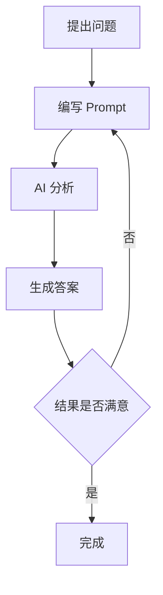
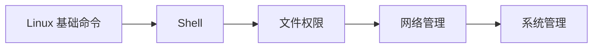
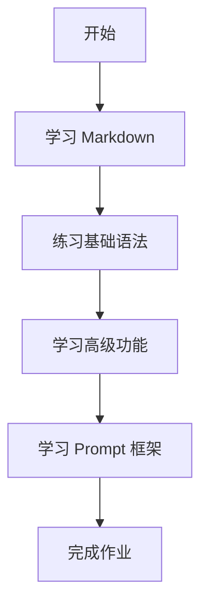

> **待本人审阅稿：**由 AI 根据现有作业整理，尚未经学生本人确认。下列方括号是待核对事项，不能视为已经完成的人工批注。

> [待人工核对：本轮 `Linux作业1-20262803李令琪.md` 是否为真实提交稿；补充你实际修改的理由和过程。]

# Linux 作业：Markdown 学习

> **姓名：** 李令琪  
> **学号：** 20262803  

## 一、AI 返回内容的学习：Markdown 基础

### 1. 什么是 Markdown

Markdown 是一种轻量级标记语言，文件通常以`.md`为扩展名。它使用少量符号表达标题、列表、链接、表格、代码等结构，具有语法简单、可读性强、适合版本管理等特点。

Markdown 常见的应用场景包括：

- 编写 GitHub/Gitee 项目的 `README.md`
- 编写技术博客和课程笔记
- 编写软件文档
- 记录实验过程
- 编写 AI Prompt（提示词）
- 配合工具生成 HTML、PDF、Word 和 PPT 等文件

### 2. 标题

Markdown 使用 `#` 表示标题，最多可以写六级标题。

```markdown
# 一级标题
## 二级标题
### 三级标题
#### 四级标题
##### 五级标题
###### 六级标题
```

通常建议在 `#` 后加一个空格，使文档更规范。

### 3. 粗体、斜体和删除线

```markdown
**粗体**
*斜体*
***粗斜体***
~~删除线~~
```

显示效果：

- **粗体**
- *斜体*
- ***粗斜体***
- ~~删除线~~

### 4. 列表

#### 4.1 无序列表

```markdown
- Linux
- Python
- Markdown
```

也可以使用 `*` 或 `+`。

#### 4.2 有序列表

```markdown
1. 学习 Markdown
2. 完成练习
3. 提交作业
```

#### 4.3 任务列表

部分 Markdown 平台支持任务列表：

```markdown
- [x] 学习基础语法
- [x] 学习代码块
- [x] 学习提示词框架
- [x] 发布技术博客
```

### 5. 链接和图片

链接的基本格式：

```markdown
[GitHub](https://github.com/)
```

图片的基本格式：

```markdown

```

链接用于跳转网页，图片语法则比链接多一个 `!`。

### 6. 引用

使用 `>` 可以插入引用：

```markdown
> Markdown 的目标之一是让纯文本本身也保持较好的可读性。
```

嵌套引用：

```markdown
> 第一层引用
>> 第二层引用
```

### 7. 表格

Markdown 可以使用 `|` 和 `-` 创建表格。

```markdown
| 工具 | 类型 | 用途 |
| --- | --- | --- |
| Typora | 离线 | Markdown 编辑 |
| VS Code | 离线 | 编程与 Markdown |
| HackMD | 在线 | 在线编辑和协作 |
```

显示效果：

| 工具 | 类型 | 用途 |
| --- | --- | --- |
| Typora | 离线 | Markdown 编辑 |
| VS Code | 离线 | 编程与 Markdown |
| HackMD | 在线 | 在线编辑和协作 |

还可以通过冒号控制对齐方式：

```markdown
| 左对齐 | 居中 | 右对齐 |
| :--- | :---: | ---: |
| A | B | C |
```

### 8. 行内代码与代码块

行内代码使用一对反引号：

```markdown
Linux 中可以使用 `ls` 查看目录内容。
```

代码块一般使用三个反引号，并在开头标注语言：

````markdown
```bash
pwd
ls -la
cd /home
```
````

Python 示例：

```python
print("Hello Markdown!")
```

C 语言示例：

```c
#include <stdio.h>

int main(void)
{
    printf("Hello Markdown!\n");
    return 0;
}
```

代码块对于计算机专业学习特别有用，因为代码与普通文字可以清楚地区分，并且很多编辑器还能进行语法高亮。

### 9. 分隔线

使用三个或更多 `-` 可以创建分隔线：

```markdown
---
```

---

## 二、Markdown 工具推荐

### 1. 在线工具

#### StackEdit

StackEdit 是浏览器中的 Markdown 编辑器，可用于编辑和预览 Markdown，适合练习基础语法。

官网：<https://stackedit.io/>

#### HackMD

HackMD 支持在线 Markdown 编辑与协作，也适合技术笔记、团队文档和课堂练习。

官网：<https://hackmd.io/>

### 2. 离线工具

#### Typora

Typora 是专门的 Markdown 编辑器，采用接近“所见即所得”的编辑方式，支持表格、代码块、数学公式等内容，也可以将文档导出为 PDF。

官网：<https://typora.io/>

#### Visual Studio Code

VS Code 可以直接编辑 `.md` 文件，并提供 Markdown 预览功能。安装扩展后还能进一步支持格式检查、目录生成、Marp 幻灯片等。

官方文档：<https://code.visualstudio.com/docs/languages/markdown>

#### Obsidian

Obsidian 使用 Markdown 文件构建个人知识库，支持双向链接、标签和插件，适合长期整理学习笔记。

官网：<https://obsidian.md/>

---

## 三、Markdown 高级用法

### 1. 插入数学公式

很多扩展 Markdown 编辑器支持 LaTeX 风格的数学公式。

行内公式示例：

```markdown
勾股定理可以写为 $a^2+b^2=c^2$。
```

独立公式示例：

```markdown
$$
E=mc^2
$$
```

二次方程求根公式：

```markdown
$$
x=\frac{-b\pm\sqrt{b^2-4ac}}{2a}
$$
```

数学公式非常适合数学、密码学、人工智能、算法等课程的笔记。需要注意的是，不同 Markdown 平台对公式语法的支持程度可能不同。

### 2. 使用 Mermaid 绘图

Mermaid 可以使用文本描述流程图、时序图等图形。下面是我练习的流程图：



Linux 学习流程也可以表示为：



与普通画图软件相比，Mermaid 的一个优点是图形本身也是文本，方便修改，也方便使用 Git 进行版本管理。

### 3. 使用 Markdown 制作 PPT

Marp 可以使用 Markdown 制作幻灯片。例如：

````markdown
---
marp: true
theme: default
paginate: true
---

# Markdown 学习

Linux 课程作业

---

# Markdown 的优点

- 语法简单
- 可读性强
- 适合编写代码
- 方便版本管理

---

# Markdown 高级功能

- 数学公式
- Mermaid 绘图
- 制作 PPT
- 格式转换
````

在 Marp 中，幻灯片内容仍然主要通过 Markdown 编写，`---` 可以用于分隔页面。Marp 可以将 Markdown 幻灯片导出为 HTML、PDF 和 PowerPoint 等格式。

### 4. Markdown 格式转换

Pandoc 是常用的文档转换工具，可以在 Markdown、HTML、Word、LaTeX 等格式之间进行转换，并支持生成 PDF。

Markdown 转 HTML：

```bash
pandoc homework.md -o homework.html
```

Markdown 转 Word：

```bash
pandoc homework.md -o homework.docx
```

Markdown 转 PDF：

```bash
pandoc homework.md -o homework.pdf
```

生成 PDF 时，具体环境中通常还需要配置可用的 PDF 引擎。

---

## 四、Markdown 在 ChatGPT 等 AIGC 提示词工程中的应用

Prompt 如果全部写成一大段自然语言，AI 有时不容易区分背景、任务、限制条件和输出格式。Markdown 可以通过标题、列表、表格和代码块，把 Prompt 组织成明确的结构。

例如，一个简单的提示词可能只有：

```text
给我讲一下 chmod。
```

改成 Markdown 结构化 Prompt 后，可以写成：

```markdown
# 角色

你是一名 Linux 系统管理员和计算机教师。

# 上下文

我是一名刚开始学习 Linux 的大学生，目前正在学习 Linux 文件权限。

# 任务

请解释 chmod 命令，并说明 755、644 分别代表什么。

# 要求

1. 使用简单语言解释
2. 至少给出两个例子
3. 每个例子给出 Linux 命令
4. 解释数字权限的计算方法

# 输出格式

请按照以下结构回答：

## 基本概念
## 数字权限
## 命令实例
## 常见错误
```

这样可以让 AI 更明确地知道：

- 应扮演什么角色
- 当前上下文是什么
- 需要完成什么任务
- 有哪些约束
- 结果应该用什么格式输出

因此，Markdown 不仅是文档格式，也非常适合组织结构化提示词。

---

# 五、问题 1：哪些内容我已经掌握？哪些内容没有掌握？

## 1. 我已经掌握的内容

在学习本次内容以前，我已经接触过一些Markdown基础语法，主要包括：

1. 使用 `#` 编写标题；
2. 使用 `-` 编写无序列表；
3. 使用数字编写有序列表；
4. 使用 `**文字**` 表示粗体；
5. 插入链接；
6. 使用反引号表示行内代码；
7. 使用三个反引号插入代码块；
8. 编写简单表格。

这些内容在阅读 GitHub 项目的`README.md`、查看编程资料以及记录简单学习笔记时都比较常见。

## 2. 我以前没有系统掌握的内容

通过这次学习，我发现Markdown的功能比我以前理解的丰富。我之前没有系统掌握的内容主要包括：

1. 使用 LaTeX 语法编写数学公式；
2. 使用 Mermaid 绘制流程图；
3. 使用 Marp 将 Markdown 制作成 PPT；
4. 使用 Pandoc 转换 Markdown、HTML、Word、PDF 等格式；
5. 使用 Markdown 编写结构化 AI Prompt；
6. 使用结构化 Prompt 框架设计提示词。

## 3. 对没有掌握内容的实践

本次作业中，我重点练习了数学公式、Mermaid和结构化Prompt。以下进行展示：

### 数学公式练习

```markdown
$$
a^2+b^2=c^2
$$
```

### Mermaid 练习



### 格式转换练习

我学习了 Pandoc 的基本命令，例如：

```bash
pandoc homework.md -o homework.html
pandoc homework.md -o homework.docx
pandoc homework.md -o homework.pdf
```

通过这些练习，我认识到 Markdown 不仅能排版文字，还能够把程序代码、数学公式、图表描述和提示词保存在同一个纯文本文件中，这对我们计算机技术专业的学生学习来说很方便。

---

# 六、问题 2：提示词框架学习

在完成本次作业以前，我对于ICDO、BROKE、CRISP等结构化提示词框架都不太了解。

因此，我通过 AI 和搜索资料学习了一个提示词框架：**CO-STAR**。

CO-STAR 将 Prompt 分为以下六个主要部分：

| 字母 | 英文 | 含义 |
| --- | --- | --- |
| C | Context | 上下文、背景信息 |
| O | Objective | 目标，即希望 AI 完成什么任务 |
| S | Style | 希望采用的表达或写作风格 |
| T | Tone | 回答的语气 |
| A | Audience | 输出内容面向的对象 |
| R | Response | 希望 AI 使用的输出形式 |

## 1. Context：上下文

告诉 AI 当前问题发生在什么背景下。

例如：

```text
我是一名正在学习 Linux 的大学生，目前学习到文件权限部分。
```

## 2. Objective：目标

明确希望 AI 完成什么任务。

例如：

```text
解释 Linux 的 chmod 命令和数字权限。
```

## 3. Style：风格

规定内容的表达方式。

例如：

```text
采用由浅入深的教程式写法，并结合实例。
```

## 4. Tone：语气

规定回答的语气。

例如：

```text
语言清晰、友好、客观。
```

## 5. Audience：受众

说明内容是写给谁看的。

例如：

```text
面向刚开始学习 Linux 的大学生。
```

## 6. Response：响应格式

规定最终结果的组织形式。

例如：

```text
使用 Markdown 输出，包含概念、命令、示例和总结。
```

我认为这种结构化方法最大的作用，是减少 Prompt 中的模糊信息，让 AI 更清楚地理解“做什么、为谁做、怎样做以及如何输出”。

---

## 七、使用 Markdown 设计 CO-STAR 通用 Prompt 模板

作业要求中提出，一个好的 Prompt 至少要包括角色、上下文和任务。CO-STAR本身已经包含上下文和目标，我在它的基础上增加了Role（角色）和Constraints（限制条件），形成如下的模板。

````markdown
# Role｜角色

你是一名[填写 AI 应扮演的角色，例如：Linux 系统管理员、程序员、教师]。

# Context｜上下文

我的基本情况：

- [用户背景]
- [已有知识]
- [当前问题]
- [其他必要背景]

# Objective｜目标 / 任务

请完成以下任务：

1. [任务 1]
2. [任务 2]
3. [任务 3]

# Style｜表达风格

请采用以下风格：

- [例如：深入浅出]
- [例如：教程式]
- [例如：技术文档风格]

# Tone｜语气

回答的语气要求：

- [例如：客观]
- [例如：清晰]
- [例如：友好]

# Audience｜目标读者

回答面向：

[例如：没有 Linux 基础的大一学生]

# Constraints｜限制条件

请遵守以下要求：

1. [限制条件 1]
2. [限制条件 2]
3. 如果存在不确定的信息，请明确指出，不要编造。

# Response｜输出格式

请使用 Markdown 格式回答，并按照以下结构：

## 1. [第一部分]

## 2. [第二部分]

## 3. [第三部分]

最后给出简短总结。
````

---

## 八、模板实际应用示例

以下列出我让AI帮助我学习Linux的chmod命令的写法：

````markdown
# Role

你是一名具有丰富教学经验的Linux系统管理员。

# Context

我是一名大学生，刚开始学习 Linux。
我知道 Linux 中存在文件权限，但是不理解 rwx 和 755 的关系。

# Objective

请向我解释 Linux chmod 命令以及数字权限的计算方法。

# Style

采用由浅入深的教程方式，并结合实际命令。

# Tone

清晰、友好、客观。

# Audience

Linux 初学者。

# Constraints

1. 不要假设我已经理解二进制权限。
2. 所有命令都要解释作用。
3. 至少给出 chmod 755 和 chmod 644 两个例子。

# Response

使用 Markdown 格式回答，包含：

## chmod 的作用
## rwx 权限含义
## 数字权限计算方法
## chmod 755 示例
## chmod 644 示例
## 常见错误
````

这个 Prompt 比简单输入“解释 chmod”提供了更多背景、目标和约束，因此AI更容易给出符合我的学习需求的回答。
