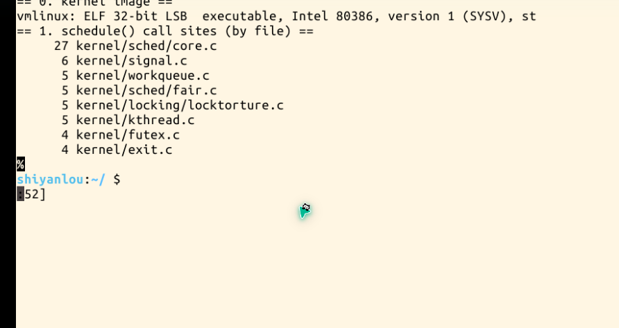
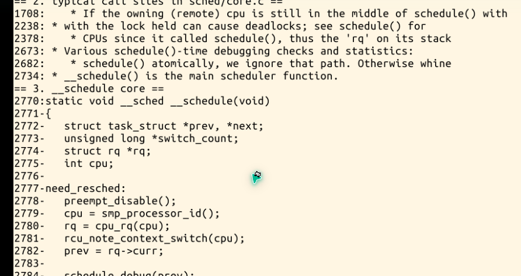
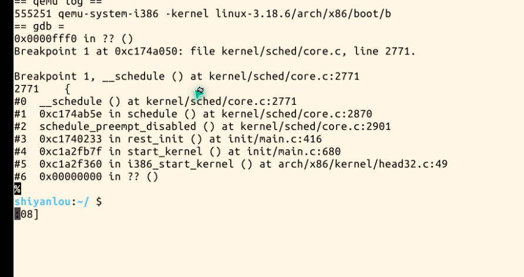
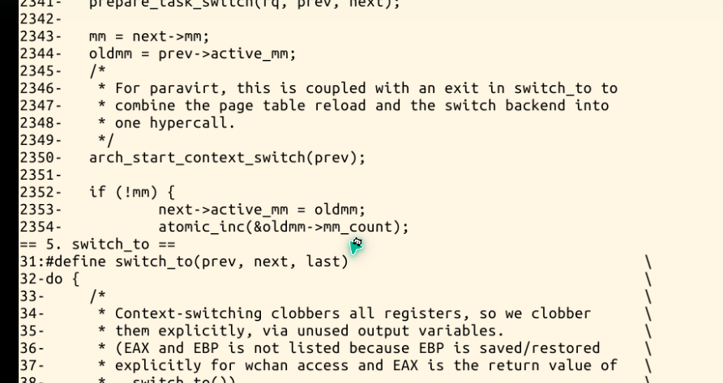
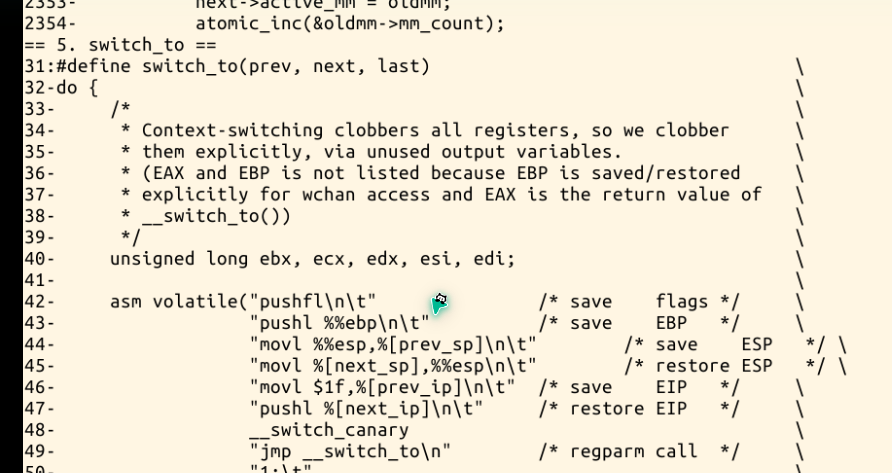
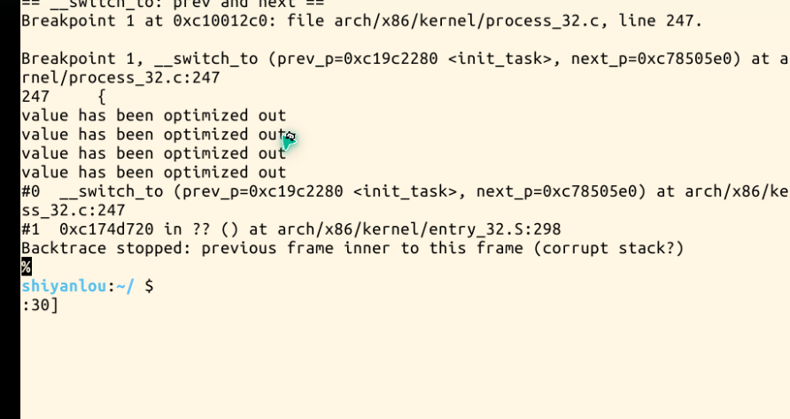
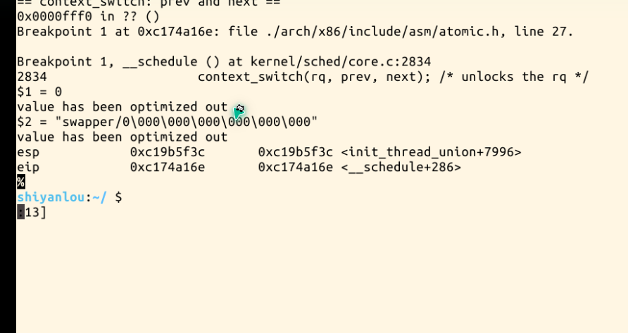

# 实验8 理解进程调度时机，跟踪分析进程调度与进程切换的过程

> **姓名**：李令琪　　**学号**：20262803
>
> **原创作品，转载请注明出处。** 本文为《Linux 内核分析》MOOC 课程（<http://mooc.study.163.com/course/USTC-1000029000>）配套实验报告。

---

## 目录

- [一、实验目的](#一实验目的)
- [二、实验环境](#二实验环境)
- [三、实验内容与过程](#三实验内容与过程)
  - [3.1 调度时机：在内核源码中搜索 schedule()](#31-调度时机在内核源码中搜索-schedule)
  - [3.2 __schedule 的主体流程](#32-__schedule-的主体流程)
  - [3.3 用 gdb 跟踪一次真实的调度](#33-用-gdb-跟踪一次真实的调度)
  - [3.4 context_switch 与 switch_to](#34-context_switch-与-switch_to)
  - [3.5 断到 __switch_to：两个 task_struct](#35-断到-__switch_to两个-task_struct)
  - [3.6 切换时的堆栈与寄存器状态](#36-切换时的堆栈与寄存器状态)
- [四、调度时机的归纳与验证](#四调度时机的归纳与验证)
- [五、总结：对"Linux 系统一般执行过程"的理解](#五总结对linux-系统一般执行过程的理解)
- [六、署名与出处声明](#六署名与出处声明)

---

## 一、实验目的

1. 通过在内核源码中检索 `schedule()`，弄清 Linux 进程调度的**时机**：到底有哪些地方、在哪几种上下文里会触发调度；
2. 用 gdb 对 `__schedule()` 下断点，观察一次真实的调度发生时的**调用栈**，把源码与运行现场对应起来；
3. 重点分析 `context_switch()` 与 `switch_to` 中的汇编代码，理解**进程上下文切换**到底切换了什么（内核栈、EIP、页表）；
4. 结合堆栈与 CPU 寄存器状态，说明"切换"这一动作在硬件层面的具体含义，并总结对"Linux 系统一般执行过程"的理解。

## 二、实验环境

| 项目 | 内容 |
| --- | --- |
| 平台 | 蓝桥云课「Linux 内核分析配套实验」在线环境 |
| 容器系统 | Ubuntu 14.04（x86-64） |
| 目标内核 | Linux 3.18.6（`~/LinuxKernel/linux-3.18.6`，含 bzImage、vmlinux、rootfs.img） |
| 内核镜像 | `vmlinux: ELF 32-bit LSB executable, Intel 80386 ... statically linked`（i386，带符号表，可被 gdb 解析） |
| 调试方式 | `qemu-system-i386 -kernel bzImage -initrd rootfs.img -nographic -s -S` + `gdb vmlinux`（`target remote :1234`） |
| 工具 | gcc 4.8.2、gdb、qemu-system-i386、grep/sed |

## 三、实验内容与过程

### 3.1 调度时机：在内核源码中搜索 schedule()

先统计 `schedule()` 在整个内核里的分布（只统计 `.c` 文件，按文件归并）：

```bash
$ cd ~/LinuxKernel/linux-3.18.6
$ grep -rn 'schedule()' --include='*.c' kernel/ | cut -d: -f1 | sort | uniq -c | sort -rn | head -8
```

```text
  27 kernel/sched/core.c
   6 kernel/signal.c
   5 kernel/workqueue.c
   5 kernel/sched/fair.c
   5 kernel/locking/locktorture.c
   5 kernel/kthread.c
   4 kernel/futex.c
   4 kernel/exit.c
```



*图 1　`schedule()` 调用点的分布（在线环境截屏）*

从这张统计可以读出三件事：

1. **`schedule()` 只出现在内核代码里**，用户态程序根本没有机会"调用调度器"，它只能通过系统调用、中断或异常进入内核，由内核在合适的时机让出 CPU；
2. 调用者集中在 `sched/core.c`（调度器自身与抢占路径）以及几类典型的"要等待"的场景：`futex`（等锁）、`signal`（等信号）、`exit`（进程退出）、`kthread`/`workqueue`（内核线程没事干）；
3. **没有**任何一处是在中断处理函数里直接调用 `schedule()` 的——中断上下文是原子上下文，不允许睡眠/切换，这条约束在源码里体现得很清楚。

以 `kernel/sched/core.c` 为例，`schedule()` 前若干处出现的位置（多为注释与调试代码）说明它处在调度器核心位置：

```text
2734:	 * __schedule() is the main scheduler function.
```

也就是说，真正干活的不是 `schedule()` 这个薄壳，而是它调用的 `__schedule()`。

### 3.2 \_\_schedule 的主体流程

```bash
$ grep -n -A 14 "^static void __sched __schedule" kernel/sched/core.c
```

```c
2770: static void __sched __schedule(void)
2771: {
2772: 	struct task_struct *prev, *next;
2773: 	unsigned long *switch_count;
2774: 	struct rq *rq;
2775: 	int cpu;
2776:
2777: need_resched:
2778: 	preempt_disable();
2779: 	cpu = smp_processor_id();
2780: 	rq = cpu_rq(cpu);
2781: 	rcu_note_context_switch(cpu);
2782: 	prev = rq->curr;
2783:
2784: 	schedule_debug(prev);
```



*图 2　`__schedule()` 开头部分（在线环境截屏）*

这段代码交代了调度的三段式结构：

- **取现场**：`preempt_disable()` 关抢占，`rq = cpu_rq(cpu)` 拿到本 CPU 的运行队列，`prev = rq->curr` 记住"我是谁"；
- **选下一个**：后面的 `pick_next_task()` 按调度类优先级依次挑选 `next`；
- **交接**：`context_switch(rq, prev, next)` 完成地址空间与寄存器现场的切换（3.18 中该行位于 2834 行）。

`need_resched:` 这个标签说明 `__schedule()` 是"循环式"的：选出来的 `next` 若又被抢占，会跳回标签重新调度。

### 3.3 用 gdb 跟踪一次真实的调度

用 qemu 启动 MenuOS 并开放 gdbstub，gdb 连上去后对 `__schedule` 下断点：

```bash
$ cd ~/LinuxKernel
$ qemu-system-i386 -kernel linux-3.18.6/arch/x86/boot/bzImage \
    -initrd rootfs.img -append "root=/dev/ram rdinit=/init console=ttyS0" \
    -nographic -s -S < /dev/null > /tmp/qemu.log 2>&1 &
$ gdb -q -batch linux-3.18.6/vmlinux \
    -ex "set remotetimeout 30" -ex "target remote :1234" \
    -ex "b __schedule" -ex "c" -ex "bt"
```

```text
Breakpoint 1, __schedule () at kernel/sched/core.c:2771
2771	{
#0  __schedule () at kernel/sched/core.c:2771
#1  0xc174ab5e in schedule () at kernel/sched/core.c:2870
#2  schedule_preempt_disabled () at kernel/sched/core.c:2901
#3  0xc1740233 in rest_init () at init/main.c:416
#4  0xc1a2fb7f in start_kernel () at init/main.c:680
#5  0xc1a2f360 in i386_start_kernel () at arch/x86/kernel/head32.c:49
#6  0x00000000 in ?? ()
```



*图 3　gdb 断在 `__schedule()` 时的调用栈（在线环境截屏）*

这个调用栈非常典型，它展示的是**系统启动阶段的第一次调度**：

```text
start_kernel (init/main.c:680)
   └── rest_init (init/main.c:416)
          └── schedule_preempt_disabled (core.c:2901)
                 └── schedule (core.c:2870)
                        └── __schedule   ← 断在这里
```

`rest_init()` 在创建完 `kernel_init`（pid 1）和 `kthreadd`（pid 2）之后，自己会调用 `schedule_preempt_disabled()` **主动**让出 CPU，从此 0 号进程退化成 idle（`swapper/0`），只在没有其它就绪进程时才被调度运行。这里的调度属于典型的"**内核线程主动调度**"。

由此可以确认一条重要事实：`schedule()` 是在**进程上下文**（有 `current`、有自己的内核栈）里被调用的，所以它可以睡眠、可以切换；这与中断上下文形成了鲜明对比。

### 3.4 context_switch 与 switch_to

`__schedule()` 选出 `next` 后，把交接工作交给 `context_switch()`：

```c
2341:	prepare_task_switch(rq, prev, next);
2343:	mm = next->mm;
2344:	oldmm = prev->active_mm;
2350:	arch_start_context_switch(prev);
2352:	if (!mm) {                      /* 内核线程没有自己的 mm */
2353:		next->active_mm = oldmm;
2354:		atomic_inc(&oldmm->mm_count);
```



*图 4　`context_switch()` 中的地址空间处理与 `switch_to`（在线环境截屏）*

这段代码解释了"内核线程为什么不用切换页表"：`next->mm == NULL` 时，内核线程直接借用上一个进程的 `active_mm`（lazy TLB），只有普通进程之间切换才需要真正执行 `switch_mm()` 换 CR3。

真正的寄存器交接在宏 `switch_to` 里完成（x86-32 版本）：

```c
31: #define switch_to(prev, next, last)
32: do {
42: 	asm volatile("pushfl\n\t"              /* save flags */
43: 	     "pushl %%ebp\n\t"                 /* save EBP */
44: 	     "movl %%esp,%[prev_sp]\n\t"       /* save ESP */
45: 	     "movl %[next_sp],%%esp\n\t"       /* restore ESP */
46: 	     "movl $1f,%[prev_ip]\n\t"         /* save EIP（标签 1） */
47: 	     "pushl %[next_ip]\n\t"            /* restore EIP */
48: 	     __switch_canary
49: 	     "jmp __switch_to\n"               /* regparm call */
50: 	     "1:\t"
51: 	     "popl %%ebp\n\t"                  /* restore EBP */
```



*图 5　`switch_to` 中的内嵌汇编（在线环境截屏）*

这段汇编可以逐行读成"三步"：

1. **保存旧进程的现场**：`pushfl` 存标志寄存器、`pushl %ebp` 存帧指针，然后把当前 `%esp` 存进 `prev->thread.sp`；最关键的是 `movl $1f, %[prev_ip]`——把标签 `1:` 的地址存进 `prev->thread.ip`，这样将来这个进程被重新调度时，会从这里"接着跑"，看起来就像 `switch_to` 刚刚返回；
2. **切换到新进程的栈**：`movl %[next_sp], %esp` 把栈指针换成 `next->thread.sp`，`pushl %[next_ip]` 把 `next->thread.ip` 压栈当作"返回地址"；
3. **跳进 C 函数完成硬件相关切换**：`jmp __switch_to` 而不是 `call`，因为返回地址已经手工压好了；`__switch_to` 里保存/恢复 FPU、TSS 的 `esp0`、调试寄存器等，最后 `ret` 就"返回"到新进程的 `1:` 标签，接着 `popl %ebp`，`switch_to` 宏结束。

### 3.5 断到 \_\_switch_to：两个 task_struct

把断点直接下到 `__switch_to`，可以同时看到"从谁切到谁"：

```bash
$ gdb -q -batch linux-3.18.6/vmlinux -ex "set remotetimeout 30" \
    -ex "target remote :1234" -ex "b __switch_to" -ex "c" \
    -ex "p prev_p->pid" -ex "p next_p->pid" -ex "bt 4"
```

```text
Breakpoint 1, __switch_to (prev_p=0xc19c2280 <init_task>, next_p=0xc78505e0)
    at arch/x86/kernel/process_32.c:247
#0  __switch_to (prev_p=0xc19c2280 <init_task>, next_p=0xc78505e0)
#1  0xc174d720 in ?? () at arch/x86/kernel/entry_32.S:298
```



*图 6　gdb 断在 `__switch_to()`，参数即两个 `task_struct *`（在线环境截屏）*

两个参数把切换对象说得很清楚：

- `prev_p = 0xc19c2280 <init_task>`：正是 0 号进程的静态任务结构体 `init_task`（`swapper/0`）；
- `next_p = 0xc78505e0`：紧随其后被调度的内核线程（`kthreadd`，pid 2），其 `task_struct` 是动态分配的；
- 返回地址 `#1 0xc174d720 in ?? () at arch/x86/kernel/entry_32.S:298` 处的 `??` 其实就是 `switch_to` 里的标签 `1:`——因为那是内嵌汇编造的"假返回地址"，gdb 找不到对应的 C 函数名。

### 3.6 切换时的堆栈与寄存器状态

再把断点下在 `context_switch`（它是 `static inline`，实际断点落在内联点 `core.c:2834`），打印寄存器：

```text
Breakpoint 1, __schedule () at kernel/sched/core.c:2834
2834		context_switch(rq, prev, next); /* unlocks the rq */
$1 = 0
$2 = "swapper/0\000\000..."
esp     0xc19b5f3c	0xc19b5f3c <init_thread_union+7996>
eip     0xc174a16e	0xc174a16e <__schedule+286>
```



*图 7　`context_switch()` 处的寄存器与 `prev` 信息（在线环境截屏）*

三点值得注意：

1. `prev->pid = 0`、`prev->comm = "swapper/0"`：正在被换下的就是 idle 进程；
2. `esp = 0xc19b5f3c` 落在 `init_thread_union` 里，说明此时用的是 `init_task` 的**内核栈**——每个进程的内核栈就放在自己的 `thread_info`（`init_thread_union` 是 0 号进程的那个 8KB 联合体）之后；
3. `eip = __schedule+286`，正好是调用 `context_switch` 之后的位置，符合"断点停在内联点"的预期。

把这些串起来，一次切换在硬件层面的动作可以归纳为下表：

| 阶段 | 栈指针 | 指令指针 | 关键动作 |
| --- | --- | --- | --- |
| 切换前（prev 运行） | `esp` 在 prev 的内核栈 | `eip` 指向 `__switch_to` 之后 | 用户态现场早在中断/系统调用入口时已存入 prev 内核栈 |
| `switch_to` 前半 | `prev->thread.sp = esp` | `prev->thread.ip = 1f` | 保存 prev 的栈指针与"返回点" |
| `switch_to` 后半 | `esp = next->thread.sp` | `push next->thread.ip` | 换成 next 的内核栈，把 next 的返回点压栈 |
| `__switch_to` | 仍用 next 的栈 | 执行 `ret` 后跳到 `1:` | 切换 TSS 的 `esp0`、FPU 状态等 |
| 返回后 | next 的栈 | `1:` 之后即 `popl %ebp` | `schedule()` 返回到 next 上次调用 `schedule()` 的地方 |

## 四、调度时机的归纳与验证

把 3.1 的检索结果和 3.3 的运行现场对照起来，可以把调度时机归纳为四类：

| 类型 | 典型触发点 | 说明 |
| --- | --- | --- |
| 主动调度 | `exit.c`（进程退出）、`futex.c`（等锁）、`signal.c`（等信号）、`kthread.c`/`workqueue.c`（内核线程无事可做） | 代码里直接调用 `schedule()`，当前进程明确知道自己要睡 |
| 抢占式调度 | 中断/系统调用返回前的 `preempt_schedule()`、`cond_resched()` | 由 `TIF_NEED_RESCHED` 标志驱动，返回用户态或内核可抢占点时补一次调度 |
| 时间片用完 | 时钟中断 `scheduler_tick()` → `resched_curr()` | 只是"置标志"，真正的切换发生在返回路径上 |
| 唤醒后抢占 | 高优先级进程被唤醒（`check_preempt_wakeup`） | 同样先置标志，再在合适时机切换 |

对照课程里的总结，我在本实验中能直接验证的是两点：

1. **"进程调度只发生在内核态"**——检索结果里没有任何用户态代码调用 `schedule()`，且 `__schedule()` 全程运行在进程的内核栈上（`esp` 落在 `init_thread_union` 内可证）；
2. **"中断上下文不能调度"**——`schedule()` 的实现开头就 `preempt_disable()` 并在末尾 `preempt_enable_no_resched()`，若在中断上下文调用会触发 `BUG: scheduling while atomic`，因此中断里只做 `resched_curr()` 置标志，真正的切换推迟到中断返回路径。

## 五、总结：对"Linux 系统一般执行过程"的理解

做完这个实验，我把"Linux 的一般执行过程"理解成一条反复循环的路径：

```text
用户态代码
  ├─ 系统调用 / 外设中断 / 异常
  ▼
硬件切换到内核栈（TSS.esp0），保存用户态 CS:EIP、EFLAGS、SS:ESP
  ▼
内核处理（进程上下文：可以睡眠、可以被调度；中断上下文：不可睡眠）
  ▼
返回路径上检查 TIF_NEED_RESCHED
  ├─ 不需要调度 → iret 回到用户态，继续执行
  └─ 需要调度   → schedule() → __schedule() → context_switch() → switch_to
                        ▼
                   换内核栈（esp）、换返回点（eip）、必要时换页表（CR3）
                        ▼
                   下一次 iret 时，回到的是"另一个进程"的用户态
```

三点体会最深：

1. **调度是"在内核里换栈"**。进程切换的本质不是"保存所有寄存器"，而是把一个进程的内核栈整体保留下来，再把另一个进程的内核栈接上去；用户的寄存器现场在进入内核那一刻就已经躺在自己的内核栈里了，`switch_to` 只动 `esp`/`eip` 两个关键点，其余交给 `__switch_to` 和返回路径。
2. **`switch_to` 的"返回地址"是造出来的**。`movl $1f, prev->thread.ip` 与 `pushl next->thread.ip` 让每个进程都以为自己的 `switch_to` 才刚刚返回——这是内核用一小段汇编实现的"协程式"技巧，也是理解"进程在上次睡下的地方醒来"的钥匙。
3. **调度时机与上下文强相关**。`schedule()` 只能出现在进程上下文；中断上下文只能用 `resched_curr()` 打标记。这条规则不是约定俗成，而是由"内核栈是否可切换""抢占计数是否为零"这些硬性条件决定的——实验中 `preempt_disable()` 出现在 `__schedule()` 的第一行，正是这一约束的代码化。

