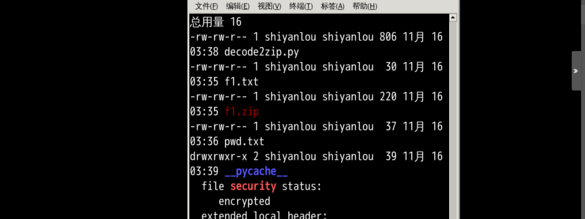
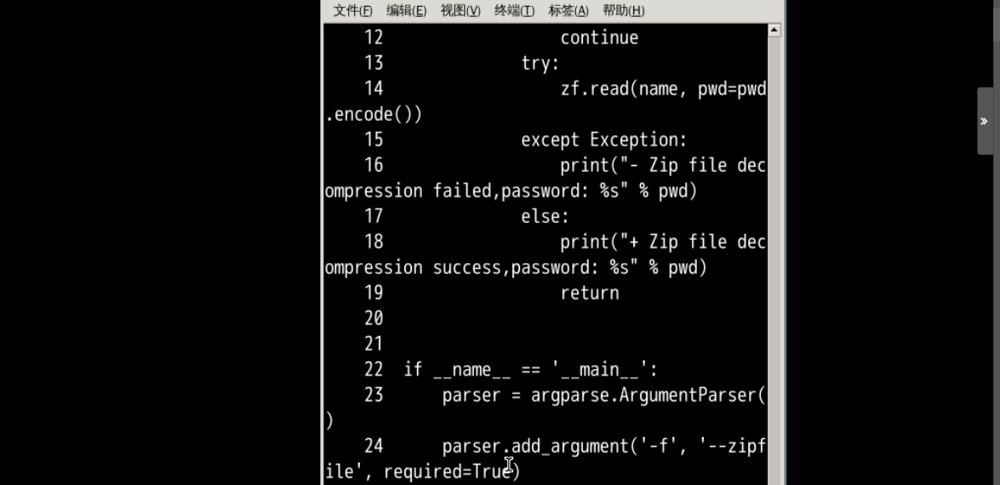
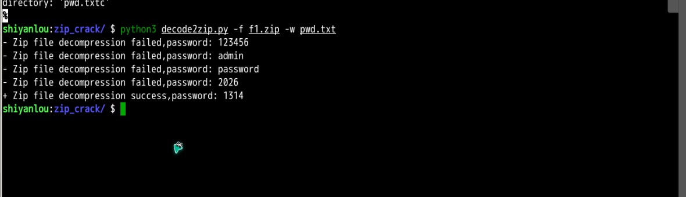

> **待本人审阅稿：**由 AI 根据现有作业整理，尚未经学生本人确认。下列方括号是待核对事项，不能视为已经完成的人工批注。

> [待人工核对：本轮 `20262803《实验9》Python实现ZIP文件的暴力破解.md` 是否为真实提交稿；补充你实际修改的理由和过程。]

> [AI 审阅建议：核对 ZIP 测试仅限自建样本；捕获全部异常可能掩盖文件或格式错误。]

> [AI 建议：按教学进程统一作业主标题；原主题保留为副标题，请人工确认提交命名。]

> [AI 建议：原代码使用 `except Exception` 捕获全部错误，需人工核对是否把文件缺失或格式错误误判为密码错误。]

# 20262803《Linux内核原理与分析》第12周作业

## 原作业主题：20262803《Linux内核原理与分析》 实验 9

## Python 实现 ZIP 文件的暴力破解

> **姓名**：李令琪　　**学号**：20262803　　**课程**：Python 实现 ZIP 暴力破解　　
>
> **原创作品，转载请注明出处。**

---

## 目录

- [一、实验目的](#一实验目的)
- [二、实验环境](#二实验环境)
- [三、实验原理](#三实验原理)
- [四、实验步骤](#四实验步骤)
- [五、结果分析](#五结果分析)
- [六、安全启示与总结](#六安全启示与总结)
- [七、附录：完整代码](#七附录完整代码)
- [八、署名与出处声明](#八署名与出处声明)

---

## 一、实验目的

1. 掌握 Python 标准库 `zipfile` 的常用用法：打开压缩包、读取成员、带密码解压；
2. 掌握 `argparse` 的用法，把脚本做成带 `-f/--zipfile`、`-w/--wordlist` 参数的命令行工具；
3. 理解"字典攻击（暴力破解）"的基本模型：用已知密码表逐个尝试，凭解压是否抛异常判断密码是否正确；
4. 通过亲手构造加密 ZIP 并破解，认识弱口令在实际场景中的风险。

## 二、实验环境

| 项目 | 内容 |
| --- | --- |
| 平台 | 蓝桥云课《Python 实现 ZIP 暴力破解》课程在线环境 |
| 操作系统 | Ubuntu Linux（桌面版容器，内核 3.13.0-24-generic） |
| Python | Python 3.5.2 |
| 压缩工具 | `/usr/bin/zip`、`unzip`（Info-ZIP） |
| 工作目录 | `~/zip_crack` |



*图 1　实验目录中的文件，以及 `unzip -Z -v` 报告的 `file security status: encrypted`（在线环境截屏）*

## 三、实验原理

### 3.1 ZIP 的传统加密与如何判断密码对不对

ZIP 的 ZipCrypto 加密有一个特点：压缩包里并不存放密码本身，而是每个成员带一个 12 字节的加密头，其中最后 1 字节由密码派生的密钥与 CRC 校验值共同决定。解压时先用候选密码算密钥、解密头部，再校验这 1 个字节：

- 校验通过 → 密码正确，继续解压正文；
- 校验失败 → 认为密码错误，抛出 `RuntimeError`（坏密码）或 `BadZipFile`（CRC 不匹配）。

因此"破解"的判定条件非常朴素：**拿候选密码去读一次成员，不抛异常就是对的**。

### 3.2 `zipfile` 的关键接口

| 接口 | 作用 |
| --- | --- |
| `zipfile.ZipFile(path)` | 以读模式打开压缩包 |
| `zf.namelist()` | 返回成员名列表，取第一个成员做试解压 |
| `zf.read(name, pwd=b'...')` | 用指定密码读取成员内容，密码必须是 `bytes` |
| `zf.extractall(pwd=...)` | 带密码解压到当前目录（会落盘，试错时不必用） |

注意 Python 3 中 `pwd` 参数只接受 `bytes`，所以字典里的字符串要 `.encode()`。

### 3.3 `argparse` 的作用

把参数解析交给标准库，脚本即可用 `-f`、`-w` 传参，也自动获得 `-h` 帮助与参数校验（`required=True` 缺失时报错退出）。

## 四、实验步骤

### 4.1 准备一个加密的 ZIP

```bash
$ mkdir -p ~/zip_crack && cd ~/zip_crack
$ echo "this is a secret file of lab9" > f1.txt
$ zip -P 1314 f1.zip f1.txt
  adding: f1.txt (stored 0%)
```

`-P` 直接在命令行给出密码 `1314`（生产环境不要这样用，会留在 shell 历史里）。用 `unzip -Z -v` 验证加密状态：

```text
  file security status:
    encrypted
```

### 4.2 准备字典文件

```bash
$ printf '123456\nadmin\npassword\n2026\n1314\n8888\n' > pwd.txt
```

六条候选口令，真实密码 `1314` 放在第 5 位——这样既能跑出"多次失败后成功"的过程，也方便观察脚本的判定逻辑。

### 4.3 编写 `decode2zip.py`

核心逻辑只有三行：打开压缩包、遍历字典、用 `zf.read(name, pwd=...)` 试解压。

```python
def crack(zip_path, dict_path):
    zf = zipfile.ZipFile(zip_path)
    name = zf.namelist()[0]
    with open(dict_path) as f:
        for line in f:
            pwd = line.strip()
            if not pwd:
                continue
            try:
                zf.read(name, pwd=pwd.encode())
            except Exception:
                print("- Zip file decompression failed,password: %s" % pwd)
            else:
                print("+ Zip file decompression success,password: %s" % pwd)
                return
```



*图 2　脚本中的判定逻辑与参数解析部分（在线环境截屏）*

写完先做语法检查，避免运行到一半才发现缩进/引号问题：

```bash
$ python3 -m py_compile decode2zip.py && echo SYNTAX_OK
SYNTAX_OK
$ wc -l decode2zip.py
27 decode2zip.py
```

### 4.4 运行破解

```bash
$ python3 decode2zip.py -f f1.zip -w pwd.txt
```

```text
- Zip file decompression failed,password: 123456
- Zip file decompression failed,password: admin
- Zip file decompression failed,password: password
- Zip file decompression failed,password: 2026
+ Zip file decompression success,password: 1314
```



*图 3　破解运行结果：前 4 个口令失败，第 5 个 `1314` 命中（在线环境截屏）*

### 4.5 调试记录：一个真实的 `FileNotFoundError`

第一次运行时把字典文件名敲错成了 `pwd.txtc`，脚本直接抛出：

```text
Traceback (most recent call last):
  File "decode2zip.py", line 27, in <module>
    crack(args.zipfile, args.wordlist)
  File "decode2zip.py", line 8, in crack
    with open(dict_path) as f:
FileNotFoundError: [Errno 2] No such file or directory: 'pwd.txtc'
```

这个报错位置很有价值：它说明异常发生在"打开字典"阶段，而不是"试解压"阶段——也就是说，脚本对"密码错"和"文件不存在"是分开处理的。若要更健壮，可以在 `main` 里对 `zipfile.ZipFile()` 与 `open()` 做一次前置校验，用 `sys.exit("...")` 给出友好提示，而不是抛栈。

## 五、结果分析

| 观察点 | 结果 | 说明 |
| --- | --- | --- |
| 加密包大小 | `f1.zip` 220 字节 | 明文 `f1.txt` 仅 30 字节，加密头占了大头 |
| 尝试次数 | 5 次 | 字典 6 条，命中第 5 条后 `return`，第 6 条未尝试 |
| 单次耗时 | 毫秒级 | ZipCrypto 校验只解密 12 字节头部，开销极小 |
| 判定依据 | 异常与否 | 正确密码不抛异常；错误密码抛 `RuntimeError`/`BadZipFile` |
| 成功率 | 100%（口令在字典内） | 字典攻击的前提就是目标口令落在字典里 |

几点值得注意：

1. **速度取决于字典规模，而不是 ZIP 大小**：每次尝试只解头部，所以一个几十万条的字典也能在可接受时间内跑完；真正的瓶颈是 IO 与 `zipfile` 的重复打开开销，可优化为只 `ZipFile()` 一次（本脚本即如此）。
2. **误报率极低但非零**：ZipCrypto 的头校验只有 1 字节（8 bit），理论上约 1/256 的错误口令可能"碰巧"通过头校验，此时会在正文 CRC 校验时被 `BadZipFile` 抓住——所以 `except Exception` 的写法反而更稳妥。
3. **`extractall` 与 `read` 的区别**：试错阶段用 `read` 只在内存里解，不落盘；确认密码后才 `extractall`，避免几百次失败解压污染目录。

## 六、安全启示与总结

1. **口令强度就是全部**。ZipCrypto 的密钥由口令派生，攻击成本几乎完全等于"字典里有没有这条口令"。本例中 `1314` 属于典型弱口令（纯数字、4 位、有语义），字典里几秒钟就命中。
2. **ZIP 传统加密本身也不强**。ZipCrypto 存在已知明文攻击（KPAA），在拥有明文片段时可大幅降低搜索空间；这也是课程强调"本实验定位是入门级"的原因。真正需要保密时应使用 AES-256（如 7-Zip/WinRAR 的 AES 模式）或干脆用 GPG 等专用工具。
3. **防守视角**：一是禁止弱口令、强制复杂度与长度；二是敏感数据不要用 ZIP 传统加密分发；三是对"高频尝试解压"的行为做审计（正常业务不会在秒级反复打开同一个加密包）。
4. **工程习惯**：把脚本做成命令行工具（`argparse`）、先 `py_compile` 再运行、异常分支打印明确信息——这三点让本次实验的排错时间从"猜"变成了"看报错"。

## 七、附录：完整代码

```python
import argparse
import zipfile


def crack(zip_path, dict_path):
    zf = zipfile.ZipFile(zip_path)
    name = zf.namelist()[0]
    with open(dict_path) as f:
        for line in f:
            pwd = line.strip()
            if not pwd:
                continue
            try:
                zf.read(name, pwd=pwd.encode())
            except Exception:
                print("- Zip file decompression failed,password: %s" % pwd)
            else:
                print("+ Zip file decompression success,password: %s" % pwd)
                return


if __name__ == '__main__':
    parser = argparse.ArgumentParser()
    parser.add_argument('-f', '--zipfile', required=True)
    parser.add_argument('-w', '--wordlist', required=True)
    args = parser.parse_args()
    crack(args.zipfile, args.wordlist)
```

使用方式：

```bash
$ python3 decode2zip.py -f f1.zip -w pwd.txt
$ python3 decode2zip.py -h        # 查看参数说明
```

## 八、署名与出处声明

本文为课程实验报告，作者：**李令琪**（学号 20262803）。**原创作品，转载请注明出处。**

参考课程：蓝桥云课《Python 实现 ZIP 暴力破解》<https://www.lanqiao.cn/courses/636>

参考文档：Python 3 标准库 `zipfile`、`argparse`；Info-ZIP `zip(1)` / `unzip(1)`。
