> **待本人审阅稿：**由 AI 根据现有作业整理，尚未经学生本人确认。下列方括号是待核对事项，不能视为已经完成的人工批注。

> [待人工核对：本轮 `20262803-李令琪-Linux命令实践2.md` 是否为真实提交稿；补充你实际修改的理由和过程。]

> [AI 审阅建议：核对 17 张从 Typora 路径归档的截图与各命令段落是否一一对应。]

> [AI 修改：将原文 Typora 本机截图复制到本目录并改为相对路径；请人工核对截图与正文是否对应。]

# Linux 常用命令学习与实践


姓名：李令琪

学号：20262803  

---

## 一、实验说明

本次实验主要学习并实践 48 个常用 Linux 命令，内容分为以下五类：

1. 文件操作类
2. 进程管理类
3. 用户管理类
4. 压缩打包类
5. 网络通信类

实践过程中，我主要在 Linux 终端中输入命令并观察运行结果。为了便于整理，五类命令分别采用长截图的方式记录。

在实验前，先创建实验环境，如图：

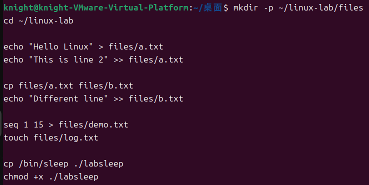

---

# 二、文件操作类

## 1. `cat`

**含义与用途：**  
用于查看或连接文件内容，适合快速查看文本文件。

**实践示例：**

```bash
cat files/a.txt
```

---

## 2. `chmod`

**含义与用途：**  
用于修改文件或目录的访问权限，包括读、写、执行权限。

**实践示例：**

```bash
touch perm.txt
ls -l perm.txt
chmod 600 perm.txt
ls -l perm.txt
```

---

## 3. `chown`

**含义与用途：**  
用于修改文件或目录的所有者和所属组。

**实践示例：**

```bash
touch owner.txt
sudo chown root:root owner.txt
ls -l owner.txt
sudo chown "$USER":"$(id -gn)" owner.txt
```

---

## 4. `cp`

**含义与用途：**  
用于复制文件或目录。

**实践示例：**

```bash
cp files/a.txt copy.txt
cat copy.txt
```

---

## 5. `dd`

**含义与用途：**  
用于按块复制和转换数据，常用于磁盘镜像、启动盘制作等操作。

**实践示例：**

```bash
dd if=/dev/zero of=test.img bs=1M count=1
ls -lh test.img
```

---

## 6. `df`

**含义与用途：**  
用于查看文件系统的磁盘总容量、已用空间和剩余空间。

**实践示例：**

```bash
df -h .
```

---

## 7. `diff`

**含义与用途：**  
用于比较两个文件或目录之间的内容差异。

**实践示例：**

```bash
diff files/a.txt files/b.txt
```

---

## 8. `du`

**含义与用途：**  
用于查看文件或目录实际占用的磁盘空间。

**实践示例：**

```bash
du -sh ~/linux-lab
```

---

## 9. `head`

**含义与用途：**  
用于查看文件开头的内容，默认显示前 10 行。

**实践示例：**

```bash
head -n 5 files/demo.txt
```

---

## 10. `touch`

**含义与用途：**  
用于创建空文件，或更新已有文件的时间戳。

**实践示例：**

```bash
touch newfile.txt
ls -l newfile.txt
```

---

## 11. `tail`

**含义与用途：**  
用于查看文件末尾内容，常用于查看日志文件。

**实践示例：**

```bash
tail -n 5 files/demo.txt
```

---

## 12. `ln`

**含义与用途：**  
用于创建文件链接，可以创建硬链接或软链接。

**实践示例：**

```bash
ln files/a.txt hardlink.txt
ln -s files/a.txt softlink.txt
ls -li files/a.txt hardlink.txt softlink.txt
```

---

## 13. `mkdir`

**含义与用途：**  
用于创建目录。

**实践示例：**

```bash
mkdir practice_dir
ls
```

---

## 14. `rmdir`

**含义与用途：**  
用于删除空目录。

**实践示例：**

```bash
mkdir empty_dir
rmdir empty_dir
ls
```

---

## 15. `mv`

**含义与用途：**  
用于移动文件或目录，也可用于重命名。

**实践示例：**

```bash
touch oldname.txt
mv oldname.txt newname.txt
ls
```

---

## 16. `rm`

**含义与用途：**  
用于删除文件或目录，使用时需要谨慎。

**实践示例：**

```bash
touch delete_me.txt
rm -v delete_me.txt
```

---

### 文件操作类实践截图

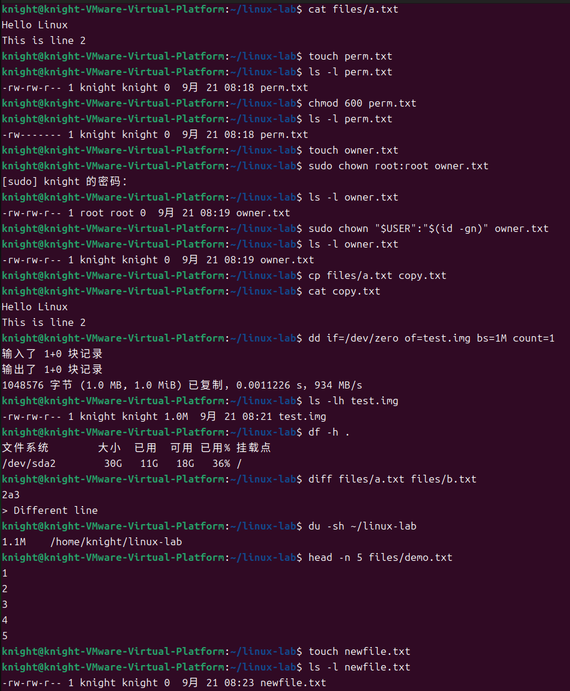

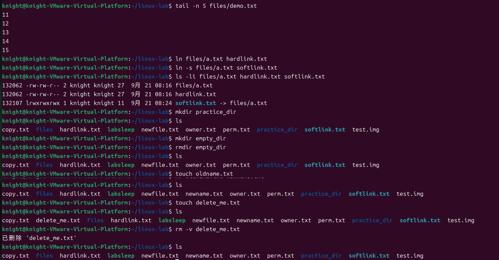

---

# 三、进程管理类

## 17. `ps`

**含义与用途：**  
用于查看系统中的进程信息，如 PID、CPU、内存和进程状态等。

**实践示例：**

```bash
ps aux | head
```

---

## 18. `top`

**含义与用途：**  
用于动态查看系统进程，以及 CPU、内存等资源使用情况。

**实践示例：**

```bash
top
```

---

## 19. `kill`

**含义与用途：**  
根据进程 PID 向进程发送信号，常用于结束指定进程。

**实践示例：**

```bash
./labsleep 300 &
ps -p $!
kill $!
ps -p $!
```

---

## 20. `killall`

**含义与用途：**  
根据进程名称向同名进程发送信号，可用于一次结束多个同名进程。

**实践示例：**

```bash
./labsleep 300 &
./labsleep 300 &
ps -C labsleep
killall labsleep
ps -C labsleep
```

---

## 21. `nice`

**含义与用途：**  
用于在启动程序时设置进程的优先级。

**实践示例：**

```bash
nice -n 10 ./labsleep 300 &
ps -o pid,ni,comm -p $!
```

---

## 22. `renice`

**含义与用途：**  
用于修改已经运行中的进程优先级。

**实践示例：**

```bash
./labsleep 300 &
renice 15 -p $!
ps -o pid,ni,comm -p $!
```

---

## 23. `bg`

**含义与用途：**  
用于将暂停的作业放到后台继续运行。

**实践示例：**

先执行：

```bash
./labsleep 300
```

按下 `Ctrl + Z` 暂停后，再输入：

```bash
bg %1
```

---

## 24. `fg`

**含义与用途：**  
用于将后台作业调回前台运行。

**实践示例：**

```bash
jobs
fg %1
```

---

## 25. `jobs`

**含义与用途：**  
用于查看当前终端中的后台任务和暂停任务。

**实践示例：**

```bash
jobs
```

---

### 进程管理类实践截图

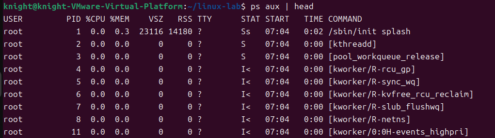

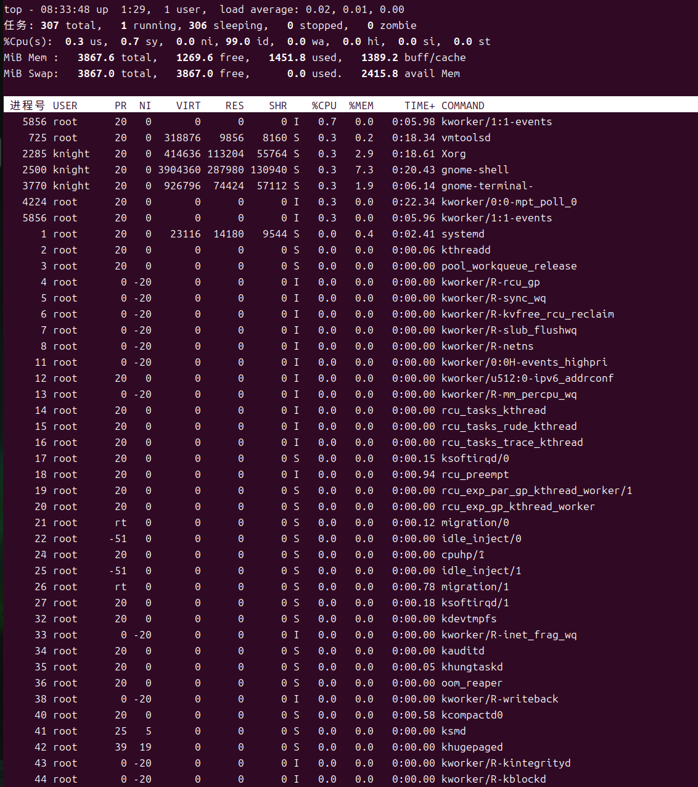

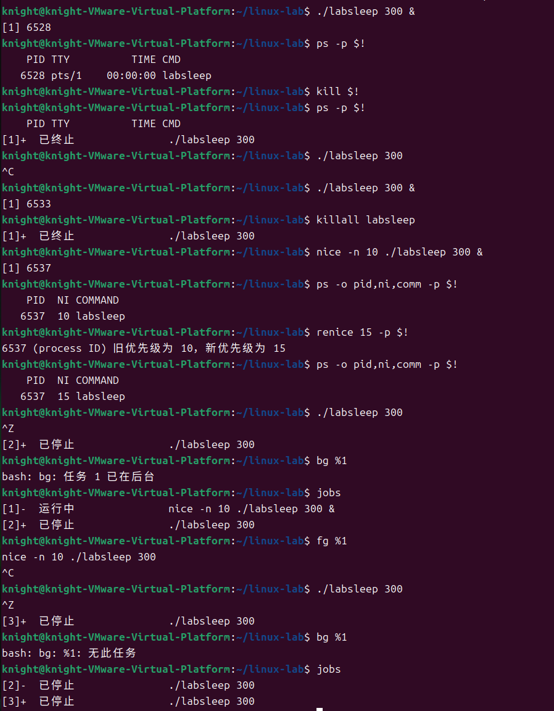

---

# 四、用户管理类

## 26. `useradd`

**含义与用途：**  
用于创建新的 Linux 用户账号。

**实践示例：**

```bash
sudo useradd -m linuxlabuser
id linuxlabuser
```

---

## 27. `userdel`

**含义与用途：**  
用于删除用户账号，配合 `-r` 参数还可删除用户主目录。

**实践示例：**

```bash
sudo userdel -r linuxlabuser
id linuxlabuser
```

如果 `id linuxlabuser` 提示“无此用户”，说明删除成功。

---

## 28. `usermod`

**含义与用途：**  
用于修改已有用户的信息，例如所属组、用户名、Shell 等。

**实践示例：**

```bash
sudo usermod -aG linuxlabgrp linuxlabuser
id linuxlabuser
```

---

## 29. `passwd`

**含义与用途：**  
用于设置或修改用户密码。

**实践示例：**

```bash
sudo passwd linuxlabuser
```

---

## 30. `su`

**含义与用途：**  
用于切换到其他用户身份。

**实践示例：**

```bash
su - linuxlabuser
whoami
```

退出当前用户：

```bash
exit
```

---

## 31. `sudo`

**含义与用途：**  
用于以其他用户身份执行命令，通常用于临时以 root 管理员权限执行命令。

**实践示例：**

```bash
sudo whoami
```

正常情况下输出：

```text
root
```

本次实验中第一次执行时出现了权限问题，具体记录见后文“问题与解决过程”。

---

## 32. `groupadd`

**含义与用途：**  
用于创建新的用户组。

**实践示例：**

```bash
sudo groupadd linuxlabgrp
```

---

## 33. `w`

**含义与用途：**  
用于查看当前登录系统的用户，以及这些用户正在执行的操作。

**实践示例：**

```bash
w
```

---

## 34. `last`

**含义与用途：**  
用于查看系统历史登录记录。

**实践示例：**

```bash
last -n 10
```

---

### 用户管理类实践截图

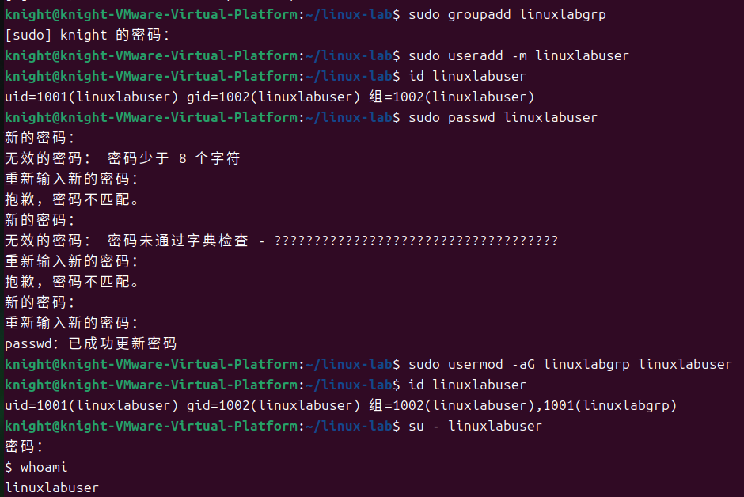

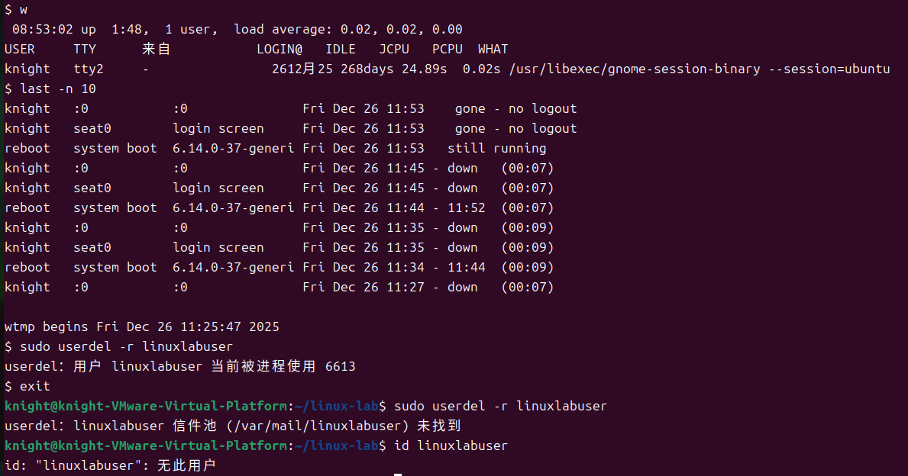

---

# 五、压缩打包类

## 35. `tar`

**含义与用途：**  
用于将多个文件或目录打包，也可以进行解包操作。

**实践示例：**

```bash
tar -cvf files.tar files/
ls -lh files.tar
tar -tf files.tar
```

---

## 36. `gzip`

**含义与用途：**  
用于使用 gzip 格式压缩文件，通常生成 `.gz` 文件。

**实践示例：**

```bash
cp files/a.txt gzip_test.txt
gzip gzip_test.txt
ls
```

---

## 37. `gunzip`

**含义与用途：**  
用于解压 `.gz` 格式的文件。

**实践示例：**

```bash
gunzip gzip_test.txt.gz
ls
```

---

## 38. `zip`

**含义与用途：**  
用于创建 `.zip` 压缩文件，可以压缩多个文件或目录。

**实践示例：**

```bash
zip -r files.zip files/
```

---

## 39. `unzip`

**含义与用途：**  
用于解压 `.zip` 压缩文件。

**实践示例：**

```bash
mkdir unzip_test
unzip files.zip -d unzip_test
```

---

### 压缩打包类实践截图

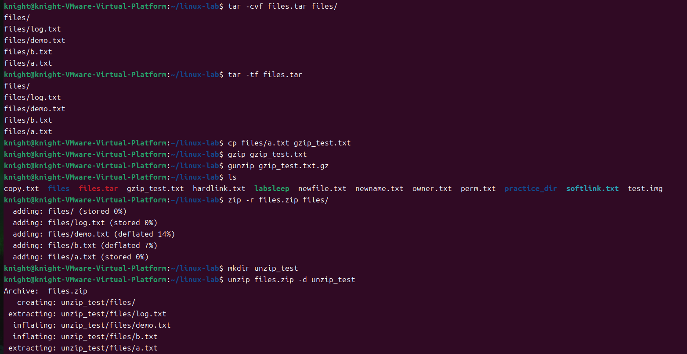

---

# 六、网络通信类

## 40. `ping`

**含义与用途：**  
用于测试本机与目标主机之间的网络连通性和网络延迟。

**实践示例：**

```bash
ping -c 4 127.0.0.1
```

---

## 41. `ifconfig`

**含义与用途：**  
用于查看或配置网络接口信息，是较旧的 Linux 网络管理命令。

**实践示例：**

```bash
ifconfig
```

现代 Linux 中如果没有该命令，可以使用 `ip` 命令代替。

---

## 42. `ip`

**含义与用途：**  
用于查看和配置 IP 地址、网卡和路由等网络信息，是现代 Linux 常用网络管理命令。

**实践示例：**

```bash
ip addr
```

也可以查看路由：

```bash
ip route
```

---

## 43. `netstat`

**含义与用途：**  
用于查看网络连接、监听端口和路由等信息，属于较旧的网络工具。

**实践示例：**

```bash
netstat -tuln
```

现代 Linux 中通常可以使用 `ss` 命令代替。

---

## 44. `ss`

**含义与用途：**  
用于查看 Socket、TCP/UDP 网络连接和监听端口。

**实践示例：**

```bash
ss -tuln
```

---

## 45. `curl`

**含义与用途：**  
用于通过 URL 请求或传输数据，常用于访问网页、测试 HTTP 请求或 API。

**实践示例：**

```bash
curl -I https://example.com
```

---

## 46. `wget`

**含义与用途：**  
用于从网络下载文件。

**实践示例：**

```bash
wget https://example.com -O example.html
ls -lh example.html
```

---

## 47. `ssh`

**含义与用途：**  
用于通过 SSH 协议安全地远程登录和管理 Linux 主机。

**实践示例：**

```bash
ssh 用户名@服务器IP
```

本次实验中使用 SSH 时出现了 `Connection refused`，具体记录见后文“问题与解决过程”。

---

## 48. `scp`

**含义与用途：**  
用于基于 SSH 在本机和远程主机之间安全复制文件。

**实践示例：**

```bash
scp files/a.txt 用户名@服务器IP:/tmp/
```

该命令需要目标主机正常运行 SSH 服务。

---

### 网络通信类实践截图

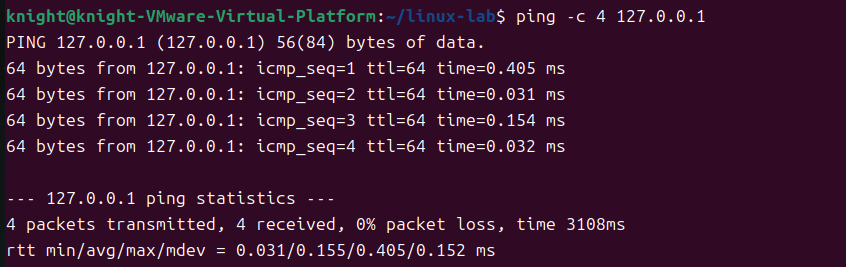

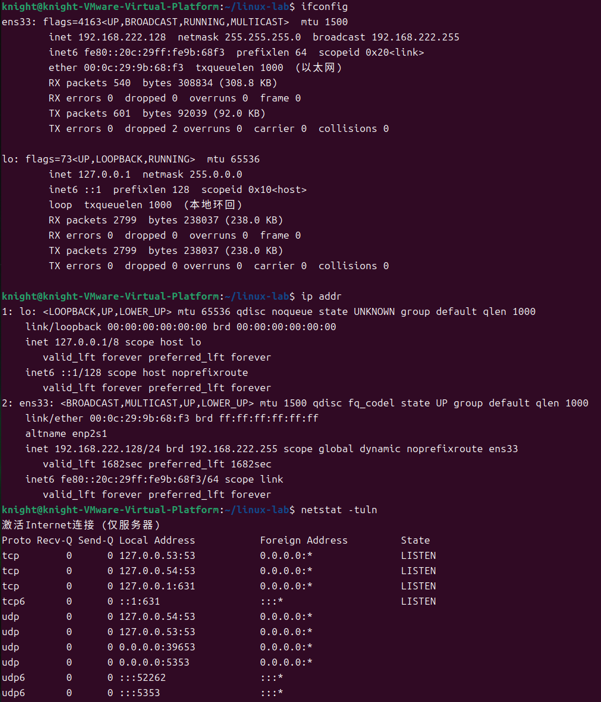

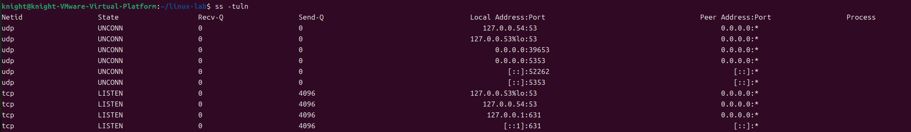

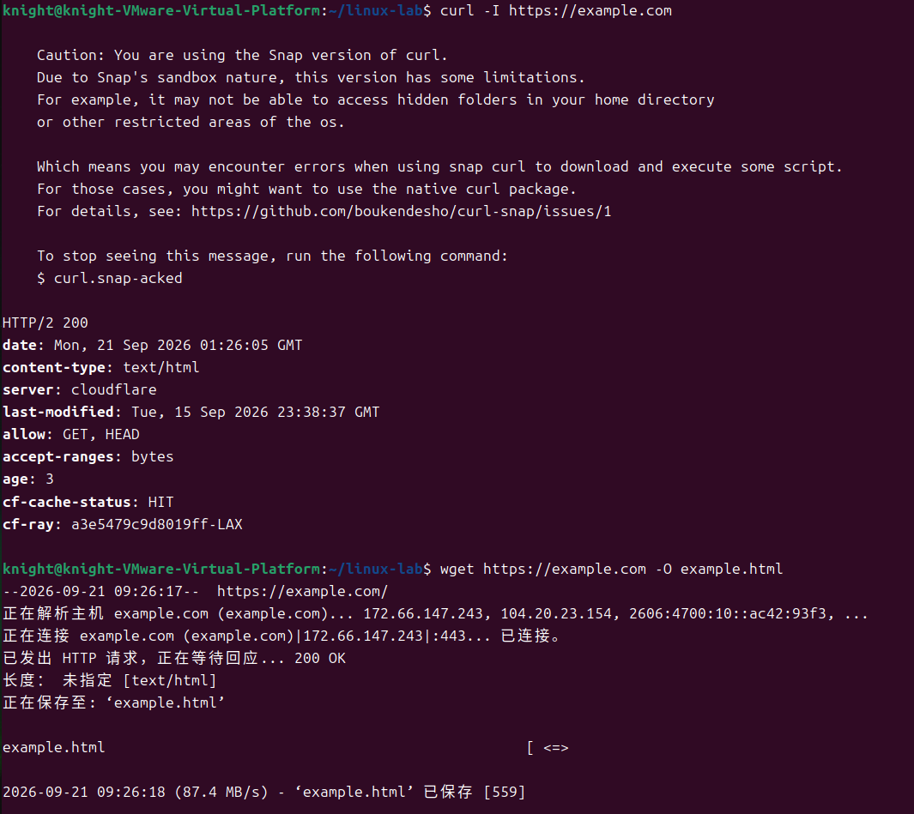

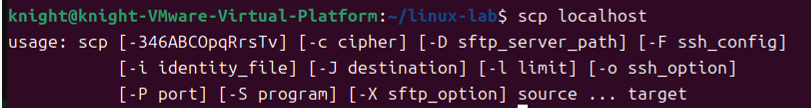

---

# 七、学习过程中出现的问题与解决过程

## 问题 1：普通用户执行 `sudo` 时提示未出现在 sudoers 文件中

### 问题现象

在切换到测试用户 `linuxlabuser` 后执行：

```bash
sudo whoami
```

系统提示：

```text
linuxlabuser 未出现在 sudoers 文件中。
```

### 原因分析

`linuxlabuser` 是使用 `useradd` 创建的普通用户。普通用户默认没有管理员权限，因此不能直接使用 `sudo`。

### 解决方法

先退出 `linuxlabuser`，返回具有 sudo 权限的原用户后，将 `linuxlabuser` 加入 `sudo` 用户组，之后重新登录该用户，再次执行命令即可。

### 问题截图

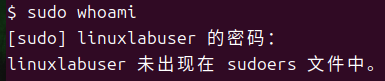

### 解决截图

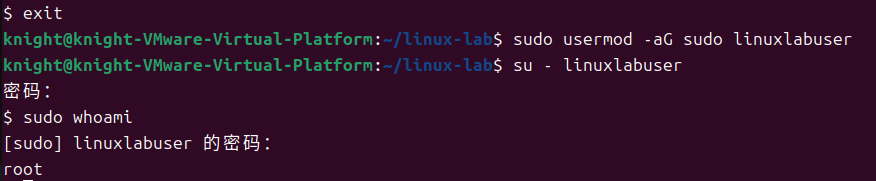

---

## 问题 2：执行 `ssh` 时出现 `Connection refused`

### 问题现象

在实践 `ssh` 命令时执行：

```bash
ssh localhost
```

系统出现：

```text
Connection refused
```

### 原因分析

`Connection refused` 表示已经尝试连接目标主机，但目标主机对应端口没有提供 SSH 服务。

常见原因包括：

1. 目标 Linux 主机没有安装 SSH Server；
2. SSH 服务没有启动；
3. SSH 服务没有监听默认的 22 端口；
4. 目标 IP 或端口填写错误；
5. 防火墙或虚拟机网络配置影响了连接。

因此，该问题说明当前实验环境中没有可正常连接的 SSH 服务。

### 问题截图


---

# 八、学习感受与建议

​	通过本次 Linux 命令实践，我对 Linux 终端操作有了更加直观的认识。相比只记忆命令的含义，实际输入命令并观察结果更容易理解每条命令适合在什么场景下使用。

​	在文件操作方面，我掌握了文件创建、复制、移动、删除、权限修改和磁盘空间查看等基础操作；在进程管理方面，进一步理解了进程、PID、前台任务和后台任务之间的关系；在用户管理方面，通过创建测试用户、修改用户组和使用 `sudo`，认识到了 Linux 对普通用户和管理员权限的区分；在压缩打包方面，了解了 `tar`、`gzip`、`zip` 等工具之间的区别；在网络通信方面，学会了查看网络信息、测试连通性以及使用 `curl`、`wget`、`ssh`、`scp` 等工具。

​	实践过程中我也遇到了一些实际问题。例如，测试用户 `linuxlabuser` 最初无法执行 `sudo`，系统提示该用户未出现在 sudoers 文件中。通过查找原因，我了解到普通用户默认没有 sudo 权限，需要由管理员将其加入 `sudo` 用户组并重新登录后才能生效；另外，在实践 `ssh` 时出现了 `Connection refused`。经过分析，我了解到 SSH 客户端命令可以正常运行并不代表目标主机一定提供 SSH 服务。只有目标机器安装并启动 SSH Server，并且相应端口处于监听状态时，远程连接才能成功。

​	我认为本次学习内容整体十分实用，是为linux后续深入学习打下的坚实基础。通过深入学习，我的建议是在学习 Linux 命令时，不仅记录命令格式，也要结合实际场景进行练习，同时注意观察命令执行前后的变化。对于 `rm`、`dd`、`userdel`、`chown` 等可能修改或删除系统数据的命令，应当优先在测试目录、测试用户或虚拟机环境中实践，避免误操作影响重要文件和系统。
