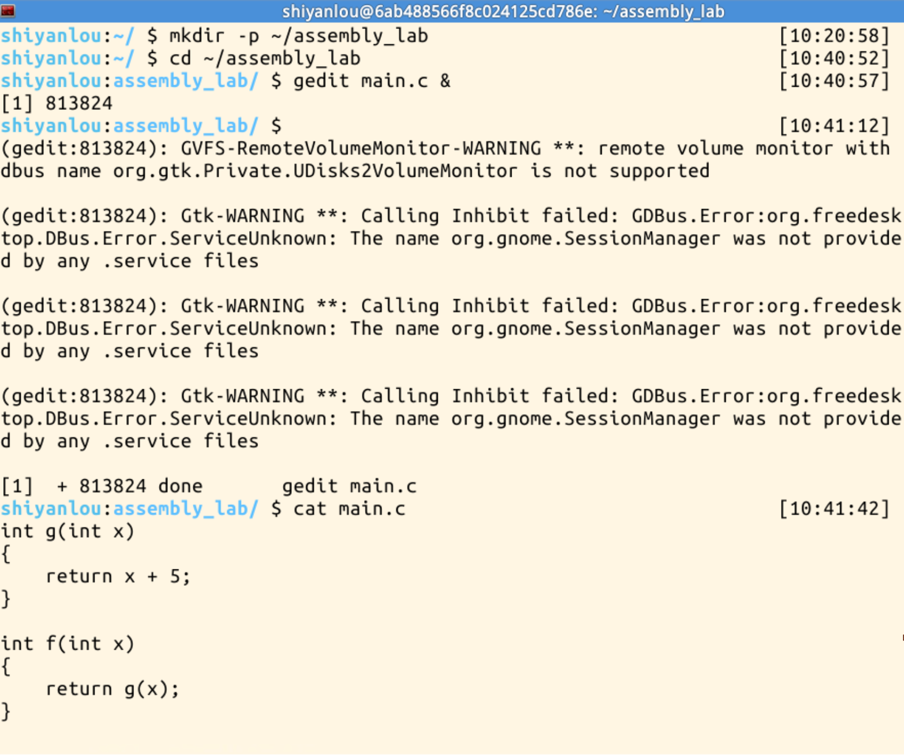
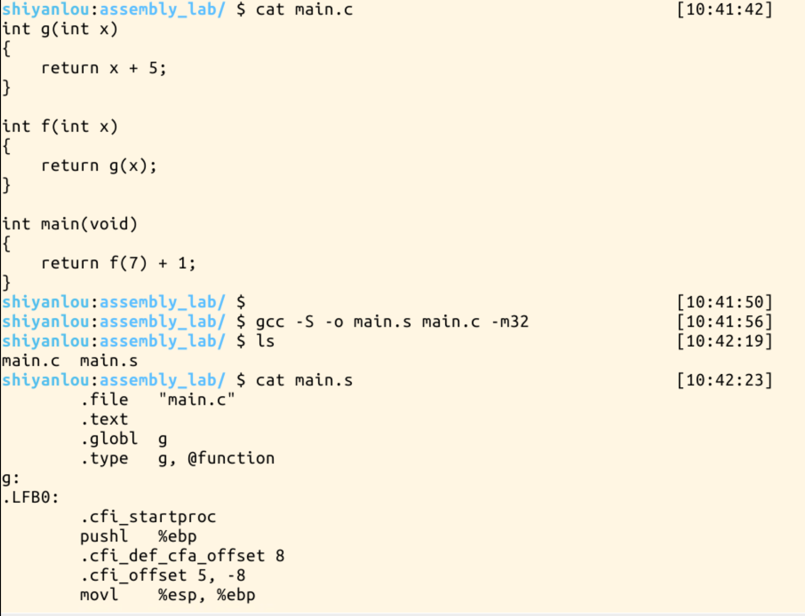

> **事后重建的原稿代理：**未保留本轮真实 AI 原稿。以下复制现存作业以便核对内容，不能作为当时未修改的 AI 输出证据。

# 从 C 程序到汇编：通过函数调用与堆栈理解计算机是如何工作的

**作者：李令琪**

**原创作品转载请注明出处**

**《Linux内核分析》MOOC课程：**\
<http://mooc.study.163.com/course/USTC-1000029000>

------------------------------------------------------------------------

## 一、实验目的

本实验通过编写一个简单的 C 程序，并使用 GCC 将其编译为 32 位 x86汇编代码，观察 `main()`、`f()`、`g()`三个函数的调用过程，重点分析函数调用过程中 EBP、ESP、EAX等寄存器以及堆栈的变化。

通过本实验，希望从汇编语言层面理解高级语言中的函数调用、参数传递、返回值传递和控制流转移是如何实现的，并进一步形成对"计算机是如何工作的"的认识。

## 二、实验程序与编译过程

本次实验使用的 C 程序如下：

``` c
int g(int x)
{
    return x + 5;
}

int f(int x)
{
    return g(x);
}

int main(void)
{
    return f(7) + 1;
}
```

程序的逻辑关系为：

``` text
main()
  |
  | f(7)
  v
 f(7)
  |
  | g(7)
  v
 g(7)
  |
  | 7 + 5
  v
 返回 12
  |
  v
 f 返回 12
  |
  v
 main 计算 12 + 1
  |
  v
 返回 13
```

首先创建实验目录并编辑 `main.c`。下图展示了实验目录的创建、使用 gedit
编辑源程序以及使用 `cat main.c` 检查程序内容的过程。



图中 gedit 启动时出现的 GVFS、DBus 和 GTK 警告来自实验桌面环境，并未影响
`main.c` 的保存以及后续 GCC 编译。

保存程序后执行：

``` bash
gcc -S -o main.s main.c -m32
```

其中，`-S` 表示让 GCC 编译到汇编阶段后停止，`-o main.s`
指定输出文件名，`-m32` 表示生成 32 位 x86 代码。

执行 `ls` 可以看到目录中已经出现 `main.c` 和 `main.s`，随后使用：

``` bash
cat main.s
```

查看生成的汇编代码。



完整的汇编输出如下图所示。


实验环境中 GCC 给出的版本信息为：

``` text
GCC: (Ubuntu 4.8.2-19ubuntu1) 4.8.2
```

忽略 `.cfi_startproc`、`.cfi_def_cfa_offset`、`.size`、`.type`
等用于汇编、调试和栈展开等用途的指示信息后，本实验需要重点分析的代码可以整理为：

``` asm
g:
    pushl   %ebp
    movl    %esp, %ebp
    movl    8(%ebp), %eax
    addl    $5, %eax
    popl    %ebp
    ret

f:
    pushl   %ebp
    movl    %esp, %ebp
    subl    $4, %esp
    movl    8(%ebp), %eax
    movl    %eax, (%esp)
    call    g
    leave
    ret

main:
    pushl   %ebp
    movl    %esp, %ebp
    subl    $4, %esp
    movl    $7, (%esp)
    call    f
    addl    $1, %eax
    leave
    ret
```

## 三、分析前需要理解的寄存器和栈

本实验中最重要的三个寄存器是 EIP、ESP、EBP 和 EAX 中的后三个，同时 EIP
所代表的指令执行位置也决定程序控制流。

-   **ESP（Stack Pointer）**：栈指针，指向当前栈顶。32 位 x86
    中，本实验每保存一个 4 字节值，ESP 通常相应减少 4。
-   **EBP（Base Pointer）**：栈帧基址寄存器。函数建立栈帧后，可以通过
    EBP 加固定偏移访问参数等数据。
-   **EAX**：通用寄存器，在本实验所采用的调用约定中用于保存整数函数的返回值。
-   **EIP（Instruction Pointer）**：指示 CPU
    接下来执行的指令位置。`call`、`ret` 等指令会影响程序的控制流。

x86 栈向低地址方向增长，可以抽象为：

``` text
高地址
   |
   |
   v
低地址     （栈增长方向）
```

因此执行 `pushl` 时，ESP 向低地址移动；执行相应的 `popl` 时，ESP
向高地址恢复。

## 四、main 函数：建立栈帧并调用 f

`main` 的核心代码为：

``` asm
main:
    pushl   %ebp
    movl    %esp, %ebp
    subl    $4, %esp
    movl    $7, (%esp)
    call    f
    addl    $1, %eax
    leave
    ret
```

首先执行：

``` asm
pushl %ebp
movl  %esp, %ebp
```

第一条指令把调用 `main` 前的 EBP 保存到栈中；第二条指令令 EBP
指向当前栈顶，从而建立 `main` 的栈帧。此时可抽象为：

``` text
高地址
+----------------------+
| main 的返回地址       |
+----------------------+
| 保存的旧 EBP          | <- EBP, ESP
+----------------------+
低地址
```

随后：

``` asm
subl $4, %esp
```

令 ESP 减少 4，在栈上预留 4 字节空间：

``` text
高地址
+----------------------+
| main 的返回地址       |
+----------------------+
| 保存的旧 EBP          | <- EBP
+----------------------+
| 4 字节空间            | <- ESP
+----------------------+
低地址
```

接下来：

``` asm
movl $7, (%esp)
```

把立即数 7 写到 ESP 指向的位置。这个 7 就是即将传给 `f` 的参数：

``` text
高地址
+----------------------+
| main 的返回地址       |
+----------------------+
| 保存的旧 EBP          | <- EBP
+----------------------+
| 参数 7                | <- ESP
+----------------------+
低地址
```

随后执行：

``` asm
call f
```

`call` 不仅跳转到 `f`，还会把下一条指令的地址作为返回地址压入栈。这样
`f` 执行完毕后才能通过 `ret` 返回 `main`。

## 五、进入 f：参数为什么位于 8(%ebp)

`f` 的代码为：

``` asm
f:
    pushl   %ebp
    movl    %esp, %ebp
    subl    $4, %esp
    movl    8(%ebp), %eax
    movl    %eax, (%esp)
    call    g
    leave
    ret
```

刚进入 `f` 时，栈中已经存在 `main` 为 `f` 准备的参数 7，以及 `call f`
自动保存的返回地址。随后 `f` 执行：

``` asm
pushl %ebp
movl  %esp, %ebp
```

保存 `main` 的 EBP 并建立 `f` 自己的栈帧。此时关键布局为：

``` text
高地址
+----------------------+
| 参数 x = 7           | <- EBP + 8
+----------------------+
| 返回 main 的地址      | <- EBP + 4
+----------------------+
| main 的 EBP          | <- EBP, ESP
+----------------------+
低地址
```

因此：

``` asm
movl 8(%ebp), %eax
```

就是从 `EBP + 8` 的内存位置取得 `f` 的第一个参数 x，并保存到 EAX
中，即：

``` text
EAX = 7
```

这里也能直观看出为什么第一个参数是 `8(%ebp)`：

``` text
EBP + 0  -> 保存的旧 EBP
EBP + 4  -> call 保存的返回地址
EBP + 8  -> 第一个参数 x
```

## 六、f 调用 g 时的堆栈变化

`f` 接下来执行：

``` asm
subl $4, %esp
movl %eax, (%esp)
```

第一条指令在栈上预留 4 字节；第二条指令将 EAX 中的 7 写入这 4
字节空间，从而为 `g(x)` 准备参数。

此时可以表示为：

``` text
高地址
+----------------------+
| f 的参数 x = 7       | <- EBP + 8
+----------------------+
| 返回 main 的地址      | <- EBP + 4
+----------------------+
| main 的 EBP          | <- f 的 EBP
+----------------------+
| g 的参数 7           | <- ESP
+----------------------+
低地址
```

然后：

``` asm
call g
```

CPU 再次保存返回地址，并将控制流转移到 `g`。因此，在 `g`
刚被调用时，栈顶又增加了一个"返回 f 的地址"。

## 七、g 函数：完成真正的加法运算

`g` 的代码为：

``` asm
g:
    pushl   %ebp
    movl    %esp, %ebp
    movl    8(%ebp), %eax
    addl    $5, %eax
    popl    %ebp
    ret
```

`g` 首先通过：

``` asm
pushl %ebp
movl  %esp, %ebp
```

保存 `f` 的 EBP 并建立自己的栈帧。这时栈的关键部分可以抽象为：

``` text
高地址
+----------------------+
| f 的参数 x = 7       |
+----------------------+
| 返回 main 的地址      |
+----------------------+
| main 的 EBP          |
+----------------------+
| g 的参数 x = 7       | <- g 的 EBP + 8
+----------------------+
| 返回 f 的地址         | <- g 的 EBP + 4
+----------------------+
| f 的 EBP             | <- g 的 EBP, ESP
+----------------------+
低地址
```

随后：

``` asm
movl 8(%ebp), %eax
```

取得 `g` 的参数：

``` text
EAX = 7
```

再执行：

``` asm
addl $5, %eax
```

于是：

``` text
EAX = 7 + 5 = 12
```

这两条汇编指令实现了 C 代码：

``` c
return x + 5;
```

因为 EAX 用于传递整数返回值，所以 `g` 返回时 EAX 中的 12 就成为 `g(7)`
的结果。

## 八、g 返回 f，f 再返回 main

`g` 最后执行：

``` asm
popl %ebp
ret
```

`popl %ebp` 恢复调用者 `f` 的 EBP；`ret` 从栈顶取得先前 `call g`
保存的返回地址，并将程序控制流送回 `f`。此时：

``` text
EAX = 12
```

因此 `f` 已经得到了 `g(x)` 的返回值。

`f` 随后执行：

``` asm
leave
ret
```

`leave` 可以近似理解为：

``` asm
movl %ebp, %esp
popl %ebp
```

即撤销当前函数的栈帧并恢复调用者的 EBP。之后 `ret` 使用 `call f`
时保存的返回地址回到 `main`。

由于 `f` 没有再改变 EAX，因此它返回给 `main` 的值仍然是：

``` text
EAX = 12
```

这对应 C 语言中的：

``` c
return g(x);
```

## 九、回到 main 并得到最终结果

回到 `main` 后继续执行：

``` asm
addl $1, %eax
```

此时 EAX 为 12，所以：

``` text
EAX = 12 + 1 = 13
```

这正对应：

``` c
return f(7) + 1;
```

最后：

``` asm
leave
ret
```

撤销 `main` 的栈帧并返回。因此从本段程序本身的计算逻辑看，`main()`
的返回值为 13。

完整调用和返回过程可以表示为：

``` text
main
 |
 | 准备参数 7
 |
 +---- call f ----------------+
 |                            |
 |                            v
 |                            f
 |                            |
 |                            | 读取 x = 7
 |                            | 为 g 准备参数 7
 |                            |
 |                            +---- call g --------+
 |                            |                    |
 |                            |                    v
 |                            |                    g
 |                            |                    |
 |                            |                    | EAX = 7
 |                            |                    | EAX += 5
 |                            |                    | EAX = 12
 |                            |                    |
 |                            |      ret <---------+
 |                            |
 |                            | EAX = 12
 |                            |
 |          ret <-------------+
 |
 | EAX = 12
 | EAX += 1
 |
 v
EAX = 13
```

## 十、对 call、leave 和 ret 的进一步理解

通过本实验可以发现，C 语言中的一次函数调用，在汇编层面需要多个机制配合。

`call` 的关键作用是保存返回地址并转移控制流；被调用函数通常先保存旧
EBP、建立自己的栈帧，再通过 EBP
的固定偏移访问参数。函数计算得到的整数结果通过 EAX
传递。函数退出时，`leave` 可以撤销当前栈帧并恢复调用者的 EBP，而 `ret`
则利用栈中保存的返回地址恢复调用者的执行流程。

因此 `call` 和 `ret` 共同解决了"去哪里执行"和"执行完回到哪里"的问题，而
EBP、ESP 与栈共同解决了函数执行过程中参数和调用现场的组织问题。

## 十一、实验总结：我对"计算机是如何工作的"的理解

通过本次实验，我对"计算机是如何工作的"有了比单纯阅读 C
代码更具体的认识。

在 C 语言层面，`return f(7) + 1;`
只是一条非常简单的语句；但从汇编代码来看，它实际上包含参数准备、函数调用、返回地址保存、栈帧建立、寄存器运算、栈帧恢复以及函数返回等一系列过程。高级语言为程序员提供了函数、参数和返回值等抽象，而编译器最终需要把这些抽象转换为
CPU 可以执行的指令。

从处理器角度看，程序的运行可以理解为 CPU
按照控制流不断执行指令，并持续改变寄存器和内存中的状态。EIP
所代表的指令执行位置决定接下来执行什么；ESP 和 EBP
帮助组织函数调用时的栈；EAX
等寄存器保存计算的中间结果或函数返回值；内存则保存程序运行所需要的数据。

本实验中的控制流可以概括为：

``` text
main -> f -> g -> f -> main
```

`main` 调用 `f`，`f` 再调用
`g`；执行完成后又依靠先前保存在栈中的返回地址逐层返回。这个过程让我认识到，所谓"函数调用"并不是
CPU 天然理解 C
函数，而是编译器和处理器通过一套明确的调用约定、寄存器使用规则和栈操作共同实现的。

因此，我对"计算机是如何工作的"的理解是：计算机按照指令序列不断完成取指、执行以及状态更新；程序的运行状态由寄存器和内存共同表示，而高级语言中的函数调用、参数传递和返回等机制，最终都会落实为控制流的改变、寄存器状态的变化以及对内存和堆栈的读写。

复杂的软件虽然具有层层抽象，但最终仍要落到处理器能够执行的一条条机器指令上。通过分析
C
程序对应的汇编代码和堆栈变化，可以把高级语言与计算机底层执行机制联系起来，这也是本次实验最大的收获。
