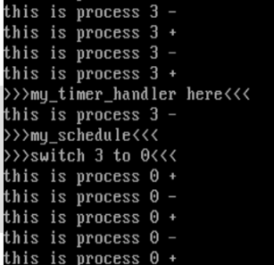

> **事后重建的原稿代理：**未保留本轮真实 AI 原稿。以下复制现存作业以便核对内容，不能作为当时未修改的 AI 输出证据。

# mykernel 实验指导（操作系统是如何工作的）

> **姓名：**李令琪
> **原创作品转载请注明出处。**\
> **课程：**《Linux 内核分析》MOOC\
> **课程地址：** <http://mooc.study.163.com/course/USTC-1000029000>

## 1. 实验环境与步骤

实验使用实验楼提供的 Linux 虚拟机，内核源码版本为 Linux
3.9.4。首先进入源码目录，应用 mykernel 补丁并编译内核：

``` bash
cd ~/LinuxKernel/linux-3.9.4
rm -rf mykernel
patch -p1 < ../mykernel_for_linux3.9.4sc.patch
make allnoconfig
make
qemu -kernel arch/x86/boot/bzImage
```

基础实验运行成功后，进入：

``` bash
cd ~/LinuxKernel/linux-3.9.4/mykernel
```

在时间片轮转版本中，主要分析和修改以下文件：

``` text
mypcb.h          —— PCB、任务数量、内核栈及线程上下文定义
mymain.c         —— 创建任务、建立循环链表、启动第一个任务
myinterrupt.c    —— 时钟处理、调度以及上下文切换
Makefile         —— 将 mymain.o 和 myinterrupt.o 编入内核
```

修改源代码后重新回到 Linux 3.9.4 根目录执行 `make`，再使用 QEMU
启动新生成的 `bzImage`。

------------------------------------------------------------------------

## 2. 基础版 mykernel：主执行流与时钟中断

最初应用实验补丁后，`my_start_kernel()`
中主要是一个不断递增计数器的无限循环；达到指定次数时打印
`my_start_kernel here`。与此同时，补丁把 `my_timer_handler()` 接入 x86
的 timer interrupt
路径，因此即使主执行流一直处于无限循环，硬件时钟中断仍然能够周期性打断它。


**图 1：基础版 mykernel 的 QEMU 输出**

从图 1 可以看到，屏幕持续输出：

``` text
my_start_kernel here ...
```

同时周期性出现：

``` text
my_timer_handler here
```

这一现象非常重要。它说明 CPU 并不是因为主程序进入 `while(1)`
就永远无法执行其他代码。时钟中断到来后，处理器可以暂时中断当前控制流，进入中断处理路径，执行完中断处理后再回到原来的执行位置。

mykernel 补丁还做了三件关键工作：

-   把 `mykernel/` 加入 Linux 内核的构建目录；
-   在 Linux 的 `start_kernel()` 后段调用 `my_start_kernel()`；
-   在 x86 的时钟中断路径中调用 `my_timer_handler()`。

因此，mykernel 并不是一个从固件开始独立启动的完整操作系统，而是借助
Linux 3.9.4
已有的启动、中断和硬件初始化环境，把教学代码嵌入其中，从而让实验重点集中在任务管理和上下文切换上。

------------------------------------------------------------------------

## 3. 时间片轮转版本的总体结构

完成时间片轮转代码后，我首先检查关键符号是否已经存在，并重新编译内核。


**图 2：源码检查与重新编译**

图 2 中可以确认：

-   `mymain.c` 已经存在 `my_process()`；
-   `myinterrupt.c` 已经存在 `my_schedule()`；
-   `mypcb.h` 中 `MAX_TASK_NUM` 为 4；
-   修改后重新执行了 `make`。

整个精简调度模型可以概括为：

``` text
Linux 启动
   |
   v
start_kernel()
   |
   v
my_start_kernel()
   |
   +--> 初始化 PCB 0、1、2、3
   |    并用 next 指针形成循环链表
   |
   v
启动 task[0]
   |
   v
my_process() 持续执行
   |
   |        周期性时钟中断
   |              |
   |              v
   |      my_timer_handler()
   |              |
   |      my_need_sched = 1
   |              |
   +--------------+
   |
   v
my_process() 检查调度标志
   |
   v
my_schedule()
   |
   +--> 保存当前任务上下文
   +--> current = current->next
   +--> 恢复/启动下一个任务
   |
   v
0 -> 1 -> 2 -> 3 -> 0 -> ...
```

------------------------------------------------------------------------

## 4. PCB：操作系统描述任务的核心数据结构

`mypcb.h` 中定义了这个实验使用的简化 PCB。实验一共创建 4
个任务，每个任务拥有自己的内核栈。PCB 中最值得关注的字段可以抽象为：

``` text
PCB
├── pid          任务编号
├── state        任务状态
├── stack[]      任务自己的内核栈
├── thread.ip    保存的指令执行位置
├── thread.sp    保存的栈指针
├── task_entry   任务入口
└── next         指向下一个 PCB
```

其中，`thread.ip` 和 `thread.sp` 是理解上下文切换的关键。对于 x86 32
位环境，可以把它们分别联系到 EIP 和 ESP：

-   **EIP** 决定 CPU 下一步从哪里继续执行；
-   **ESP** 决定 CPU 当前使用哪一个栈以及栈顶位于哪里。

真实 Linux
的进程描述结构远比这里复杂，还需要保存和管理地址空间、文件、信号、调度实体、凭据等大量信息。本实验刻意把
PCB 压缩到最小规模，是为了突出"执行上下文 + 独立栈 +
调度关系"这三个核心概念。

------------------------------------------------------------------------

## 5. 进程（任务）的创建与循环链表

### 5.1 初始化 task\[0\]

`my_start_kernel()` 首先初始化 0 号任务。它主要完成以下工作：

``` text
pid = 0
state = runnable
task_entry / ip = my_process
sp = task[0] 自己的栈顶
next = 自己
```

这里最关键的两个初始化是：

``` text
IP -> my_process
SP -> task[0] 的独立栈
```

也就是说，在任务真正开始运行之前，内核已经准备好了"从哪里执行"和"使用哪一个栈"。

### 5.2 创建其余任务

接下来程序以 `task[0]` 为模板建立其余任务，并分别修改：

-   PID；
-   初始状态；
-   每个任务自己的栈顶；
-   `next` 指针。

最终 4 个 PCB 构成一个循环链表：

``` text
+---------+     +---------+     +---------+     +---------+
| task 0  | --> | task 1  | --> | task 2  | --> | task 3  |
+---------+     +---------+     +---------+     +---------+
     ^                                                |
     |________________________________________________|
```

这也是本实验能够自然实现 Round-Robin
的原因。调度器不需要复杂的选择算法，只要取当前 PCB 的
`next`，就能够依次得到：

``` text
0 -> 1 -> 2 -> 3 -> 0 -> 1 -> ...
```

------------------------------------------------------------------------

## 6. 第一个任务是怎样启动的

完成 PCB 初始化后：

``` text
my_current_task -> task[0]
```

但仅仅改变一个 C 指针，并不会让 CPU 自动开始执行 task 0。CPU
真正关心的是当前寄存器状态。因此，实验代码使用内联汇编完成了两件本质性的工作：

1.  把 ESP 切换到 `task[0]` 准备好的独立栈；
2.  让控制流转移到 task 0 的入口 `my_process()`。

可以把这个过程抽象成：

``` text
my_start_kernel()
      |
      |  准备 task[0].thread.sp
      |  准备 task[0].thread.ip
      v
ESP <- task[0].thread.sp
EIP <- task[0].thread.ip
      |
      v
my_process()
```

实验实现利用栈和 `ret`
指令完成控制流转移：先把目标执行地址安排到新栈中，再由 `ret`
把目标地址装入 EIP。

因此，"启动一个任务"从处理器层面看，并不是某种神秘操作。其核心就是：为任务准备一套有效的 CPU
执行上下文，尤其是栈和下一条指令的位置，然后让处理器开始使用这套上下文。

这也解释了为什么每个任务必须拥有独立的栈。如果多个任务共享同一套栈帧，那么函数调用、局部变量和返回地址会互相破坏，任务就无法独立暂停和恢复。

------------------------------------------------------------------------

## 7. `my_process()`：任务运行与调度检查点

4 个任务最终都运行同一个 `my_process()` 函数，但因为 `my_current_task`
指向不同 PCB，所以打印出的 PID 不同。

其逻辑可以概括为：

``` text
while (true):
    做一些计算
    周期性打印当前 pid
    如果 my_need_sched == 1:
        清除调度标志
        调用 my_schedule()
    继续执行
```

这说明实验中的"任务"并不是 4 份完全不同的程序，而是 4
套彼此独立的执行上下文。即使代码入口相同，只要它们拥有不同的
PCB、不同的栈以及不同的执行现场，就可以作为不同任务被分别调度。

------------------------------------------------------------------------

## 8. 时钟中断如何产生时间片

`myinterrupt.c` 中的 `my_timer_handler()`
由系统时钟中断周期性触发。处理函数维护一个计数器，当满足设定周期并且当前还没有待处理的调度请求时，就设置：

``` text
my_need_sched = 1
```

同时这里可以注意到，这个教学版本的时钟中断处理函数本身并没有立即执行 `my_schedule()`。

它只是设置"需要调度"的标志。真正的 `my_schedule()` 是当前任务回到
`my_process()` 后，在检查到 `my_need_sched` 时调用的。

因此实验的调度链条实际是：

``` text
时钟中断到来
     |
     v
my_timer_handler()
     |
     v
设置 my_need_sched
     |
     v
中断返回，当前任务继续
     |
     v
my_process() 到达检查点
     |
     v
发现需要调度
     |
     v
my_schedule()
```

------------------------------------------------------------------------

## 9. `my_schedule()`：时间片轮转与上下文切换

### 9.1 选择下一个任务

调度器首先保存当前 PCB，并沿着循环链表选择下一个 PCB：

``` text
prev = current
next = current->next
```

随后：

``` text
current = next
```

由于 PCB 已经构成循环链表，所以这一选择天然实现：

``` text
0 -> 1 -> 2 -> 3 -> 0
```

### 9.2 为什么必须保存上下文

假设 task 0 正在执行，时间片结束后要切换到 task 1。

如果内核只是简单跳转到 task 1，而没有记录 task 0
的执行位置，那么以后再次调度 task 0 时就不知道应该从哪里继续。

因此切换前必须保存"现场"。在这个精简实验中，最关键的是：

``` text
task 0:
    保存 ESP
    保存 EIP
    保存与栈帧有关的 EBP

task 1:
    恢复 ESP
    恢复 EIP
    恢复相应栈帧状态
```

于是任务切换可以抽象为：

``` text
正在运行 task 0
      |
      v
保存 task 0 上下文
      |
      v
选择 task 1
      |
      v
恢复 task 1 上下文
      |
      v
CPU 从 task 1 上次的位置继续运行
```

这就是上下文切换的核心。

### 9.3 已运行任务与第一次运行任务

`my_schedule()` 对"已经运行过的任务"和"第一次被调度的任务"采用不同处理。

#### 情况 A：任务以前已经运行过

这种任务曾经被切走，所以已经保存了有效的执行现场。重新调度它时，只需要恢复保存的栈和执行位置：

``` text
恢复旧 SP
恢复旧 IP
继续上次被切走的位置
```

#### 情况 B：任务第一次运行

新任务没有"上一次暂停的位置"，因为它从来没有运行过。因此第一次调度时，需要使用初始化阶段准备好的：

``` text
SP -> 新任务自己的栈
IP -> my_process 入口
```

使其从入口开始第一次执行。

这一区别非常重要：**恢复一个旧任务**和**第一次启动一个新任务**在概念上并不是同一件事。

------------------------------------------------------------------------

## 10. 实验现象：从 task 0 切换到 task 1

运行时间片轮转版本后，QEMU 中出现了以下关键输出：


**图 3：task 0 切换到 task 1**

截图中的关键顺序为：

``` text
this is process 0
>>>my_timer_handler here<<<
>>>my_schedule<<<
>>>switch 0 to 1<<<
this is process 1
```

这段输出可以逐步解释为：

1.  task 0 正在运行；
2.  时钟中断到来，`my_timer_handler()` 提出调度请求；
3.  task 0 在运行过程中检查到调度标志；
4.  进入 `my_schedule()`；
5.  调度器选择 task 1；
6.  保存 task 0 的执行现场；
7.  task 1 第一次被调度，切换到自己的栈和入口；
8.  CPU 开始执行 task 1，因此随后打印 `this is process 1`。

这里最重要的不是 `switch 0 to 1`
这句日志本身，而是**日志之后确实开始持续输出 process
1**。这说明控制流已经真正进入 task 1。

------------------------------------------------------------------------

## 11. 实验现象：从 task 3 回到 task 0

继续运行后，还观察到了 task 3 向 task 0 的切换：



**图 4：task 3 切换回 task 0**

截图中可以看到：

``` text
this is process 3
>>>my_timer_handler here<<<
>>>my_schedule<<<
>>>switch 3 to 0<<<
this is process 0
```

这张截图具有特别重要的意义。

task 0 并不是第一次启动。它此前已经运行过，并在切换到 task 1
时保存了自己的执行现场。现在从 task 3 再次调度到 task 0，调度器恢复 task
0 保存的上下文，task 0 因而能够继续运行。

同时，`3 -> 0` 也证明 PCB 链表是闭环的。结合之前的 `0 -> 1` 以及 4
个任务的循环链表结构，可以验证本实验的 Round-Robin
调度机制已经正常工作。

------------------------------------------------------------------------

## 12. 一次完整轮转的逻辑分析

把整个过程连起来，可以得到：

``` text
task 0 运行
   |
   | 时间片到
   v
保存 task 0
恢复/启动 task 1
   |
   | 时间片到
   v
保存 task 1
恢复/启动 task 2
   |
   | 时间片到
   v
保存 task 2
恢复/启动 task 3
   |
   | 时间片到
   v
保存 task 3
恢复 task 0
   |
   +--------------------> 下一轮
```

从调度策略上看，这是最简单的公平轮转：没有优先级，也没有复杂的动态时间片计算，只按照固定的循环链表顺序选择下一个任务。

从 CPU 角度看，真正发生的事情则更加基础：

``` text
保存 A 的寄存器/栈状态
        ↓
修改当前 PCB
        ↓
恢复 B 的寄存器/栈状态
        ↓
CPU 开始沿 B 的控制流执行
```

所谓"进程 A 被暂停、进程 B
开始运行"，本质上就是这组底层状态变化所形成的高级抽象。

## 13. 对"操作系统是如何工作的"的理解

完成这个实验之前，"进程调度""时钟中断""上下文切换"等概念很容易停留在课本定义上。通过
mykernel，可以把它们连接成一条实际的 CPU 控制流。

首先，CPU 本身并不知道"进程 0""进程
1"这样的高级概念。处理器看到的是寄存器、内存、栈和指令。操作系统通过 PCB
把一组执行状态组织成一个可以管理的任务，并通过 `my_current_task`
等数据结构记录当前正在运行的任务。

其次，操作系统必须能够重新获得 CPU 控制权。如果一个程序获得 CPU
后可以永远运行而不被打断，操作系统就无法可靠地实施多任务调度。周期性硬件时钟中断解决了这个问题：即使当前任务一直执行循环，时钟中断仍能让处理器进入内核的中断处理路径。于是操作系统获得了检查时间片和提出调度请求的机会。

同时，调度并不只是"选一个进程"。选择下一个任务只是第一步。真正让另一个任务继续运行，还必须完成上下文切换：保存当前任务的执行现场，并恢复目标任务以前保存的执行现场。对于第一次运行的新任务，则需要人为构造初始上下文，让其从入口函数和自己的独立栈开始执行。

因此，我对"操作系统是如何工作的"的理解可以概括为：操作系统依靠中断等机制不断获得处理器控制权，以数据结构记录和管理系统中的任务与资源，根据策略决定下一步应该让谁运行，再通过保存和恢复CPU 执行上下文，把处理器从一个任务切换到另一个任务。

## 14. 实验结论

本实验完成了一个简单的时间片轮转多道程序内核模型，并通过 QEMU
输出验证了任务切换。

实验中首先观察到基础版 `my_start_kernel()` 与 `my_timer_handler()`
的交替执行，从而验证硬件时钟中断可以打断当前控制流。随后，通过 4 个
PCB、4 套独立内核栈和循环 `next`
指针建立任务队列；利用时钟中断设置调度请求；由 `my_schedule()`
选择下一个任务，并通过保存与恢复执行上下文完成切换。

实验截图中成功观察到：

``` text
my_timer_handler
my_schedule
switch 0 to 1
```

以及：

``` text
my_timer_handler
my_schedule
switch 3 to 0
```

这说明调度器不仅能够从 task 0 切换到后继任务，也能够在循环链表末端从
task 3 回到 task 0，时间片轮转机制能够正常工作。

通过源代码和运行结果可以得出：进程切换的本质是执行上下文的切换；时间片轮转的基础是周期性时钟中断和可恢复的任务上下文；操作系统正是通过不断管理、保存、选择和恢复这些状态，让多个任务有序共享同一个处理器。
