> **事后重建的原稿代理：**未保留本轮真实 AI 原稿。以下复制现存作业以便核对内容，不能作为当时未修改的 AI 输出证据。

# 跟踪分析 Linux 内核的启动过程

> **作者：**李令琪\
> **原创作品转载请注明出处**\
> **《Linux 内核分析》MOOC课程：<http://mooc.study.163.com/course/USTC-1000029000>**

## 一、实验环境与 QEMU 启动

实验目录为：

``` bash
cd ~/LinuxKernel/
```

首先检查实验目录：

``` bash
pwd
ls
```

本实验使用 Linux 3.18.6 的内核镜像 `bzImage` 和课程提供的 `rootfs.img`：

``` bash
qemu -kernel linux-3.18.6/arch/x86/boot/bzImage -initrd rootfs.img
```

### 实验截图 1：QEMU 启动 Linux 3.18.6 并进入 MenuOS


从实验结果可以看到，QEMU 成功装载 Linux 3.18.6 内核和
`rootfs.img`。完成内核初始化后，系统显示 MenuOS 标志并进入 `MenuOS>>`
命令提示符。这说明内核已经完成启动，并成功运行 rootfs
中提供的用户空间程序。

随后执行 `help`、`version` 等命令，可以看到 MenuOS 提供的基本命令。

### 实验截图 2：MenuOS 的 `help` 和 `version` 命令

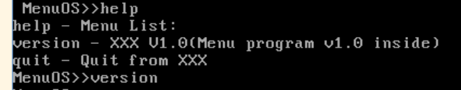

这一步证明实验所使用的用户空间环境能够正常工作，也为后续分析"内核如何最终启动
`/init`"提供了可观察的终点。

### 实验截图 3：执行 `quit` 后的内核异常信息

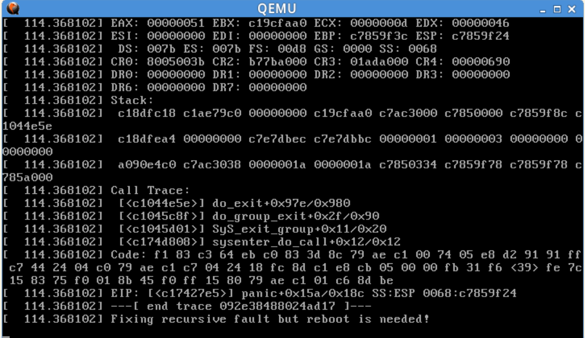

在 MenuOS 中执行 `quit` 后，QEMU
中出现调用栈和 panic 信息，其中能够看到
`do_exit`、`do_group_exit`、`SyS_exit_group` 等函数。

这并不是普通应用程序退出时应有的现象。结合后面的 GDB
调试可以知道，本实验的 `/init` 最终作为 **PID 1** 运行。PID 1 是 Linux
用户空间的初始进程，具有特殊地位；当它退出后，内核无法按照普通用户进程退出的方式继续维持系统，因此会进入严重错误状态。这个现象从另一个角度验证了
MenuOS `/init` 与 1 号进程之间的关系。

------------------------------------------------------------------------

## 二、使用 GDB 远程调试 Linux 内核

为了调试内核，重新使用以下命令启动 QEMU：

``` bash
qemu -kernel linux-3.18.6/arch/x86/boot/bzImage -initrd rootfs.img -s -S
```

其中：

-   `-S`：QEMU 启动后暂时冻结虚拟 CPU，等待调试器控制；
-   `-s`：等价于开启 `-gdb tcp::1234`，即在 TCP 1234 端口等待 GDB 连接。

然后打开另一个终端：

``` bash
cd ~/LinuxKernel/
gdb
```

在 GDB 中加载包含调试符号的 `vmlinux`：

``` gdb
file linux-3.18.6/vmlinux
break start_kernel
target remote :1234
continue
```

这里需要区分 `bzImage` 和 `vmlinux`：QEMU 使用压缩后的 `bzImage`
启动内核，而 GDB 使用包含符号信息的 `vmlinux` 来完成源码级调试。

### 实验截图 4：GDB 成功命中 `start_kernel`

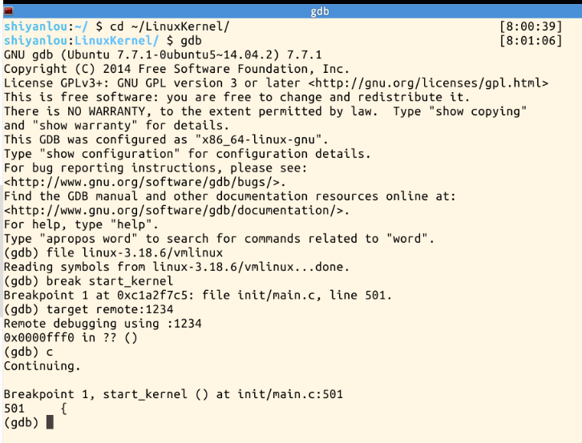

截图中可以看到：

``` text
Breakpoint 1, start_kernel() at init/main.c:501
```

因此已经成功进入 Linux 3.18.6 的 `start_kernel()`。这也是本实验分析内核
C 语言初始化过程的主要起点。

------------------------------------------------------------------------

## 三、`start_kernel()` 的入口与调用关系

在 `start_kernel()` 断点处执行：

``` gdb
bt
list
```

### 实验截图 5：`start_kernel()` 的调用栈与源代码

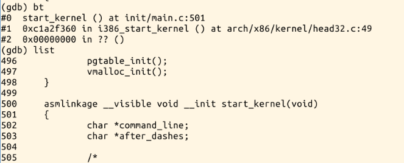

从调用栈可以看到：

``` text
#0 start_kernel() at init/main.c:501
#1 i386_start_kernel() at arch/x86/kernel/head32.c:49
```

这说明在当前 32 位 x86
实验环境中，体系结构相关的早期启动代码完成必要准备后，由
`i386_start_kernel()` 进入通用内核初始化函数 `start_kernel()`。

因此，`start_kernel()` 并不是计算机上电后执行的第一条 Linux
指令。在它之前已经经历了体系结构相关的启动过程。但是，从 Linux 通用内核
C 代码的角度看，`start_kernel()` 是最重要的初始化入口之一。

------------------------------------------------------------------------

## 四、`start_kernel()` 执行过程分析

Linux 3.18.6 的 `start_kernel()` 位于
`init/main.c`。这个函数非常长，因为内核必须在创建正常用户空间环境之前建立几乎所有基础运行条件。

从整体功能上，可以把 `start_kernel()` 的执行过程理解为以下几个阶段。

### 1. 建立最基本的内核运行环境

内核首先完成与启动
CPU、体系结构和启动参数有关的准备工作，包括处理命令行参数以及调用体系结构相关的初始化代码。

其中 `setup_arch()` 是非常重要的一步，它负责完成大量与 x86
体系结构相关的初始化，并为后续通用内核代码准备硬件和内存布局信息。

### 2. 建立内存管理机制

Linux 内核运行离不开内存管理。启动早期只能使用有限的内存管理手段，因此
`start_kernel()`
需要逐渐建立正式的页分配、slab/slub、内核对象等内存管理基础设施。

这一阶段完成后，内核后面的子系统才可以更自由地进行动态内存分配。

### 3. 初始化调度系统

`start_kernel()` 会初始化 Linux
调度器。调度器是多任务系统的核心组件之一，它决定可运行任务如何获得 CPU。

这一阶段非常关键，因为后面的 `rest_init()`
将真正产生新的内核执行流。如果调度系统没有建立，就无法正常调度这些任务。

### 4. 初始化中断、时钟和定时器

内核还需要建立中断处理、时钟源和定时器等基础设施。

中断使 CPU
能够响应硬件事件；时钟和定时器则为调度、超时、延迟任务等功能提供时间基础。因此，这些组件都是系统进入正常运行状态之前必须完成的初始化内容。

### 5. 初始化控制台和其他核心子系统

随着初始化继续进行，内核逐步建立 console、VFS、缓存、RCU
等基础机制，并继续处理各种核心子系统。

从启动过程的角度看，`start_kernel()`
的核心意义不是"启动一个普通程序"，而是**从一个功能非常有限的早期内核环境逐步构造出能够进行进程调度、内存分配、中断处理、文件系统访问和设备初始化的完整内核运行环境**。

### 6. 进入 `rest_init()`

当 `start_kernel()` 的主体初始化工作完成后，会进入 `rest_init()`。

这一步是本实验中非常重要的转折点：此前主要是在当前启动执行流中建立内核基础设施，而从
`rest_init()` 开始，Linux
将创建最初的重要任务，并逐步把系统带入正常的多任务运行状态。

------------------------------------------------------------------------

## 五、设置关键断点

为了避免对庞大的内核启动代码逐条单步执行，本实验采用"关键函数断点 +
`continue`"的方法跟踪启动主线。

实验中设置的关键断点包括：

``` gdb
break start_kernel
break rest_init
break kernel_init
break kernel_init_freeable
break do_basic_setup
break do_initcalls
break run_init_process
```

并使用：

``` gdb
info breakpoints
```

检查断点。

### 实验截图 6：关键断点设置结果

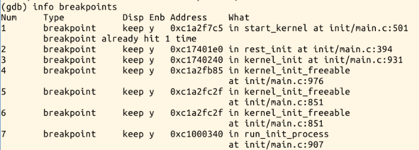

截图表明已经成功设置了从 `start_kernel` 到 `run_init_process`
的关键调试点。

值得注意的是，在编译优化开启的情况下，某些函数可能被内联，因此 GDB
显示的断点位置可能落在调用者 `kernel_init_freeable()`
的具体源代码行，而不是显示成完全独立的函数入口。这属于编译优化后的正常调试现象，并不意味着相应初始化过程没有执行。

------------------------------------------------------------------------

## 六、`rest_init()`：从单一启动执行流走向多任务

继续执行后，GDB 命中：

``` text
Breakpoint 2, rest_init() at init/main.c:394
```

### 实验截图 7：进入 `rest_init()`

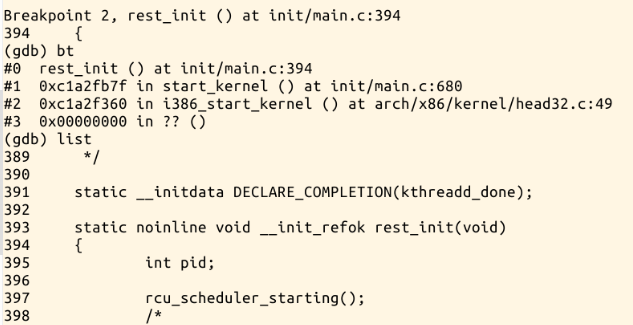

调用栈显示：

``` text
rest_init()
start_kernel()
i386_start_kernel()
```

因此可以清楚地看到：

``` text
i386_start_kernel
        ↓
start_kernel
        ↓
rest_init
```

`rest_init()` 的重要任务之一，是创建 Linux 启动后最早的一批特殊任务。

从概念上可以表示为：

``` text
                         start_kernel()
                               |
                               v
                           rest_init()
                          /           \
                         /             \
                        v               v
                kernel_init         kthreadd
                   PID 1              PID 2

原有启动任务 --------------------------------> idle / swapper
                                                  PID 0
```

这里最需要注意的是：**PID 0、PID 1、PID 2 并不是完全以相同方式产生的。**

------------------------------------------------------------------------

## 七、idle 进程是怎么来的

PID 0 经常被称为 `swapper` 或 idle 任务。

它不能简单理解成 `rest_init()` 使用 `fork()` 新建出来的第一个进程。Linux
在内核启动早期就已经存在一个静态初始化的初始任务，即
`init_task`。`start_kernel()`
的启动上下文本身就建立在这个初始任务基础之上。

因此，更准确的理解是：

**0 号任务不是在 `rest_init()` 中通过普通进程创建机制新创建出来的，而是
Linux 启动时就存在的初始任务。**

当 `rest_init()`
创建出后续重要任务并完成相应同步工作以后，原来的启动执行流最终进入 CPU
idle 路径。CPU 没有其他可运行任务时，就执行 idle 任务。

因此 PID 0 的来源可以概括为：

``` text
内核早期静态初始化的 init_task
            ↓
执行早期内核初始化
            ↓
start_kernel()
            ↓
rest_init()
            ↓
原启动执行流进入 idle
            ↓
PID 0 / swapper / idle
```

------------------------------------------------------------------------

## 八、1 号进程：`kernel_init()`

继续运行后，GDB 命中：

``` text
Breakpoint 3, kernel_init (unused=0x0) at init/main.c:931
```

### 实验截图 8：进入 `kernel_init()`

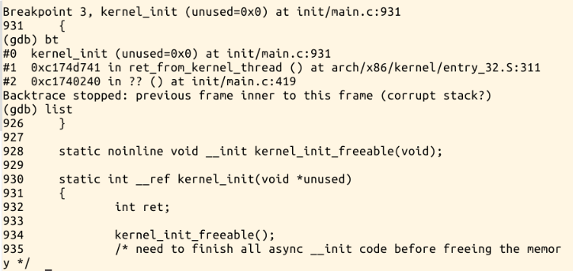

截图中的源代码可以看到：

``` c
static int __ref kernel_init(void *unused)
{
    int ret;

    kernel_init_freeable();
    ...
}
```

`rest_init()` 创建执行 `kernel_init()`
的任务。由于它是启动过程中创建的第一个新任务，因此获得特殊的 **PID 1**。

此时它仍然执行内核代码，所以不能简单地说"一创建就是普通用户空间 init
程序"。更准确地说，它首先作为内核中的 `kernel_init`
执行流继续完成剩余初始化，之后才会通过执行用户空间 `/init`
完成角色转换。

因此 PID 1 的演化过程可以理解为：

``` text
rest_init()
    ↓
创建执行 kernel_init() 的任务
    ↓
PID 1
    ↓
kernel_init_freeable()
    ↓
完成剩余内核初始化
    ↓
run_init_process("/init")
    ↓
do_execve(...)
    ↓
用户空间 /init
```

这正是"1 号进程怎么来的"这个问题的核心。

------------------------------------------------------------------------

## 九、2 号进程：`kthreadd`

`rest_init()` 还会创建 `kthreadd`，它通常获得 PID 2。

`kthreadd` 是 Linux
中非常重要的内核线程管理者，后续许多内核线程的创建都与它有关。

因此 Linux 启动后最初三个特殊 PID 可以概括为：

------------------------------------------------------------------------------------
  PID                     典型名称                来源与作用
----------------------- ----------------------- ------------------------------------
  0                       idle / swapper          启动时已经存在的初始任务，最终进入
                                                  CPU idle

  1                       init                    `rest_init()` 创建的 `kernel_init`
                                                  执行流，最终执行用户空间 `/init`

  2                       kthreadd                `rest_init()`创建，用于支持和管理后续内核线程

其中最容易混淆的是 PID 0：它不是和 PID 1、PID 2 一样在 `rest_init()`
中新创建的普通任务。

------------------------------------------------------------------------

## 十、`kernel_init_freeable()`：完成可释放的初始化工作

继续执行后，GDB 命中：

``` text
Breakpoint 4, kernel_init_freeable() at init/main.c:976
```

### 实验截图 9：进入 `kernel_init_freeable()`

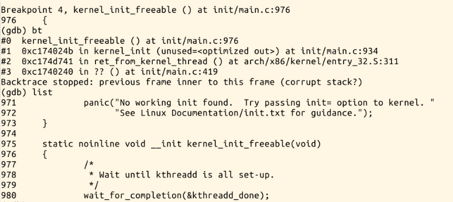

截图中能够看到：

``` c
wait_for_completion(&kthreadd_done);
```

说明 `kernel_init_freeable()` 会等待 `kthreadd`
完成必要的建立过程，然后继续进行剩余初始化。

函数名中的 `freeable` 也很有意义：Linux
中很多启动阶段的代码和数据只在初始化时需要。系统启动完成以后，这部分带有初始化属性的内存可以被释放，从而避免长期占用宝贵的内核内存。

------------------------------------------------------------------------

## 十一、`do_basic_setup()` 与 `do_initcalls()`

继续跟踪后，实验停在 `kernel_init_freeable()` 中调用 `do_basic_setup()`
的位置：

``` text
kernel_init_freeable() at init/main.c:1004
do_basic_setup();
```

### 实验截图 10：执行 `do_basic_setup()`

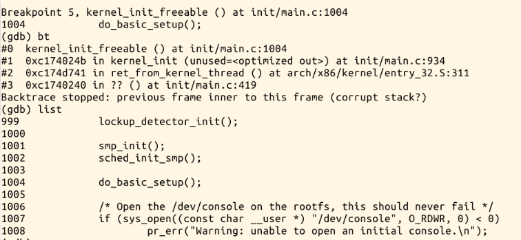

截图中还可以看到：

``` c
smp_init();
sched_init_smp();

do_basic_setup();
```

说明在进入 `do_basic_setup()` 之前，内核已经继续完成 SMP
和调度相关初始化。

`do_basic_setup()`
会进一步完成设备和内核子系统的初始化，其中非常重要的一项就是执行
`do_initcalls()`。

Linux 中大量驱动程序和子系统并不是全部直接写死在 `start_kernel()`
中依次调用，而是通过 initcall
机制注册初始化函数。内核启动时，再按照不同初始化级别逐步调用这些函数。

常见的初始化级别包括：

``` text
pure_initcall
core_initcall
postcore_initcall
arch_initcall
subsys_initcall
fs_initcall
device_initcall
late_initcall
```

因此可以把 `do_initcalls()`
理解成一个重要的"批量初始化调度器"：它按照预定顺序执行各个子系统和驱动注册的初始化函数。

从整体上看：

``` text
start_kernel()
    |
    +--> 建立内核最基础的运行环境
    |
    v
rest_init()
    |
    +--> 创建 PID 1
    +--> 创建 PID 2
    |
    v
kernel_init()
    |
    v
kernel_init_freeable()
    |
    +--> SMP / scheduler 等后续初始化
    |
    v
do_basic_setup()
    |
    v
do_initcalls()
    |
    +--> 文件系统、设备、驱动、子系统等初始化
```

这说明 Linux
的启动并不是一个函数把所有组件一次性初始化完毕，而是分阶段逐步建立系统。

------------------------------------------------------------------------

## 十二、`run_init_process()`：从内核走向用户空间

本实验最关键的最后一个断点是：

``` text
Breakpoint 7, run_init_process
(init_filename=0xc18d295d "/init")
at init/main.c:907
```

### 实验截图 11：`run_init_process("/init")`

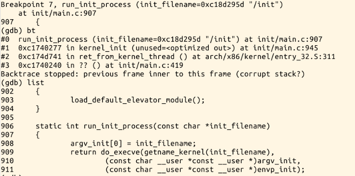

这个截图给出了非常直接的证据：

``` text
init_filename = "/init"
```

同时源代码显示：

``` c
static int run_init_process(const char *init_filename)
{
    argv_init[0] = init_filename;
    return do_execve(getname_kernel(init_filename),
                     (const char __user *const __user *)argv_init,
                     (const char __user *const __user *)envp_init);
}
```

也就是说，`kernel_init()` 最终调用 `run_init_process()`，而
`run_init_process()` 进一步通过 `do_execve()` 执行 `/init`。

这里发生的是 Linux 启动过程中的关键转换：

PID 1 没有消失，也不是重新创建了一个新的 PID 1；而是当前 PID 1 通过
exec 机制用 `/init` 的用户空间程序映像替换当前执行映像。

因此，从进程身份上它仍然是 PID 1，但执行内容已经从内核启动阶段的
`kernel_init` 过渡到了用户空间的 `/init`。

------------------------------------------------------------------------

## 十三、继续运行后进入 MenuOS

在 `run_init_process()` 断点处执行：

``` gdb
continue
```

QEMU 继续运行，最终出现 MenuOS。

### 实验截图 12：GDB 放行后 `/init` 成功进入 MenuOS

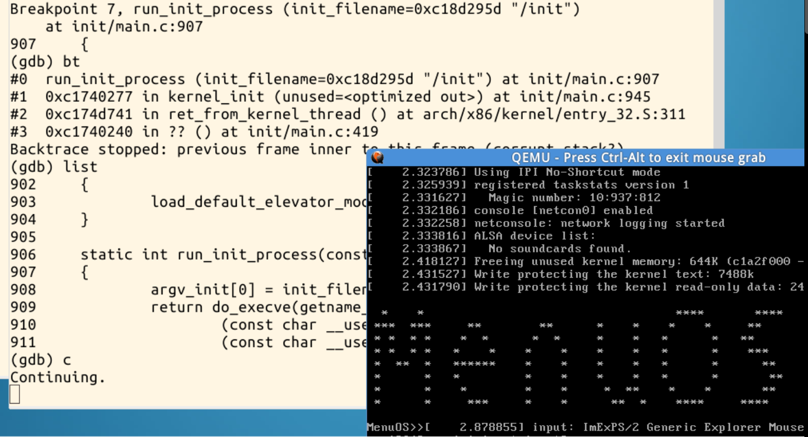

这张截图将 GDB 中的：

``` text
run_init_process(init_filename="/init")
```

与 QEMU 中实际出现的：

``` text
MenuOS>>
```

放在同一个实验现场中，因此形成了非常完整的证据链：

``` text
kernel_init()
      ↓
run_init_process("/init")
      ↓
do_execve("/init", ...)
      ↓
PID 1 开始执行用户空间 /init
      ↓
MenuOS>>
```

至此，本实验已经从 `start_kernel()` 一直跟踪到了用户空间 init
程序的实际启动。

------------------------------------------------------------------------

## 十四、完整启动路径总结

结合本次 GDB 实验，可以将观察到的 Linux 3.18.6 启动主线概括为：

``` text
x86 体系结构相关早期启动代码
            ↓
i386_start_kernel()
            ↓
start_kernel()
            ↓
体系结构、内存、调度、中断、时钟等核心初始化
            ↓
rest_init()
       ┌────┴───────────────┐
       ↓                    ↓
kernel_init             kthreadd
  PID 1                   PID 2
       ↓
kernel_init_freeable()
       ↓
do_basic_setup()
       ↓
do_initcalls()
       ↓
完成剩余初始化
       ↓
run_init_process("/init")
       ↓
do_execve("/init", ...)
       ↓
用户空间 /init（仍为 PID 1）
       ↓
MenuOS

与此同时：
原始启动任务 → idle / swapper（PID 0）
```

------------------------------------------------------------------------

## 十五、对 Linux 系统启动过程的理解

通过本次实验，我对 Linux 启动过程最大的认识是：Linux
的启动不是简单地"加载内核，然后运行init"，而是一个从极简执行环境逐步建立完整操作系统运行环境的过程。

`start_kernel()`
是理解这一过程的重要入口。进入该函数时，体系结构相关的早期代码已经完成了一部分准备工作，但通用内核中的大量核心机制仍需要建立。`start_kernel()`
逐步初始化内存管理、调度、中断、时钟以及其他核心子系统，使内核从只能执行有限启动代码的状态，逐渐具备正常管理
CPU、内存和任务的能力。

随后进入 `rest_init()`，启动过程出现了一个关键变化：Linux
开始建立正常的任务体系。

我认为理解 idle 进程时最重要的一点是：**PID 0 并不是 `rest_init()`
中通过普通 fork 过程创建出来的。** 它来源于内核启动时已经存在的初始任务
`init_task`。早期启动代码本身就在这一初始任务上下文中执行。完成创建其他关键任务等工作以后，这条原始执行流最终进入
idle 路径，因此形成我们通常所说的 0 号进程（swapper/idle）。

PID 1 的来源则不同。`rest_init()` 创建执行 `kernel_init()`
的任务，使它成为系统中的 1 号进程。`kernel_init()`
并不会立即进入普通用户程序，而是继续执行 `kernel_init_freeable()`
等函数，完成剩余的内核初始化工作。实验中能够实际跟踪到
`do_basic_setup()` 等初始化过程。

当这些工作完成后，`kernel_init()` 最终尝试运行用户空间 init。本实验在
`run_init_process()` 断点处清楚地观察到了：

``` text
init_filename="/init"
```

并且源代码显示它调用 `do_execve()`。这意味着 PID 1 通过 exec
机制开始执行 rootfs 中的 `/init`。继续运行后，QEMU 中实际出现
`MenuOS>>`，因此从 GDB
调用路径和实际运行现象两个方面都验证了从内核空间到用户空间的转换。

另外，本实验在 MenuOS 中执行 `quit` 后观察到了
`do_exit`、`do_group_exit`
等调用以及内核严重错误信息。这使我进一步认识到 PID 1
与普通进程不同：本实验的 MenuOS `/init` 就处于 PID 1
的位置，它承担用户空间初始进程的角色。一旦这个初始进程退出，系统便无法像普通程序退出那样简单回到另一个父进程继续工作。

因此，我对 Linux 启动过程最终形成的整体理解是：

Linux 先依靠启动时已经存在的 PID 0 执行内核初始化；`start_kernel()`
建立操作系统的核心基础设施；`rest_init()` 创建 PID 1 和 PID
2，使系统进入正常的多任务阶段；PID 0 最终成为 idle，PID 2 成为
`kthreadd`，而 PID 1 继续完成剩余初始化，并最终通过 `exec` 执行用户空间
`/init`。至此，系统才真正完成从"内核自身启动"到"用户空间开始运行"的关键跨越。
