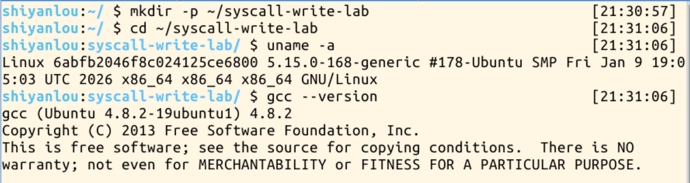
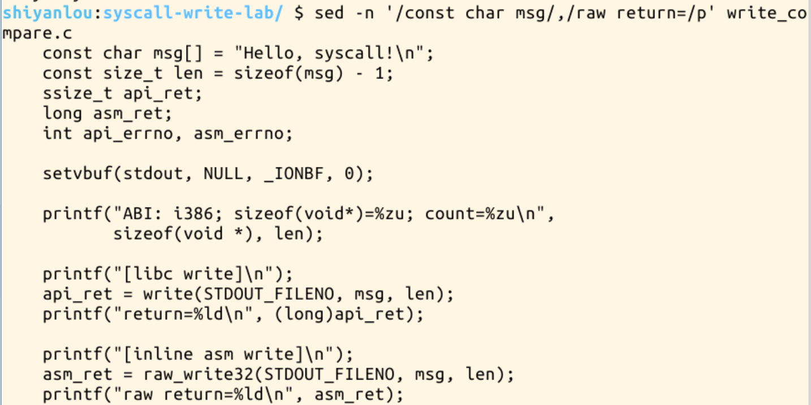
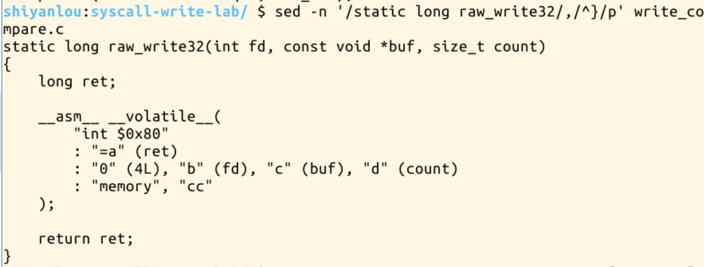
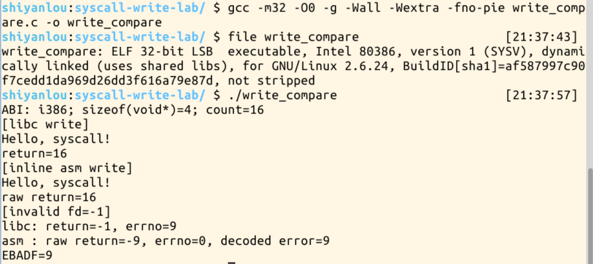
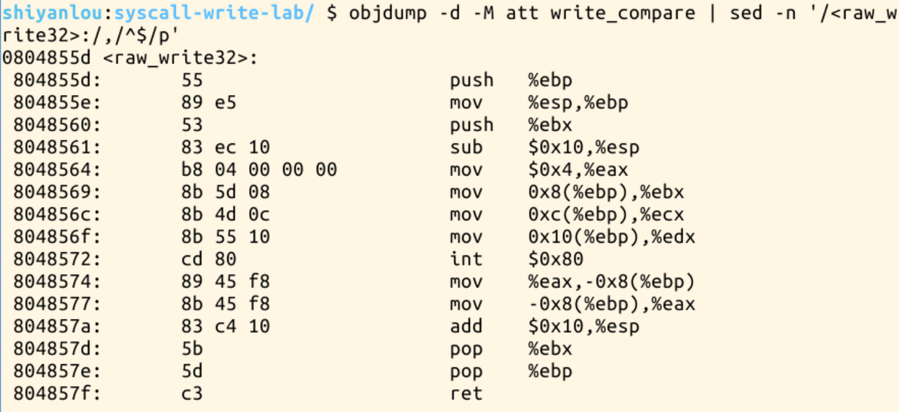

> **待本人审阅稿：**由 AI 根据现有作业整理，尚未经学生本人确认。下列方括号是待核对事项，不能视为已经完成的人工批注。

> [待人工核对：本轮 `20262803《Linux内核原理与分析》第5周作业.md` 是否为真实提交稿；补充你实际修改的理由和过程。]

> [AI 审阅建议：核对宿主 64 位内核与 i386 用户程序的 ABI，区分 libc 错误转换和原始返回值。]

> [AI 建议：按教学进程统一作业主标题；原主题保留为副标题，请人工确认提交命名。]

# 20262803《Linux内核原理与分析》第5周作业

## 原作业主题：使用库函数 API 和 C 代码中嵌入汇编代码两种方式使用同一个系统调用

**姓名：** 李令琪

**原创作品转载请注明出处**

**《Linux 内核分析》MOOC 课程 [http://mooc.study.163.com/course/USTC-1000029000](http://mooc.study.163.com/course/USTC-1000029000)**

## 一、系统调用选择

本实验我选择 `write`，其功能是向文件描述符对应的对象写入数据。在本实验采用的 Linux i386 系统调用 ABI 中，`write` 的系统调用号为 **4**，对应内核处理函数 `sys_write`，不属于作业排除的 13 号 `time`。选取 `write` 的原因是：它的三个参数分别包含整数、指针和长度，能直接展示参数传递规则，而且输出结果容易观察。

库函数原型可写为：

```c
ssize_t write(int fd, const void *buf, size_t count);
```

`fd` 为文件描述符；`buf` 为待写数据的起始地址；`count` 为请求写入的字节数。成功时返回实际写出的字节数，失败时库函数返回 `-1` 并设置 `errno`。成功不一定表示写出了全部请求数据，一般程序还需处理短写；本实验使用 16 字节的短消息，重点观察系统调用机制。

## 二、实验环境与截图

本实验统一采用 **32 位 x86（i386）用户程序**。64 位 x86 主机可以在支持 i386 程序运行且具备相应开发库的条件下进行实验，编译时使用 `-m32`。内核处理过程按教材介绍的 Linux 3.18 系列 x86-32 路径分析；实验机当前的内核版本应按实际运行记录填写。

| 项目 | 实验记录 |
| --- | --- |
| 操作系统及内核版本 | Linux 5.15.0-168-generic，x86_64；Ubuntu 实验环境（见图 1） |
| GCC 版本 | GCC (Ubuntu 4.8.2-19ubuntu1) 4.8.2 |
| 可执行文件格式 | ELF 32-bit LSB executable，Intel 80386，动态链接（见图 4） |
| 用户程序指针长度 | 实际输出 `sizeof(void*)=4`（见图 4） |



图 1 记录了实验目录、实际内核信息与 GCC 版本；图 4 进一步记录程序的 32 位 ELF 格式。

## 三、实验代码与运行方法

以下程序在同一个进程中先调用 libc 的 `write()`，再调用使用内嵌汇编实现的 `raw_write32()`。两次调用使用相同的文件描述符、缓冲区和长度，随后再分别传入无效描述符 `-1`，比较错误返回方式。

```c
/* Linux i386: compare libc write() with an inline-assembly system call. */
#include <errno.h>
#include <stdio.h>
#include <unistd.h>

#if !defined(__i386__)
#error "This experiment uses the i386 ABI. Compile with gcc -m32."
#endif

/* Return the kernel's raw result; deliberately do not change errno. */
__attribute__((noinline))
static long raw_write32(int fd, const void *buf, size_t count)
{
    long ret;

    __asm__ __volatile__(
        "int $0x80"
        : "=a" (ret)
        : "0" (4L), "b" (fd), "c" (buf), "d" (count)
        : "memory", "cc"
    );

    return ret;
}

int main(void)
{
    const char msg[] = "Hello, syscall!\n";
    const size_t len = sizeof(msg) - 1;
    ssize_t api_ret;
    long asm_ret;
    int api_errno, asm_errno;

    /* Keep diagnostic printf output in the intended order. */
    setvbuf(stdout, NULL, _IONBF, 0);

    printf("ABI: i386; sizeof(void*)=%zu; count=%zu\n",
           sizeof(void *), len);

    printf("[libc write]\n");
    api_ret = write(STDOUT_FILENO, msg, len);
    printf("return=%ld\n", (long)api_ret);

    printf("[inline asm write]\n");
    asm_ret = raw_write32(STDOUT_FILENO, msg, len);
    printf("raw return=%ld\n", asm_ret);

    /* Invalid fd: compare libc error conversion with the raw result. */
    errno = 0;
    api_ret = write(-1, msg, len);
    api_errno = errno;

    errno = 0;
    asm_ret = raw_write32(-1, msg, len);
    asm_errno = errno;

    printf("[invalid fd=-1]\n");
    printf("libc: return=%ld, errno=%d\n", (long)api_ret, api_errno);
    printf("asm : raw return=%ld, errno=%d, decoded error=%ld\n",
           asm_ret, asm_errno, asm_ret < 0 ? -asm_ret : 0L);
    printf("EBADF=%d\n", EBADF);

    return 0;
}
```

编译和运行：

```bash
gcc -m32 -O0 -g -Wall -Wextra -fno-pie write_compare.c -o write_compare
file write_compare
./write_compare
```

本次使用 GCC 4.8.2 编译，已按图 4 的命令成功生成并运行 32 位程序。





## 四、实验结果与两种方式的对照

下列内容与图 4 的本次实际运行结果一致：

```text
ABI: i386; sizeof(void*)=4; count=16
[libc write]
Hello, syscall!
return=16
[inline asm write]
Hello, syscall!
raw return=16
[invalid fd=-1]
libc: return=-1, errno=9
asm : raw return=-9, errno=0, decoded error=9
EBADF=9
```



消息 `Hello, syscall!\n` 包含 16 个字节。`sizeof(msg)` 还包含 C 字符串结束标记 `\0`，所以程序用 `sizeof(msg)-1` 作为写入长度。本次实际运行中两次均返回 16，说明两种方式都成功请求了相同的写操作。

错误路径进一步揭示了库函数与系统调用的区别。对无效描述符，Linux i386 内核的原始返回值为 `-EBADF`，即 `-9`。libc 封装将该错误转换成函数返回 `-1`，并把 `errno` 设为 `EBADF`。本实验的汇编函数直接交回 `eax` 的结果，没有进行这种转换，所以返回 `-9`；此前清零的用户态 `errno` 保持为 0。

因此，库函数 API 除了发起请求，还负责向应用程序提供规定的错误接口。若要把原始汇编函数包装为类似 libc 的接口，可以在检测到负错误码后设置 `errno` 并返回 `-1`；本实验保留原始结果以便比较。这里只讨论 `write`，不把“所有系统调用都能这样简单判断”作为一般结论。

## 五、内嵌汇编的参数传递过程

### 1. 系统调用 ABI 与普通 C 函数调用的区别

在本实验的 i386 `int $0x80` ABI 中，`eax` 用于传递系统调用号；第 1 至第 6 个参数依次通过 `ebx`、`ecx`、`edx`、`esi`、`edi`、`ebp` 传递；返回值通过 `eax` 交回。

对应到这次 `write`，进入内核前的状态为：

| 内容 | 寄存器 | 本实验的成功调用 |
| --- | --- | --- |
| 系统调用号 | `eax` | `4` |
| 第一个参数 `fd` | `ebx` | `1`，即标准输出 |
| 第二个参数 `buf` | `ecx` | `msg` 在用户空间的起始地址 |
| 第三个参数 `count` | `edx` | `16` |
| 系统调用结果 | 返回后的 `eax` | 本次成功调用为 `16`；无效描述符时为 `-9` |

`ecx` 中传递的是**指针值**，并不是把整段字符串装进寄存器。内核随后依据该用户地址和长度访问数据。用户提供的地址仍然需要由内核按用户内存访问规则检查、使用；放进寄存器不等于它自动成为可信的内核地址。

普通的 i386 C 函数调用常按其调用约定从用户栈传入参数。进入内核的系统调用则遵循另一套 ABI，并切换到内核栈。用户程序先在寄存器里准备约定的数据，内核入口再保存和组织这些数据；不能把一次普通的用户态 `call` 与系统调用的特权级切换混为一谈。

### 2. 分析 GCC 扩展内联汇编

核心代码为：

```c
__asm__ __volatile__(
    "int $0x80"
    : "=a" (ret)
    : "0" (4L), "b" (fd), "c" (buf), "d" (count)
    : "memory", "cc"
);
```

这段代码使用约束把 C 变量绑定到指定寄存器，由 GCC 生成装载寄存器的指令：

| 写法 | 含义 |
| --- | --- |
| `"=a"(ret)` | 输出操作数 0 来自 `eax`，将系统调用结果交给 C 变量 `ret`。 |
| `"0"(4L)` | 输入与输出操作数 0 使用同一个位置；调用前将系统调用号 4 放入 `eax`。这里的 `0` 是操作数编号，不是把数值 0 传给内核。 |
| `"b"(fd)` | 将第一个参数放入 `ebx`。 |
| `"c"(buf)` | 将第二个参数的指针值放入 `ecx`。 |
| `"d"(count)` | 将第三个参数放入 `edx`。 |
| `volatile` | 表明这段汇编具有需要保留的副作用，避免因返回值未使用等情况被优化删除。 |
| `"memory"` | 告诉编译器这里可能通过指针访问未逐一列出的内存，使缓冲区准备与调用的关系得到正确处理。它是编译器约束，不是 CPU 内存屏障指令。 |
| `"cc"` | 保守声明条件码可能受影响。 |

`eax` 已作为输出操作数描述，不能再重复放进破坏列表。编译器也会处理普通 C 函数约定要求保存的寄存器，例如在需要时保存和恢复 `ebx`。模板只有一条 `int` 指令，并不意味着寄存器没有被装载；装载工作由输入约束产生的机器代码完成。

### 3. 分析本次实际生成的反汇编

本次执行以下命令，提取 `raw_write32` 的反汇编：

```bash
objdump -d -M att write_compare | sed -n '/<raw_write32>:/,/^$/p'
```



图 5 中函数从 `0x0804855d` 开始，实际指令如下。地址随重新编译和链接可能变化，此处记录本次截图中的地址。

```asm
0804855d: push %ebp
0804855e: mov  %esp,%ebp
08048560: push %ebx
08048561: sub  $0x10,%esp
08048564: mov  $0x4,%eax
08048569: mov  0x8(%ebp),%ebx
0804856c: mov  0xc(%ebp),%ecx
0804856f: mov  0x10(%ebp),%edx
08048572: int  $0x80
08048574: mov  %eax,-0x8(%ebp)
08048577: mov  -0x8(%ebp),%eax
0804857a: add  $0x10,%esp
0804857d: pop  %ebx
0804857e: pop  %ebp
0804857f: ret
```

先看进入内核前的关键步骤：

| 指令地址 | 指令 | 作用 |
| --- | --- | --- |
| `0x08048564` | `mov $0x4,%eax` | 将 i386 的 `write` 调用号 4 放入 `eax`。 |
| `0x08048569` | `mov 0x8(%ebp),%ebx` | 从 C 函数栈帧取得第一个参数 `fd`，放入系统调用参数寄存器 `ebx`。 |
| `0x0804856c` | `mov 0xc(%ebp),%ecx` | 从栈帧取得第二个参数 `buf` 的指针值，放入 `ecx`。 |
| `0x0804856f` | `mov 0x10(%ebp),%edx` | 从栈帧取得第三个参数 `count`，放入 `edx`。 |
| `0x08048572` | `int $0x80` | 按已经准备好的调用号和参数发起系统调用；对应机器码为 `cd 80`。 |

这里的栈偏移反映了**两套调用约定之间的转换**。`main` 按普通 i386 C 函数调用方式调用 `raw_write32(fd, buf, count)`；建立栈帧后，`0(%ebp)` 为保存的旧 `ebp`，`4(%ebp)` 为 C 函数调用的返回地址，三个参数依次位于 `8(%ebp)`、`12(%ebp)`、`16(%ebp)`。GCC 随后把它们分别装入 `ebx/ecx/edx`，供系统调用 ABI 使用。

本次成功调用在执行 `int` 前的参数应为 `ebx=1`、`ecx=msg` 的地址、`edx=16`。其中 `0x10(%ebp)` 表示“栈帧偏移 16 字节处的内容”，不能直接解释为把常量 16 写入 `edx`；本次该参数的值为 16，来自 `sizeof(msg)-1`。

系统调用返回后，`0x08048574` 的 `mov %eax,-0x8(%ebp)` 将原始结果保存到局部变量 `ret` 的栈位置。随后 `0x08048577` 再将 `ret` 装入 `eax`，作为普通 C 函数 `raw_write32` 的返回值。这对应源码中的 `"=a"(ret)` 和 `return ret`。

函数开头的 `push %ebp` 与 `mov %esp,%ebp` 建立用户态 C 函数栈帧，`sub $0x10,%esp` 预留局部栈空间；末尾对应恢复。`ebx` 是此 C 函数调用约定要求被调用者保存的寄存器，因此编译器在使用它传递系统调用参数前后生成 `push %ebx` 和 `pop %ebx`。这些动作属于用户态函数的准备与收尾，不是内核入口保存上下文的过程。

因此，这张反汇编截图清楚地展示了“C 栈参数 → 系统调用寄存器 → `int $0x80` → `eax` 原始结果 → C 函数返回值”的完整用户态路径。

## 六、从用户态进入内核并返回的过程

结合教材第四章的参数传递规则与第五章对系统调用入口的分析，本实验的汇编路径包含以下阶段。

### 1. 用户程序准备请求

`raw_write32()` 按 ABI 准备调用号和三个参数。此时程序仍在用户态执行，单纯把 `eax` 设为 4 并不会调用内核；真正触发入口的是随后执行的 `int $0x80`。

### 2. CPU 根据中断向量进入受控入口

`0x80` 是中断向量号，十进制为 128；`4` 才是这次请求的系统调用号，两者承担不同作用。

在教材所讨论的原生 32 位 Linux 路径中，内核为 0x80 设置了允许用户态触发的入口。CPU 通过 IDT 中对应的描述符进入内核，发生用户态到内核态的特权级切换，并在切换内核栈时保存返回所需的用户态状态，例如用户栈位置、标志和返回指令地址。随后开始执行 `system_call` 入口代码。

CPU 的硬件入口动作与内核汇编保存通用寄存器的动作是两个环节。入口代码还要保存系统调用号及通用寄存器上下文，以便分派请求和恢复执行。

### 3. 内核分派具体系统调用

`system_call` 是多个系统调用共用的入口，具体服务通过系统调用号区分。入口代码保存上下文、处理必要的入口工作并检查调用号；在教材的 32 位分派路径中，通过如下指令选择内核处理函数：

```asm
call *sys_call_table(,%eax,4)
```

其中比例因子 4 来自 **32 位函数指针的字节数**。当 `eax=4` 时，分派代码取出表中索引为 4 的函数指针，也就是 `write` 对应的处理函数。这里的索引从 0 开始，不是把中断向量 0x80 当作表项编号。

参数最初由用户态寄存器传入，内核入口保存寄存器后，按内核的调用约定让 `sys_write` 取得参数。在教材所述的 i386 入口中，这与保存到内核栈上的参数布局以及 `asmlinkage` 调用约定有关；不应解释成所有内核 C 函数都直接沿用用户态寄存器调用约定。

### 4. 内核执行写操作

`sys_write` 根据文件描述符找到当前进程对应的打开文件对象，进行所需检查，并通过 VFS 及目标对象的写入实现完成请求。标准输出通常关联终端，也可能被 shell 重定向到文件或管道，因此 `fd=1` 表示标准输出描述符，不能简单等同于某个固定硬件设备。

字符串缓冲区仍在用户空间。内核按照用户内存访问规则读取其数据；具体的读取或复制环节随目标对象及其写入实现而变化。无效文件描述符的对照调用无法取得合法的写入目标，因此产生 `EBADF`。

### 5. 保存结果并恢复用户态

内核处理函数返回后，入口/返回代码将结果保存到将要恢复的寄存器上下文中，使用户程序看到返回后的 `eax`。返回用户态前还可能需要处理信号或重新调度等待处理工作，并非每次系统调用都必然立即返回，也并非每次都会切换进程。

在本实验分析的 `int $0x80` 正常返回路径中，内核恢复相应上下文，通过中断返回机制回到用户态，继续执行 `int` 后面的指令。GCC 再按 `"=a"(ret)` 把结果交给 C 代码。

### 6. 库函数方式与汇编方式的联系

调用 libc `write()` 时，应用程序按普通 C 函数接口传入参数；封装例程负责转换为系统调用约定、触发进入内核，并处理返回结果。本实验的汇编函数由程序员直接指定 i386 寄存器和 `int $0x80`，省去了这部分封装。

两条路径请求的是同一项内核服务，但 libc 的底层入口指令可能随 libc 和运行环境变化，例如使用快速系统调用入口。仅凭相同输出或 `strace` 中相同的调用名称，不能断定两条路径都执行了 `int $0x80`。

如果在较新的 64 位内核上运行本实验的 32 位程序，实际进入的是相应兼容路径，内部符号和实现可能与教材的原生 32 位 `system_call` 不同。因此，本文把本次用户程序的 i386 ABI 验证与教材版本的内核流程分析分别说明。

## 七、可选的系统调用跟踪

```bash
strace -e trace=write -o trace.txt ./write_compare
cat trace.txt
```

可在真实日志中查找两个写入 `Hello, syscall!\n` 的成功请求，以及两个无效描述符的失败请求。由于 `printf` 也可能使用 `write` 输出说明文字，日志中出现额外调用是正常的。

特别需要注意，strace 会把两次失败都格式化为 `-1 EBADF`。这并不说明原始汇编结果变成了 `-1`；原始 `eax=-9` 与跟踪工具面向读者显示的错误表示是不同层次。可以结合程序打印结果，或用 GDB 在 `int $0x80` 前后观察寄存器，进一步验证。

以上给出可进一步验证的方法。本次已经完成的记录为图 1 至图 5，未将 strace 或 GDB 跟踪写作已完成的实验。

## 八、总结

通过比较这两种调用方式，我把系统调用理解为用户程序与内核之间一套受控的请求和返回协议。应用程序指定“需要什么服务”，内核按照既定规则检查请求、使用资源并交回结果。库函数提供了便于编程的接口；系统调用 ABI 规定了调用号、参数和结果的传递方式；内核入口和具体处理函数共同完成受保护的服务。

在本实验中，`eax=4` 表达“请求 write”，`ebx/ecx/edx` 表达“向哪个描述符写、数据在哪里、写多少字节”，`int $0x80` 触发特权级切换。指针参数使有限的寄存器能够描述用户内存中的数据，但内核仍必须检查和正确访问这些数据。返回后的 `eax` 则表示操作结果，libc 在此基础上进一步提供 `-1` 与 `errno` 的错误约定。

我也认识到，进入内核态不等于创建新进程或必然切换到其他进程。系统调用首先是当前执行任务的权限与执行上下文变化；阻塞、信号处理和调度可能影响何时返回。将寄存器传参、受控入口、内核分派、结果保存与上下文恢复联系起来，才能完整理解一次系统调用，而不只是记住某一条汇编指令。
