> **待本人审阅稿：**由 AI 根据现有作业整理，尚未经学生本人确认。下列方括号是待核对事项，不能视为已经完成的人工批注。

> [待人工核对：本轮 `20262803《Linux内核原理与分析》第6周作业.md` 是否为真实提交稿；补充你实际修改的理由和过程。]

> [AI 审阅建议：核对实际经过的 system_call 返回路径与只从源码分析的未执行分支。]

> [AI 建议：按教学进程统一作业主标题；原主题保留为副标题，请人工确认提交命名。]

# 20262803《Linux内核原理与分析》第6周作业

## 原作业主题：分析 system_call 中断处理过程

**姓名：** 李令琪

**原创作品转载请注明出处**

**《Linux 内核分析》MOOC 课程 [http://mooc.study.163.com/course/USTC-1000029000](http://mooc.study.163.com/course/USTC-1000029000)**

## 一、实验环境

上一次实验使用库函数 `write()` 和 C 内嵌汇编两种方式调用同一个系统调用。本次继续选择 i386 的 4 号系统调用 write，在 QEMU 中运行 Linux 3.18.6，用 GDB 观察从 `system_call` 入口、系统调用表分派、内核函数执行，到恢复现场并执行 `iret` 的过程，重点分析返回用户态前的调度时机。

| 项目 | 本次实际环境 |
| --- | --- |
| 实验楼宿主环境 | Linux 5.15.0-168-generic，x86_64 |
| QEMU 客体／调试目标 | Linux 3.18.6，i386 32 位内核 |
| GDB | GNU gdb 7.7.1 |
| 编译器 | 前一实验已确认 GCC 4.8.2 |
| 内核符号文件 | `~/LinuxKernel/linux-3.18.6/vmlinux`，ELF 32-bit、未剥离符号 |
| 内核配置 | `CONFIG_X86_32=y`、`CONFIG_DEBUG_INFO=y`、`CONFIG_FRAME_POINTER=y` |
| 地址随机化 | `CONFIG_RANDOMIZE_BASE` 未启用 |
| 调用参数 | `fd=1`，`buf="Hello, syscall!\n"`，`count=16` |

宿主机的 `uname -a` 不能代表被调试内核的版本。本次断点和汇编分析对应 QEMU 中加载的 Linux 3.18.6 i386 内核，不能套用 x86_64 的 `syscall` 指令、寄存器传参约定或现代内核入口代码。

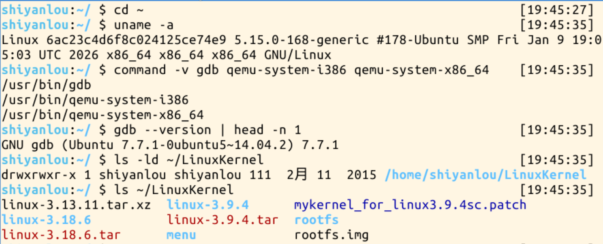

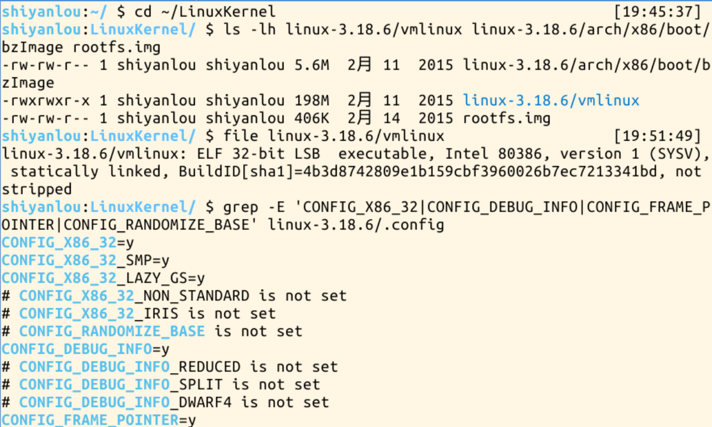

## 二、构造便于识别的 write 调用

原有 MenuOS 使用 `test.c` 注册命令。为保留原实验环境，我备份该文件，新增 `write-asm` 命令，并单独生成 `init-write-lab` 和 `rootfs-write-lab.img`。

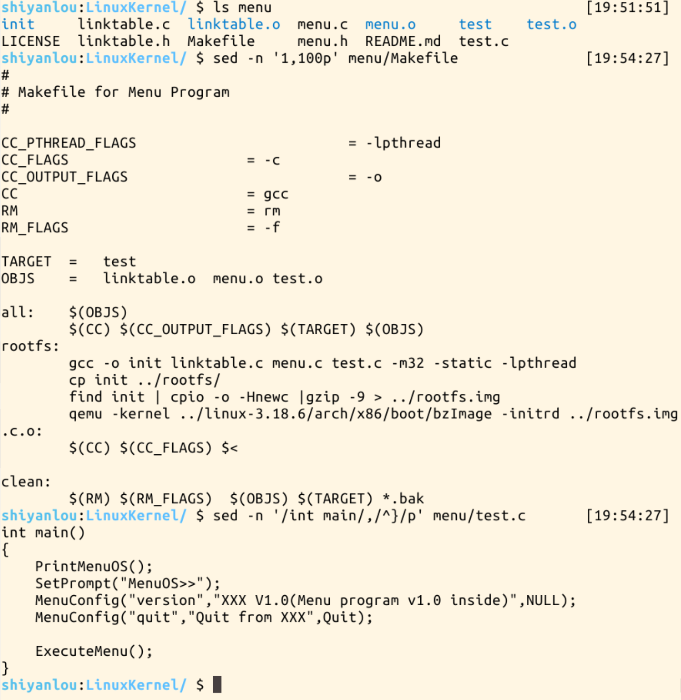

新增命令的处理函数如下：

```c
static int LabWriteAsm(int argc, char *argv[])
{
    static const char msg[] = "Hello, syscall!\n";
    long ret;

    (void)argc;
    (void)argv;
    __asm__ __volatile__(
        "int $0x80"
        : "=a" (ret)
        : "0" (4L), "b" (1), "c" (msg), "d" (sizeof(msg) - 1)
        : "memory", "cc"
    );
    return ret == (long)(sizeof(msg) - 1) ? 0 : -1;
}
```

在 `ExecuteMenu()` 前注册：

```c
MenuConfig("write-asm", "write via int 0x80", LabWriteAsm);
```

`"=a"` 指定返回值来自 EAX，`"0"` 将系统调用号输入绑定到同一个寄存器；`"b"`、`"c"`、`"d"` 分别将参数放入 EBX、ECX、EDX。`volatile` 防止该汇编被当作无用计算删除，`memory` 告知编译器这段汇编涉及约束列表之外的内存访问，`cc` 声明条件码可能受影响；它们都不是 CPU 的内存栅栏。字符串包含换行，共 16 字节；`sizeof(msg)-1` 排除末尾的空字符。

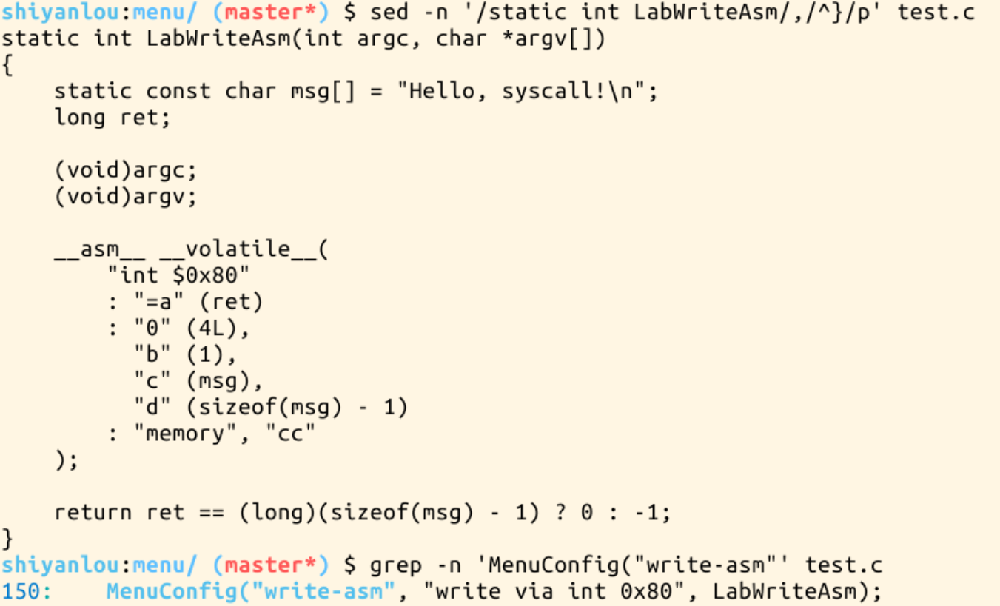

编译并打包独立 initramfs：

```bash
cd ~/LinuxKernel/menu
gcc -m32 -O0 -g -static -fno-pie -o init-write-lab linktable.c menu.c test.c -lpthread
file init-write-lab
mkdir -p ../rootfs-write-lab
cp init-write-lab ../rootfs-write-lab/init
cd ../rootfs-write-lab
find init | cpio -o -H newc | gzip -9 > ../rootfs-write-lab.img
```

`-m32` 生成 i386 程序，`-static` 使这个只有 `/init` 的小型文件系统不必再携带动态链接器和共享库。这里的 `-O0 -g` 针对用户程序；现有内核仍按其原配置编译，因此 GDB 在内核中显示 `<optimized out>` 是可能的。

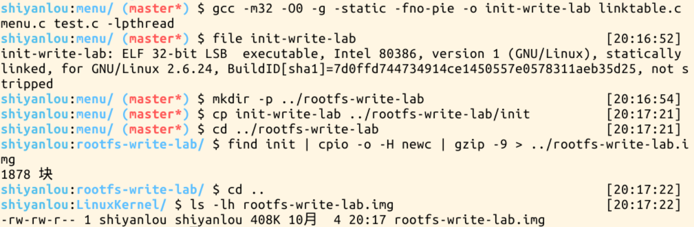

## 三、建立 QEMU 与 GDB 的调试连接

终端 A 启动 QEMU：

```bash
cd ~/LinuxKernel
qemu-system-i386 \
  -kernel linux-3.18.6/arch/x86/boot/bzImage \
  -initrd rootfs-write-lab.img \
  -smp 1 -S -gdb tcp:127.0.0.1:1234
```

`-S` 让客体 CPU 在启动时暂停，`-gdb` 开启远程调试接口。终端 B 加载与该内核匹配的符号：

```bash
cd ~/LinuxKernel
gdb linux-3.18.6/vmlinux
```

```gdb
set pagination off
set disassembly-flavor att
target remote 127.0.0.1:1234
break start_kernel
continue
list
```

断点成功停在 `init/main.c:501`。这说明调试连接及内核符号可用。

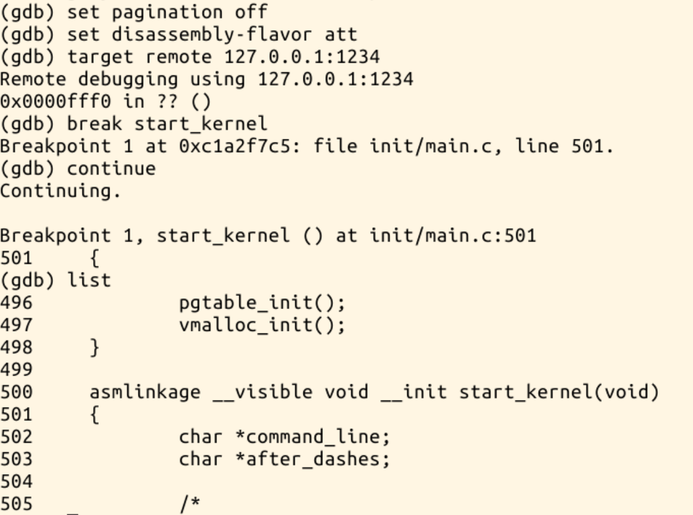

接着禁用启动断点，设置有条件的系统调用入口断点：

```gdb
disable 1
break *system_call if $eax == 4 && $ebx == 1 && $edx == 16 && *(unsigned int *)$ecx == 0x6c6c6548
continue
```

在 QEMU 的 `MenuOS>>` 提示符输入 `write-asm`。条件中的 `0x6c6c6548` 是小端序下字符串前四字节 `Hell` 的值，用于减少 MenuOS 自身输出产生的其他 write 调用干扰。

## 四、从用户态进入 system_call：保护现场

Linux 3.18.6 的 i386 初始化代码将 IDT 中的 `0x80` 向量与 `system_call` 入口关联。执行 `int $0x80` 时，CPU 根据门描述符进入内核；本次由 CPL 3 进入 CPL 0，使用内核栈，并在该栈中保存用于返回的用户 SS、ESP、EFLAGS、CS、EIP。这些字段从当前栈顶向高地址排列为 EIP、CS、EFLAGS、ESP、SS。

这只是当前任务的用户态／内核态转换，**不等于已经切换到另一个进程**。另外，本版本的 `0x80` 入口使用系统陷阱门，不能笼统认为 `int $0x80` 必然自动清除 IF；后面返回路径中的 `cli` 才是本实验明确观察到的关中断指令。

入口断点的实际结果如下：

| 寄存器 | 观察值 | 含义 |
| --- | --- | --- |
| EAX | `4` | i386 write 系统调用号 |
| EBX | `1` | 标准输出文件描述符 |
| ECX | `0x080ca98b` | 用户缓冲区地址 |
| EDX | `0x10`，即 16 | 写入字节数 |
| EIP | `0xc174d884` | `system_call` 入口 |
| ESP | `0xc7859fe4` | 此时的内核栈指针 |
| CS／SS | `0x60`／`0x68` | 当前已在内核态；CS 低两位为 0 |

`x/s $ecx` 显示 `"Hello, syscall!\n"`，参数与用户程序一致。

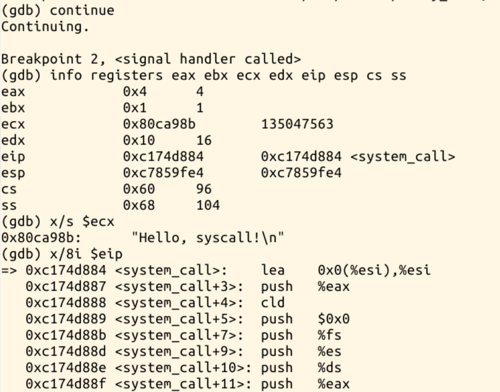

入口主干可以按以下顺序理解，代码是根据教材所列 Linux 3.18.6 代码及本次反汇编提取的节选，省略了部分宏和配置分支：

```asm
ENTRY(system_call)
    ASM_CLAC
    pushl_cfi %eax                   # 保存 orig_eax
    SAVE_ALL                        # 保存其余现场
    GET_THREAD_INFO(%ebp)
    testl $_TIF_WORK_SYSCALL_ENTRY,TI_flags(%ebp)
    jnz syscall_trace_entry
    cmpl $(NR_syscalls),%eax
    jae syscall_badsys
syscall_call:
    call *sys_call_table(,%eax,4)
syscall_after_call:
    movl %eax,PT_EAX(%esp)
```

`RING0_INT_FRAME` 等标注用于汇编／调试展开信息，不应当误认为是实际压栈指令。`ASM_CLAC` 是与 SMAP 有关的入口处理；本次对应位置显示为 `lea 0x0(%esi),%esi`，可视作不改变寄存器值的占位指令。随后 `push %eax` 保存原系统调用号，`SAVE_ALL` 包括清除方向标志、保存通用寄存器与段寄存器状态等工作，形成 `pt_regs` 布局。用户态 EBP 也已保存，当前 EBP 可改用于保存 `thread_info` 地址。

入口跟踪、审计等工作通过 `_TIF_WORK_SYSCALL_ENTRY` 判断。有相应标志时走 `syscall_trace_entry`，由 `syscall_trace_enter` 处理，再使用其返回的调用号决定是否分派。本次记录的是有效 write 的普通分派路径。普通路径使用无符号比较检查调用号；超出范围则走 `syscall_badsys`，以 `-ENOSYS` 作为错误结果。

## 五、系统调用表分派与参数如何交给 C 函数

在 `syscall_call` 处停止：

```gdb
disable 2
tbreak *syscall_call
continue
set $lab_regs = $esp
set $lab_ti = $ebp
info registers eax ebp esp
x/4i $eip
x/3wx $esp
```

实际得到 EAX=4、EBP=`0xc7858000`、ESP=`0xc7859fb4`。此时 EBP 指向当前任务的 `thread_info`，ESP 指向保存的 `pt_regs`。栈顶三个 32 位数依次为 `1`、`0x080ca98b`、`16`。

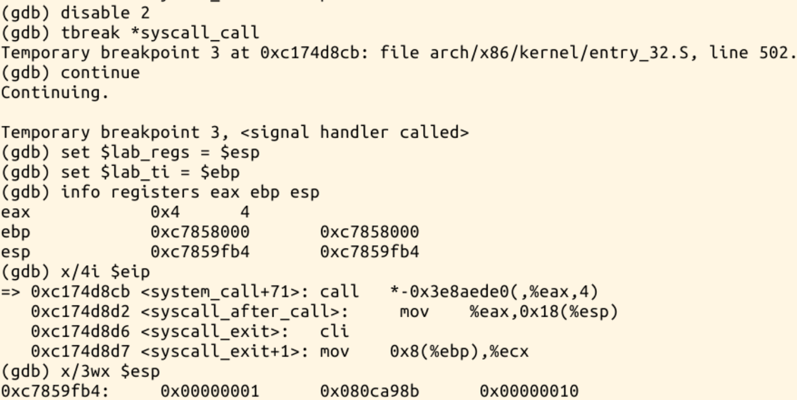

分派指令 `call *sys_call_table(,%eax,4)` 是一次间接调用：每个 i386 表项为 4 字节，取出 `sys_call_table + EAX*4` 处的函数指针，再调用它。乘以 4 是表项大小，不是参数个数，也不是调用号本身的固定值。

```gdb
set $write_entry = ((unsigned int *)&sys_call_table)[4]
p/x $write_entry
info symbol $write_entry
tbreak *$write_entry
continue
info args
x/s (char *)buf
```

本次第 4 项为 `0xc112b7d0`，符号查询显示 `sys_write`，命中后 GDB 显示 `SyS_write`，源码位置为 `fs/read_write.c:577` 的 `SYSCALL_DEFINE3(write, ...)`。两个名称与该宏生成的入口／别名有关，本次是通过表项地址确认调用目标，并非按显示名称猜测。

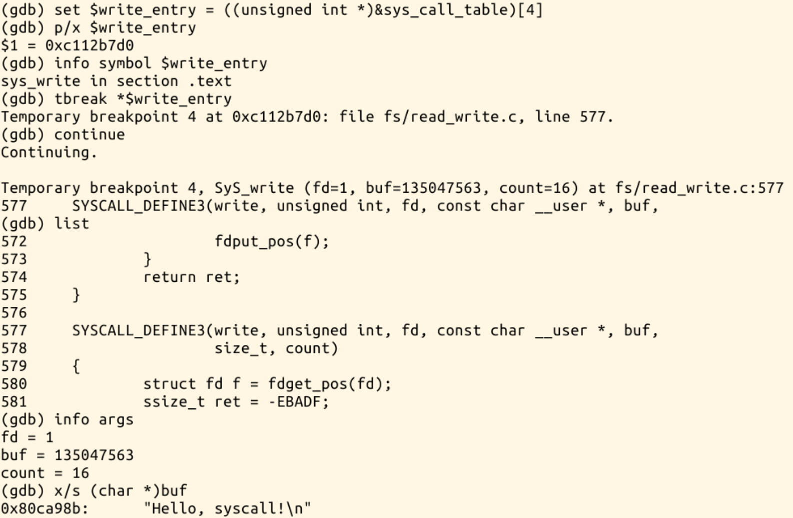

用户态系统调用 ABI 用寄存器传参，而该 i386 内核的 `asmlinkage` 系统调用入口按照栈参数约定接收参数。`SAVE_ALL` 已把 EBX、ECX、EDX 保存为相邻栈槽；`call` 再压入返回地址，使入口函数能够把这三个槽位作为 fd、buf、count 读取。因此参数从用户寄存器进入保存的内核栈，再交给 C 入口，不需要在分派前另行逐个 `push` 参数。

与本次 write 有关的 `pt_regs` 布局为：

| 相对 `$lab_regs` 的偏移 | 字段 | 本次含义／值 |
| --- | --- | --- |
| `0x00` | EBX | fd=1 |
| `0x04` | ECX | buf=`0x080ca98b` |
| `0x08` | EDX | count=16 |
| `0x0c`、`0x10`、`0x14` | ESI、EDI、EBP | 其余用户通用寄存器 |
| `0x18` | EAX | 后续写入系统调用返回值 |
| `0x1c`、`0x20`、`0x24` | DS、ES、FS | 保存的段寄存器槽位 |
| `0x28` | GS 槽位 | 本机启用 LAZY_GS，该槽位为占位 |
| `0x2c` | orig_eax | 原始系统调用号 4 |
| `0x30`、`0x34`、`0x38` | EIP、CS、EFLAGS | 用户态返回现场 |
| `0x3c`、`0x40` | 用户 ESP、SS | 跨特权级返回时恢复 |

## 六、write 执行与返回值保存

本机源码显示，write 先通过 `fdget_pos(fd)` 获取文件对象，默认返回值为 `-EBADF`；描述符有效时读取文件位置，调用 `vfs_write(f.file, buf, count, &pos)`，成功后更新位置并释放引用，最终返回实际写入字节数。

```gdb
list 577,592
tbreak vfs_write
continue
info args
```

命中 `vfs_write` 时，file=`0xc7a1b000`、buf=`0x080ca98b`、count=16、pos=`0xc7859f98`，再次证明缓冲区和长度沿调用链传递正确。`buf` 带有 `__user` 语义，表示它来自用户地址空间；内核和具体写入实现需要按用户内存访问规则处理它。

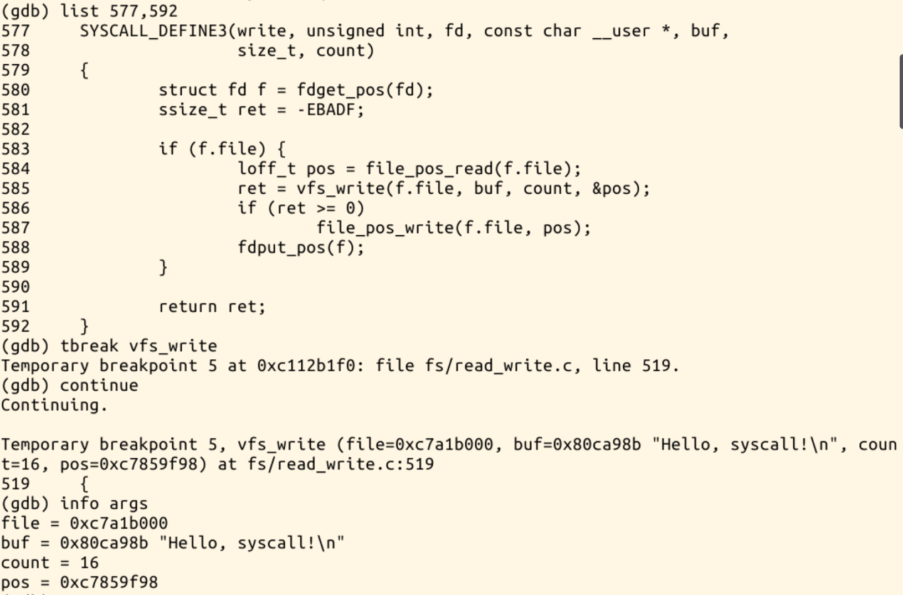

执行 `finish` 后，GDB 显示 `vfs_write` 返回 **16**。随后停在 `syscall_after_call`：

```gdb
finish
tbreak *syscall_after_call
continue
info registers eax esp
x/i $eip
si
x/wd $lab_regs+0x18
x/wd $lab_regs+0x2c
```

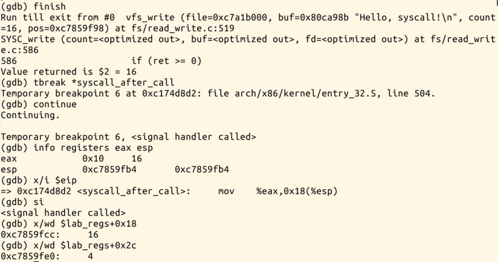

`0xc174d8d2` 处的 `mov %eax,0x18(%esp)` 将 16 写入地址 `0xc7859fcc`。地址 `0xc7859fe0` 的 `orig_eax` 仍为 4。入口时的 EAX 表示“要调用哪个服务”，返回时的 EAX 表示“服务结果”，因此必须把结果写回保存现场中的 EAX 槽位，否则恢复现场时会恢复错误的值。

这里的 16 是内核原始返回值。若内核返回错误，原始结果通常是负的错误码；上一实验中的 libc 封装还会把它转换为 `-1` 并设置 `errno`，这不是本次 `iret` 自身完成的工作。

## 七、iret 之前：退出检查与进程调度时机

系统调用 C 函数返回，并不意味着马上执行 `iret`。本机的退出主干为：

```asm
syscall_exit:
    cli
    mov 0x8(%ebp),%ecx
    test $0x1008feff,%ecx
    jne syscall_exit_work
restore_all_notrace:
    # 返回栈与 ESPFIX 相关检查，随后恢复寄存器
```

`cli` 关闭本 CPU 的可屏蔽中断，接着读取 `thread_info.flags`。这样可避免在采样标志与完成返回之间，被本 CPU 上的中断设置新的返回工作却错过检查。随后用 `_TIF_ALLWORK_MASK` 检查是否有待处理工作。本机编译出的掩码为 `0x1008feff`，不应脱离该版本和配置把它当作通用常数。

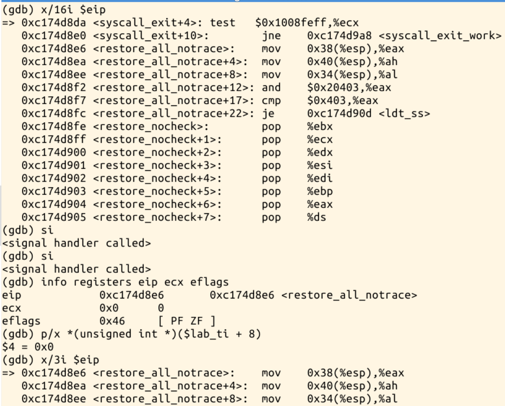

本次实际观察到 ECX=0、`thread_info.flags=0`，两条单步执行了截图中的 `test` 和 `jne`，EIP 到达 `0xc174d8e6 <restore_all_notrace>`，说明**本次未进入退出工作和退出调度分支**。此处检查只证明退出时没有待处理请求，不能据此断言整个 write 的内部绝对没有发生调度。

虽然本次没有执行调度分支，但反汇编清楚展示了它的工作方式：

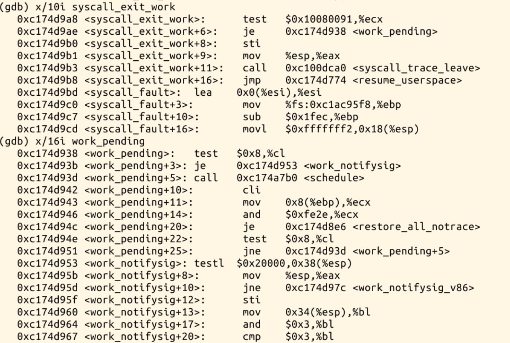

`syscall_exit_work` 首先检查 `_TIF_WORK_SYSCALL_EXIT`；若需要退出跟踪，则开启中断调用 `syscall_trace_leave`，之后进入 `resume_userspace` 重新检查普通返回工作。否则直接进入 `work_pending`。因此，“进入 syscall_exit_work”也不等于“一定调用 schedule”。

本机 `work_pending` 的关键指令如下，节选只保留调度循环：

```asm
work_pending:
    test $0x8,%cl
    je work_notifysig
    call schedule
    cli
    mov 0x8(%ebp),%ecx
    and $0xfe2e,%ecx
    je restore_all_notrace
    test $0x8,%cl
    jne work_pending+5
```

`0x8` 对应 `_TIF_NEED_RESCHED`。设置该位时，返回用户态前调用 `schedule`，这是一处明确的调度检查点。调度可能让其他可运行任务执行，但一次调用 `schedule` 并不必然换到不同任务。原任务再次获得 CPU 后，仍从自己的内核调用链继续退出检查。

调度返回后，代码再次 `cli`、重新读取 flags，并使用 `_TIF_WORK_MASK`（本机为 `0xfe2e`）筛选普通返回工作：没有工作则恢复现场；仍需要调度则再次调用 `schedule`；还有信号或恢复通知等工作则进入 `work_notifysig`。对普通用户态返回，相关代码开启中断调用 `do_notify_resume`，再回到 `resume_userspace` 继续检查。这里重新检查的是普通返回工作，不能在流程图中把已处理的退出跟踪标志无条件重复处理。

另外，write 运行在进程上下文，具体写入操作在允许睡眠的条件下也可能等待资源并发生调度。这与本节讨论的“系统调用退出前因 NEED_RESCHED 而调度”是不同位置的调度机会。

## 八、恢复现场与 iret：五个字段的逐项验证

恢复路径还包含针对特殊返回栈的 ESPFIX 检查。本次走普通返回路径。`RESTORE_REGS 4` 恢复保存的通用寄存器和段寄存器，并跳过 `orig_eax`，最终让 ESP 指向硬件返回框架。到达 `irq_return` 时，实际指令为 `iret`：

```gdb
tbreak *irq_return
continue
x/i $eip
info registers eax eip esp cs ss eflags
x/5wx $esp
```

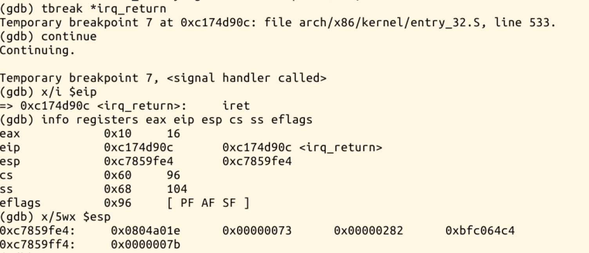

此时 EIP=`0xc174d90c`、ESP=`0xc7859fe4`、CS=`0x60`、SS=`0x68`，仍在内核态，EAX 已恢复为 16。栈中五个返回字段为：

| 栈地址 | 值 | iret 恢复的字段 |
| --- | --- | --- |
| `0xc7859fe4` | `0x0804a01e` | 用户 EIP |
| `0xc7859fe8` | `0x00000073` | 用户 CS |
| `0xc7859fec` | `0x00000282` | 用户 EFLAGS |
| `0xc7859ff0` | `0xbfc064c4` | 用户 ESP |
| `0xc7859ff4` | `0x0000007b` | 用户 SS |

执行 `si` 单步越过 `iret` 后：

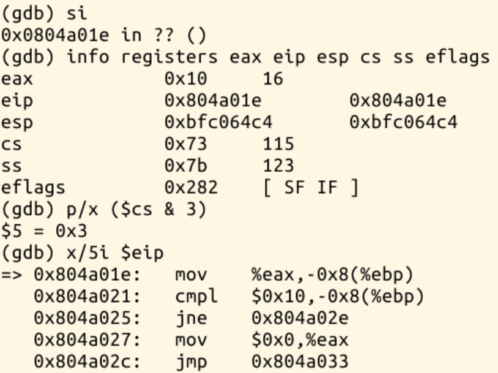

| 项目 | iret 前 | iret 后 |
| --- | --- | --- |
| EIP | `0xc174d90c` | `0x0804a01e` |
| ESP | `0xc7859fe4` | `0xbfc064c4` |
| CS | `0x60`，CPL=0 | `0x73`，CPL=3 |
| SS | `0x68` | `0x7b` |
| EFLAGS | `0x96`，IF=0 | `0x282`，IF=1 |
| EAX | 16 | 16 |

恢复后的地址和段寄存器与返回栈逐项一致，`$cs & 3` 的结果为 3。`iret` 恢复的是保存的用户 EFLAGS，不是保留退出检查期间产生的内核条件码。EAX 已由前面的恢复代码取回，`iret` 并不额外从该五字段框架中恢复 EAX。

用户态当前指令为 `mov %eax,-0x8(%ebp)`，随后与 `0x10` 比较，正好对应处理函数保存和检查返回值的 C 代码。GDB 显示 `??` 是因为只加载了 vmlinux，没有加载用户程序符号。入口处的 `<signal handler called>` 也是调试器对特殊栈框架的展开显示，不能据此认定程序执行了用户信号处理函数；断点地址、指令和寄存器才是此次判断路径的依据。

继续运行后，QEMU 输出字符串并恢复 MenuOS 提示符：


## 九、简要流程图

下图限定为 **原生 i386、有效 write、无系统调用入口／退出跟踪的路径**，并补充返回前可能发生的调度和通知处理。蓝色是本次实际经过的路径，橙色是本次未执行、通过代码分析的分支。无效调用号、跟踪／过滤、VM86、ESPFIX 和返回故障分支已在正文说明或作为特殊配置路径省略。

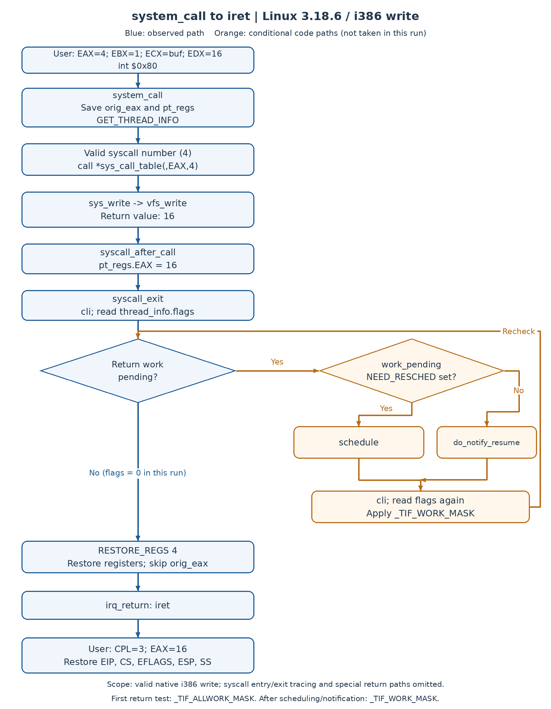

图中的首次返回检查使用 `_TIF_ALLWORK_MASK`；调度或通知处理之后，重新读取 flags 并使用 `_TIF_WORK_MASK`。图中“Return work pending?”统一表示相应阶段的检查，不表示循环重新执行首次退出跟踪检查。完整可编辑流程见 `flowchart.mmd`，矢量图见 `flowchart.svg`。

本次实际路径可概括为：`system_call → syscall_call → sys_write → vfs_write → syscall_after_call → syscall_exit → restore_all_notrace → restore_nocheck → irq_return / iret → 用户态`。

## 十、总结：从系统调用推广到一般中断

通过这次实验，我把系统调用处理理解为一个有明确入口和返回契约的过程：用户程序按 ABI 准备调用号和参数，CPU 完成受控的特权级转换，入口汇编保存现场并建立内核能够使用的上下文；内核通过系统调用表执行服务，将结果写回保存的返回寄存器；退出路径处理当前任务的调度请求、信号和恢复通知，最后恢复现场并通过 `iret` 回到用户程序的后续指令。

`sys_write` 的 `return` 只是服务函数执行完毕。是否立即返回用户态，还要由退出标志和返回路径决定。本次 flags 为 0，因此直接恢复现场；反汇编中的条件分支则说明，有 NEED_RESCHED 时返回前可以调度，调度后必须再次检查，不能把 `iret` 当作每次系统调用 C 函数返回后的无条件下一步。

这一思路可以推广为一般中断处理的共同框架：保存被打断的执行现场，进入对应处理逻辑，处理允许在返回边界完成的工作，再恢复适当的执行上下文。不过，各类事件的触发方式和执行约束不同，不能将它们完全等同：

| 比较项 | 本实验的系统调用 | 一般硬件中断／异常 |
| --- | --- | --- |
| 触发方式 | 用户程序同步执行 `int $0x80` | 硬件中断通常异步；异常通常由当前指令触发 |
| 入口选择 | `0x80` 门进入统一入口，再按调用号分派 | 根据中断／异常向量选择入口，未必有系统调用号 |
| 栈与特权级 | 本次 CPL 3→0，切换至内核栈，返回时 CPL 0→3 | 若打断的是内核态，并不一定发生同样的跨级栈切换 |
| 是否可睡眠 | 系统调用在进程上下文，条件允许时可阻塞 | 硬中断上下文不能像普通进程上下文那样任意睡眠 |
| 返回前调度 | 本版本在允许的返回路径检查 NEED_RESCHED | 需结合返回用户态／内核态、抢占配置及当前上下文判断 |

这里的 `int $0x80` 是软件触发的同步入口，不是 Linux 用于延后处理中断工作的 `softirq` 子系统。也不是每次中断都会导致进程切换：特权级转换、现场保存和任务调度是相关但不同的概念。

最直接的证据是本次 `iret` 前后五个字段完全对应，返回值 16 保持不变，用户代码继续比较该返回值，并恢复 MenuOS 提示符。这使“保护现场—执行服务—检查返回工作—恢复现场”的过程从抽象流程变成了可逐项核对的实验结果。
