> **事后重建的原稿代理：**未保留本轮真实 AI 原稿。以下复制现存作业以便核对内容，不能作为当时未修改的 AI 输出证据。

# 分析 Linux 内核创建一个新进程的过程

**作者：李令琪**  

**原创作品转载请注明出处**

**《Linux 内核分析》MOOC 课程 [http://mooc.study.163.com/course/USTC-100002900](http://mooc.study.163.com/course/USTC-100002900)**

## 一、实验环境与材料说明

实验目录为 `~/LinuxKernel`，内核镜像位于 `linux-3.18.6` 目录。`file` 的输出确认 `vmlinux` 是 **32 位 Intel 80386 ELF 文件**，没有被剥离符号；环境中存在 `gdb` 和 `qemu-system-i386`。

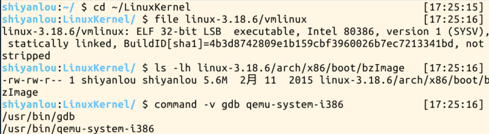

*图 1：`file linux-3.18.6/vmlinux`、内核启动镜像及 GDB、QEMU 工具检查。本文的寄存器名称、栈偏移和汇编路径均按 32 位 x86 分析。*

| 项目 | 本次材料中的信息 |
| --- | --- |
| 实验环境 | 实验楼 Linux 虚拟机环境，终端用户为 `shiyanlou` |
| 内核目录与符号文件 | `~/LinuxKernel/linux-3.18.6/vmlinux` |
| 启动镜像 | `linux-3.18.6/arch/x86/boot/bzImage` |
| 目标架构 | 32 位 x86，即 i386 |
| 用户态测试程序 | menu 程序中的 `fork-lab` 命令，处理函数为 `LabForkProcess` |
| 根文件系统镜像 | `rootfs-fork-lab.img`，包含作为 `/init` 运行的测试程序 |
| 调试方式 | GDB 跟踪 QEMU 中的内核执行现场 |
| 本次内核栈大小 | GDB 得到 `sizeof(union thread_union) = 8192` 字节 |

题目指定阅读 [Linux v3.18-rc6 的 `task_struct`](https://github.com/torvalds/linux/blob/v3.18-rc6/include/linux/sched.h#L1235)，实验截图使用的是 `linux-3.18.6` 目录。对这两个源码版本的关键文件进行核对后，本文涉及的任务结构、进程创建、32 位上下文准备和返回汇编实现一致；调度部分的具体行号按 [v3.18.6 的源码](https://github.com/gregkh/linux/blob/v3.18.6/kernel/sched/core.c)说明。

## 二、理解 task_struct：新进程需要哪些内核信息

`task_struct` 是内核描述一个可调度任务的核心结构。它既记录任务的身份、状态和调度信息，也通过指针关联地址空间、文件、信号等资源，并包含体系结构相关的执行上下文。在 Linux 中，每个线程也有自己的任务结构，不能简单把一个 `task_struct` 等同于一个多线程进程的全部信息。

本次实验首先查看了 `include/linux/sched.h` 中结构体的开头：

```bash
sed -n '1235,1268p' linux-3.18.6/include/linux/sched.h
```

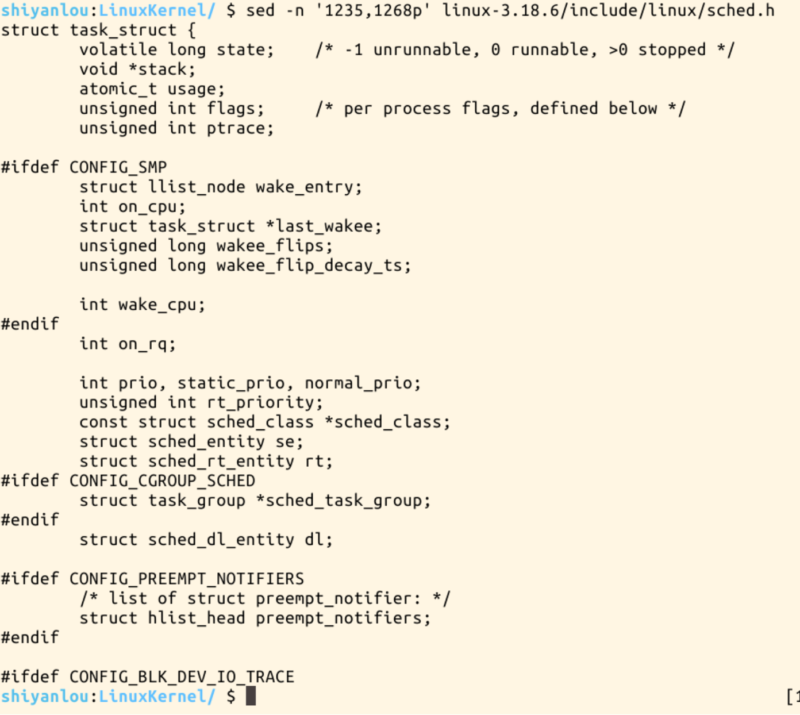

*图 2：结构体开头包含 `state`、`stack`、`usage`、`flags`，以及调度相关字段。截图只展示了结构体的一部分，下面结合完整源码解释与进程创建直接相关的成员。*

| 字段 | 含义及在本次实验中的作用 |
| --- | --- |
| `state` | 任务状态；`TASK_RUNNING` 为 0，表示正在运行或可以运行，还需结合是否入队理解实际调度状态 |
| `stack` | 指向任务的内核栈分配区域；本次 32 位实现中该区域低地址处放置 `thread_info` |
| `usage` | 任务结构的引用计数，关系到其生命周期 |
| `flags` | 任务属性，如区分普通用户任务与内核线程 |
| `prio`、`sched_class`、`se` 等 | 优先级、调度类和调度实体，创建时需要进行调度初始化 |
| `pid`、`tgid` | 任务 ID 与线程组 ID；本次创建独立子进程，完成初始化后二者相等 |
| `real_parent`、`parent` | 父任务关系；调试等情况下二者的含义可能有区别，本实验检查的是 `real_parent` |
| `children`、`sibling` | 组织进程之间的父子关系 |
| `mm`、`active_mm` | 用户地址空间及调度时使用的内存管理上下文 |
| `files`、`fs`、`sighand`、`signal` | 文件、文件系统环境及信号资源；是否复制或共享取决于创建标志 |
| `thread` | 体系结构相关的上下文；本次重点检查 `thread.sp`、`thread.sp0`、`thread.ip` |

这些字段说明，创建新进程不能只做一次结构体拷贝。复制父任务可以作为初始化的起点，但子进程必须拥有正确的身份、父子关系、资源引用、调度状态和首次执行现场。字段定义可对照 [v3.18-rc6 的 `sched.h`](https://github.com/torvalds/linux/blob/v3.18-rc6/include/linux/sched.h#L1235)。

## 三、从 fork 到 sys_clone：创建新进程的内核路径

### 3.1 用户态 fork 与内核 clone 入口的关系

`fork()` 是用户程序调用的接口，不能仅凭它的名称就认定本次执行一定进入名为 `sys_fork` 的入口。本次截图中，系统调用编号为 **120，即 i386 的 `clone`**，GDB 也实际停在 `SyS_clone`。因此，本次测试的 `fork()` 通过 `clone` 系统调用进入内核，再由公共的创建逻辑完成具有 `fork` 语义的子进程创建。编号可对照 [i386 系统调用表](https://github.com/torvalds/linux/blob/v3.18-rc6/arch/x86/syscalls/syscall_32.tbl#L129)。

GDB 中出现的 `SyS_clone`、`SYSC_clone` 是系统调用宏展开相关的符号名称；本文在讨论系统调用时沿用题目中的 `sys_clone`。

本实验的主要路径可以概括为：

```text
用户程序 fork()
    ↓
clone 系统调用入口：sys_clone / SyS_clone
    ↓
do_fork
    ↓
copy_process
    ├─ dup_task_struct：分配任务结构和独立内核栈
    ├─ 初始化调度、复制或共享资源
    ├─ copy_thread：准备首次运行的栈与寄存器现场
    └─ 分配 PID，建立父子关系，登记新任务
    ↓
wake_up_new_task：使子进程进入运行队列
    ├─ 父进程沿自己的系统调用路径返回子进程 PID
    └─ 调度器选择子进程后，子进程首次从 ret_from_fork 执行
```

这里的 `copy_process` 和 `copy_thread` 都在发起系统调用的父进程上下文中执行。`wake_up_new_task` 使新任务可以参与调度，具体哪一刻运行由调度器决定，父子进程的先后顺序也不是 `fork` 保证的。源码路径见 [`kernel/fork.c`](https://github.com/torvalds/linux/blob/v3.18-rc6/kernel/fork.c#L1623)和 [`wake_up_new_task`](https://github.com/gregkh/linux/blob/v3.18.6/kernel/sched/core.c#L2116)。

### 3.2 各层函数如何创建和修改任务结构

`sys_clone` 主要把参数传递给 `do_fork`。本次源码中入口的核心调用为：

```c
return do_fork(clone_flags, newsp, 0, parent_tidptr, child_tidptr);
```

`do_fork` 组织整个创建过程：调用 `copy_process`，成功后取得子进程 PID、唤醒新任务，并向父进程返回该 PID。`copy_process` 则负责具体创建工作。

| 创建阶段 | 对新任务的主要处理 |
| --- | --- |
| 参数和资源限制检查 | 检查标志组合、权限和任务数量等条件，失败时终止创建 |
| `dup_task_struct(current)` | 分配新 `task_struct` 和内核栈，以父任务的信息初始化，再把新任务的 `stack` 指向自己的栈 |
| 任务字段初始化 | 重新初始化链表、锁、待处理信号、运行时间统计等，避免把父任务的运行历史直接当成子任务的状态 |
| `sched_fork` | 初始化调度实体、优先级等；本版本设置 `TASK_RUNNING`，此时新任务尚未由 `wake_up_new_task` 入队 |
| 资源处理 | 根据 `clone_flags` 处理文件、信号、地址空间、命名空间等资源 |
| `copy_thread` | 在新任务内核栈上准备 `pt_regs`，设置内核栈指针和首次执行位置 |
| 身份与关系登记 | 分配 PID，设置 `tgid`、`group_leader`、`real_parent`，建立任务之间的关系 |
| 返回 `do_fork` | 返回创建成功的任务指针，再由 `do_fork` 调用 `wake_up_new_task` |

其中，`dup_task_struct` 建立了新的任务结构和栈，但其后仍需逐项调整资源和身份，不能认为返回时所有字段已经具有最终值。相关顺序可对照 [`dup_task_struct`](https://github.com/torvalds/linux/blob/v3.18-rc6/kernel/fork.c#L305)、[`copy_process`](https://github.com/torvalds/linux/blob/v3.18-rc6/kernel/fork.c#L1182)与 [`sched_fork`](https://github.com/gregkh/linux/blob/v3.18.6/kernel/sched/core.c#L1915)。

普通 `fork` 没有设置 `CLONE_VM`，会建立独立的内存管理结构。这也不意味着立即完整复制所有用户物理页：私有可写映射通常通过写时复制，即 COW，在写入时再分离相应页面。文件描述符表可以独立，而表项引用的打开文件对象仍可共享。后文的 GDB 截图直接验证的是父子 `mm` 指针不同，**没有直接验证所有物理页的复制或写时复制触发过程**。资源处理可对照 [`copy_mm` 等函数](https://github.com/torvalds/linux/blob/v3.18-rc6/kernel/fork.c#L885)和 [`copy_page_range`](https://github.com/torvalds/linux/blob/v3.18-rc6/mm/memory.c)。

## 四、GDB 跟踪：从系统调用入口到新任务创建完成

### 4.1 准备用户程序与根文件系统

截图显示，menu 程序已经包含 `fork_lab_handler.h`，并注册命令：

```c
MenuConfig("fork-lab", "fork and wait for child", LabForkProcess);
```

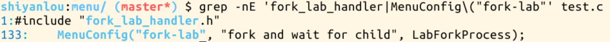

*图 3：`test.c` 中的头文件引用与命令注册。截图未提供 `LabForkProcess` 的完整函数体，本文不把自行补写的示例程序当成实际测试源码。*

随后，在 menu 目录编译 32 位静态程序，并制作只包含 `init` 的根文件系统镜像。以下命令按截图整理：

```bash
gcc -m32 -O0 -g -static -fno-pie -o init-fork-lab linktable.c menu.c test.c -lpthread
file init-fork-lab
mkdir -p ../rootfs-fork-lab
cp init-fork-lab ../rootfs-fork-lab/init
cd ../rootfs-fork-lab
find init | cpio -o -H newc | gzip -9 > ../rootfs-fork-lab.img
cd ..
ls -lh rootfs-fork-lab.img
```

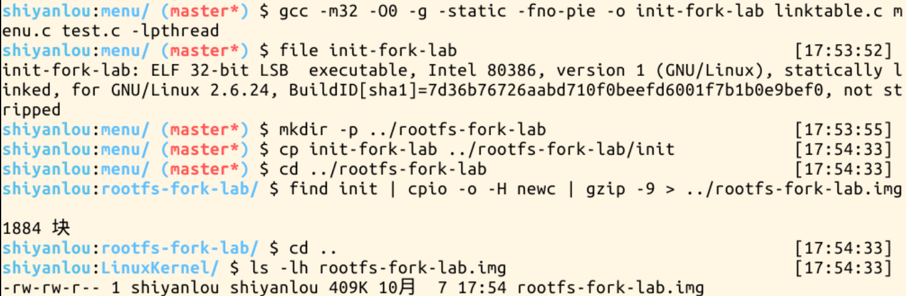

*图 4：`init-fork-lab` 为 32 位静态 ELF，生成的 `rootfs-fork-lab.img` 约为 409K。这里的 `-O0 -g` 用于用户态测试程序，不能据此认为内核也关闭了编译优化。*

材料没有保留 QEMU 启动和 GDB 连接的完整命令；后续实际断点现场证明已进入内核调试。为便于理解环境，下面给出与材料中镜像路径一致的**复现示例**，不把它记为截图中原样执行过的命令：

```bash
# 在 ~/LinuxKernel 中启动 QEMU，等待调试器连接
qemu-system-i386 -kernel linux-3.18.6/arch/x86/boot/bzImage \
  -initrd rootfs-fork-lab.img -append "rdinit=/init" -s -S

# 在另一个终端加载与启动镜像对应的内核符号文件
gdb linux-3.18.6/vmlinux
```

```gdb
target remote :1234
```

### 4.2 确认关键函数符号

GDB 查询到了下列地址，并通过 `start_kernel` 断点验证内核执行已经可以被调试器控制。

| 符号 | 本次地址 |
| --- | --- |
| `sys_clone` / `SyS_clone` | `0xc1042c60` |
| `do_fork` | `0xc10428b0` |
| `copy_process` | `0xc10412c0` |
| `copy_thread` | `0xc10010b0` |
| `ret_from_fork` | `0xc174d700` |

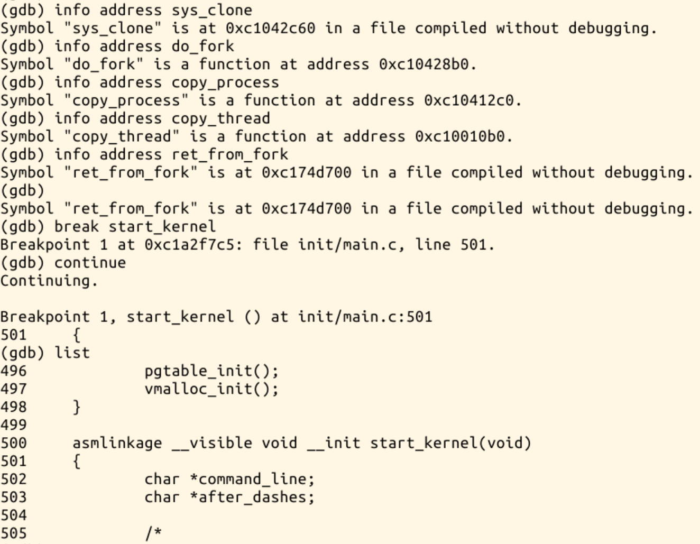

*图 5：关键符号地址和 `start_kernel` 的源码现场。个别别名或汇编符号提示没有调试信息，但仍可用地址断点和指令检查进行分析。*

跟踪时，应先让内核启动完成，再在用户程序触发 `fork-lab` 时跟踪目标系统调用，避免把启动阶段创建内核线程的过程混入本次用户进程实验。截图中保留的入口条件为 `($ebx & 0xff) == 17`，可筛选带 `SIGCHLD` 的创建请求，但该条件本身不能唯一识别某一次测试。

### 4.3 在 sys_clone 入口检查参数

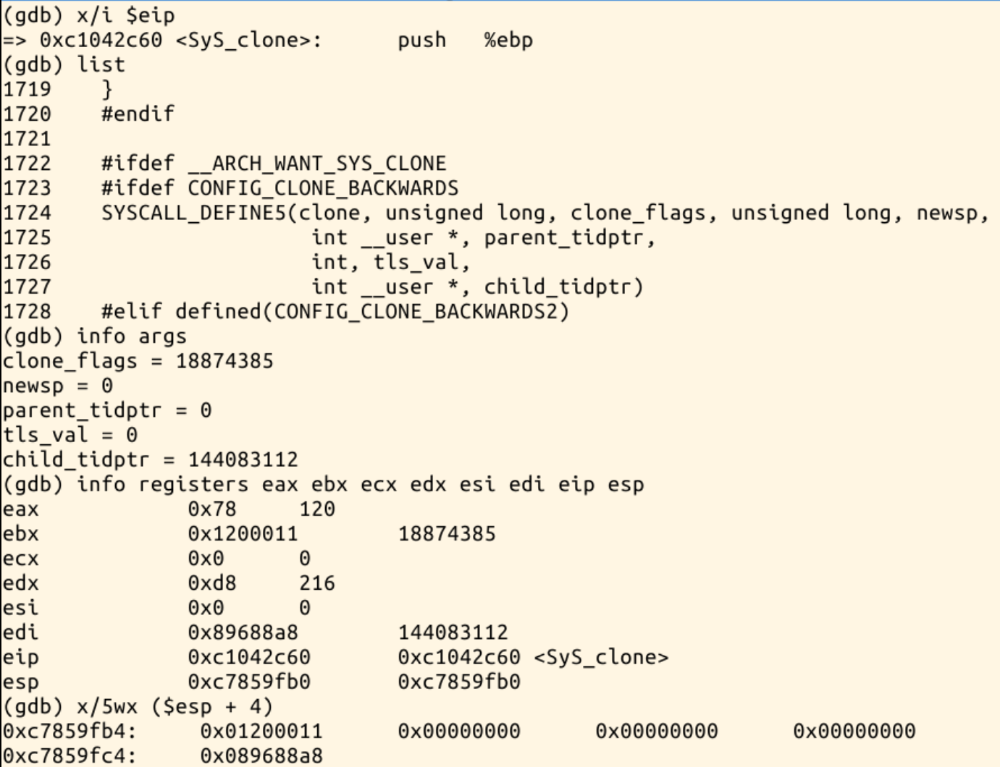

*图 6：`x/i $eip` 指向 `SyS_clone`，`info args` 与栈内存共同显示本次请求的参数。*

关键观察结果如下：

```text
clone_flags = 18874385 = 0x01200011
newsp = 0
parent_tidptr = 0
tls_val = 0
child_tidptr = 0x089688a8
EAX = 0x78 = 120
EIP = 0xc1042c60 <SyS_clone>
ESP = 0xc7859fb0
```

标志值可以分解为：

```text
0x01200011
  = 0x01000000  CLONE_CHILD_SETTID
  | 0x00200000  CLONE_CHILD_CLEARTID
  | 0x00000011  SIGCHLD
```

它包含子任务 TID 设置与清除相关标志，以及退出信号 `SIGCHLD`，没有 `CLONE_VM` 和 `CLONE_THREAD`，与创建独立子进程的语义相符。标志定义见 [`include/uapi/linux/sched.h`](https://github.com/torvalds/linux/blob/v3.18-rc6/include/uapi/linux/sched.h#L6)。

需要注意，到了 C 函数入口后，实时寄存器不一定还完整保留用户态传入的所有原值。例如图中的实时 `EDX` 为 `0xd8`，而 `info args` 和栈上的 `parent_tidptr` 均为 0。判断内核函数接收到的参数，应结合调用约定、函数参数和栈内容，不应把当前寄存器值机械地当成原始参数。

### 4.4 验证 do_fork 与 copy_process 调用关系

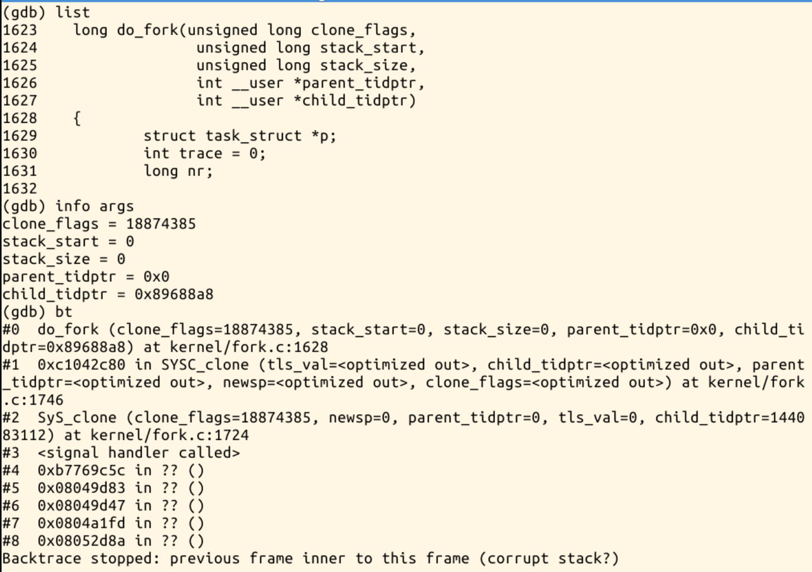

*图 7：`do_fork` 得到同一组创建标志，`stack_start = 0`、`stack_size = 0`，调用栈向上连接到 `SYSC_clone` 和 `SyS_clone`。*

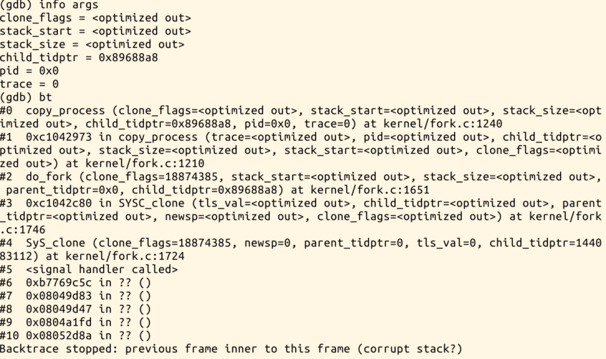

*图 8：进入 `copy_process` 后，调用栈连接到 `do_fork`。截图同时记录了 `<optimized out>` 和回溯终止提示，相关限制在第七节说明。*

这两张图与源码一致，验证了本次创建请求经过 `sys_clone → do_fork → copy_process`。图中的 `pid = 0x0` 是传给 `copy_process` 的 `struct pid *` 参数，不是最终子进程 PID 为 0。后续还要分配并登记新的 PID。

### 4.5 从父进程内核栈定位当前任务

在 `copy_process` 中，第一次尝试直接读取 `orig` 失败，因为它不是当前函数作用域中的变量。随后根据本次 8 KiB 对齐的内核栈定位 `thread_info`，再通过其中的 `task` 指针找到父任务。按截图整理的命令为：

```gdb
set $fork_stack_size = (unsigned long)sizeof(union thread_union)
set $fork_ti = (struct thread_info *)((unsigned long)$esp & ~($fork_stack_size - 1))
set $fork_parent = $fork_ti->task
p/x $fork_parent
p $fork_parent->comm
p $fork_parent->pid
p $fork_parent->tgid
p/x $fork_parent->stack
p $fork_parent->stack == (void *)$fork_ti
```

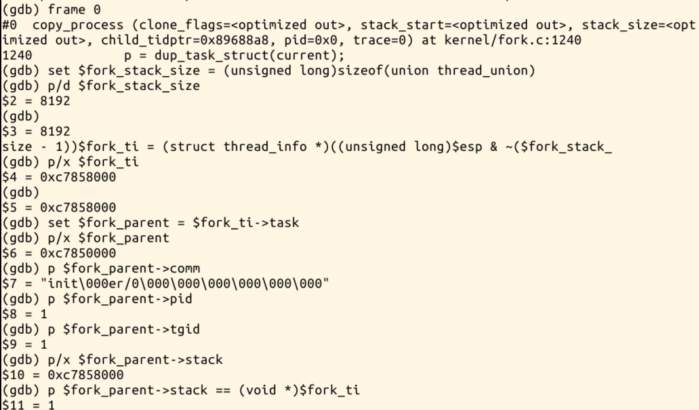

*图 9：栈大小为 8192，栈基址为 `0xc7858000`，由 `thread_info->task` 得到父任务地址 `0xc7850000`。*

实际结果为：

| 父任务信息 | 观察值 |
| --- | --- |
| `task_struct` 地址 | `0xc7850000` |
| `comm` 的有效名称 | `init`，以第一个 `\000` 结束 |
| `pid` / `tgid` | `1` / `1` |
| 内核栈基址 | `0xc7858000` |
| `stack == thread_info` 地址 | 比较结果为 `1` |

`comm` 是固定长度字符数组，GDB 展示了终止符之后的残留字节；有效名称应读到第一个 NUL，不能把后面的字符也当成任务名称。这里的栈地址对齐方法适用于本次旧版 32 位内核布局，不应直接套用到任意架构或新版内核。

### 4.6 验证子进程拥有独立的任务结构和内核栈

在 `dup_task_struct` 完成、`p` 已有效后，保存子任务指针并与父任务比较。

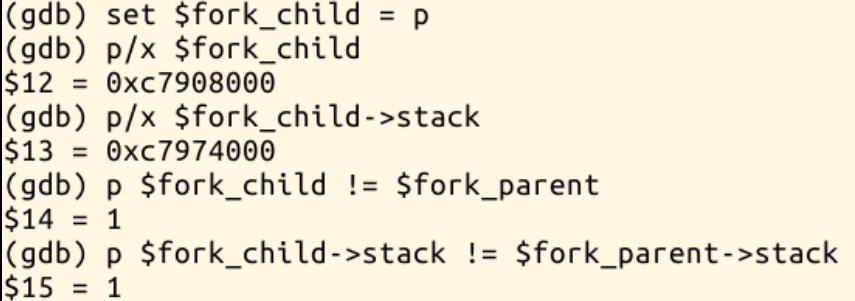

*图 10：子任务地址为 `0xc7908000`，内核栈基址为 `0xc7974000`；两次不等比较均返回 `1`。*

| 对象 | 父进程 | 子进程 |
| --- | --- | --- |
| `task_struct` 地址 | `0xc7850000` | `0xc7908000` |
| 内核栈基址 | `0xc7858000` | `0xc7974000` |

这些结果直接说明：子进程不是给父任务结构再增加一个名字，也不是继续使用父进程的同一份内核栈，而是已经获得独立的任务结构和栈分配区域。

### 4.7 检查 copy_thread 准备的首次运行现场

本次普通用户进程路径中，`copy_thread` 的关键操作是：

```c
p->thread.sp = (unsigned long)childregs;
p->thread.sp0 = (unsigned long)(childregs + 1);
*childregs = *current_pt_regs();
childregs->ax = 0;
p->thread.ip = (unsigned long)ret_from_fork;
```

`childregs` 位于子进程自己的内核栈中。其用户态寄存器现场从父进程的 `pt_regs` 复制而来，但返回值寄存器被改为 0。若调用者提供非零的新用户栈地址，源码还会修改 `childregs->sp`；本次 `sp = 0`，因此保留复制的用户栈指针。普通用户任务的首次入口是 `ret_from_fork`，内核线程则走 `ret_from_kernel_thread`，二者应区分。见 [`copy_thread` 的 32 位实现](https://github.com/torvalds/linux/blob/v3.18-rc6/arch/x86/kernel/process_32.c#L132)。

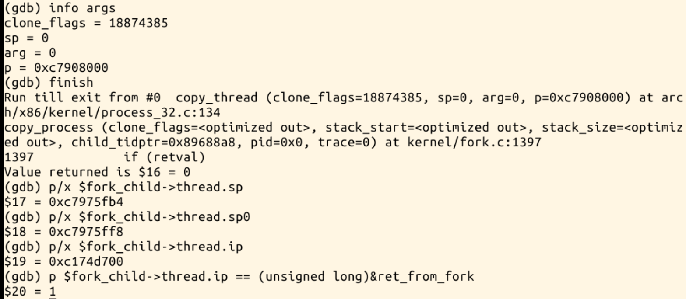

*图 11：`copy_thread` 返回 0，`thread.ip` 与 `ret_from_fork` 地址比较相等。函数返回 0 表示现场准备成功，与后来用户态 `fork()` 返回 0 是不同层次的结果。*

| 首次运行上下文 | 观察值 |
| --- | --- |
| `thread.sp` | `0xc7975fb4` |
| `thread.sp0` | `0xc7975ff8` |
| `thread.ip` | `0xc174d700`，即 `ret_from_fork` |
| `thread.ip == &ret_from_fork` | `1` |

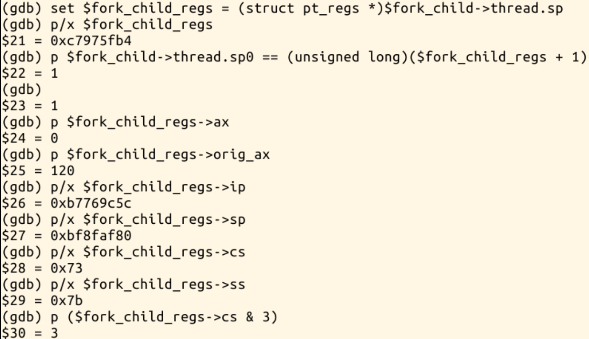

*图 12：从初始 `thread.sp` 得到子进程的 `pt_regs`，检查返回值、系统调用编号及用户态的 IP、SP、CS、SS。*

```text
childregs 地址 = 0xc7975fb4
childregs->ax = 0
childregs->orig_ax = 120
childregs->ip = 0xb7769c5c
childregs->sp = 0xbf8faf80
childregs->cs = 0x73
childregs->ss = 0x7b
(childregs->cs & 3) = 3
```

`ax` 保存将来恢复的返回值，`orig_ax` 记录原来的系统调用编号，二者不是同一用途。`cs` 的低两位为 3，表明保存的是用户态执行现场。

此时能够把 `thread.sp` 转成 `pt_regs *`，是因为它刚被 `copy_thread` 设置为首次运行现场的位置。任务以后发生调度切换时，`thread.sp` 会保存新的内核调度现场，不能始终把它当成 `pt_regs` 指针。后续观察应使用已经保存的 `childregs` 地址，或按本架构的 `task_pt_regs` 布局重新定位。

### 4.8 检查创建完成后的身份与资源关系

继续执行到 `copy_process` 返回 `do_fork` 后，检查子任务的最终身份及关系。

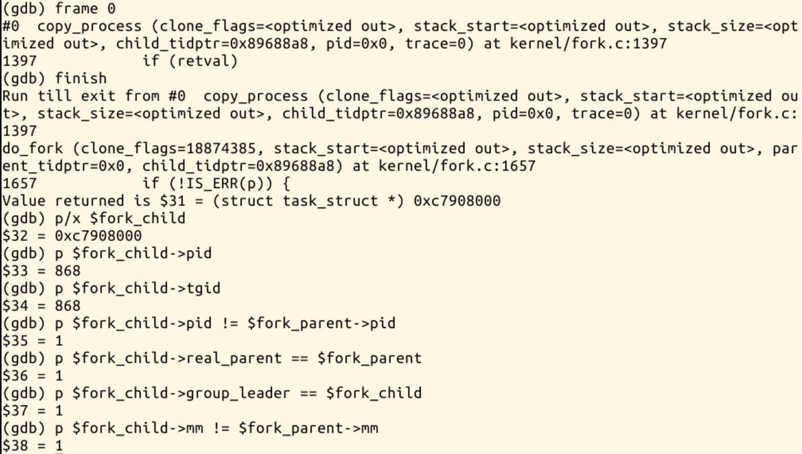

*图 13：这组创建记录的子进程 PID 为 868，父任务为 PID 1；子进程拥有独立线程组和不同的 `mm`。*

| 检查项 | 结果 | 能说明的问题 |
| --- | --- | --- |
| `child->pid` | `868` | 已获得新的任务身份 |
| `child->tgid` | `868` | 本次子进程的 PID 与线程组 ID 相等 |
| `child->pid != parent->pid` | `1` | 父子任务身份不同 |
| `child->real_parent == parent` | `1` | 正确建立实际父任务关系 |
| `child->group_leader == child` | `1` | 子任务是自己线程组的组长 |
| `child->mm != parent->mm` | `1` | 父子地址空间管理结构不同 |

这些观察对应源码中 PID 分配、非 `CLONE_THREAD` 分支和 `real_parent` 设置。它们应在 `copy_process` 完成后检查，而不应拿结构体刚复制时可能尚未重写的字段作为最终结论。

## 五、重点分析：执行起点与内核栈如何保证一致

### 5.1 两个执行位置分别解决什么问题

“子进程从哪里开始执行”需要区分内核态首次运行和返回用户态后继续运行。

| 执行阶段 | 执行位置 | 栈和现场来源 |
| --- | --- | --- |
| 首次被调度后，在内核中继续执行 | `thread.ip = ret_from_fork`，本次为 `0xc174d700` | 使用子进程的内核栈，初始 `thread.sp` 指向准备好的 `pt_regs` |
| 系统调用返回到用户态 | 恢复 `pt_regs->ip`，本次保存值为 `0xb7769c5c` | 同时恢复用户态 `SP`、`CS`、`SS`、标志和通用寄存器 |

因此，子进程第一次在内核中执行的是 `ret_from_fork`，返回用户态后继续的是父进程系统调用所保存的用户态后续路径。这个路径可能还包含系统调用返回桩和 C 库处理，不能把地址直接等同于 C 源码中 `fork()` 后的一条语句，也不能理解为重新从 `main()` 开始。

### 5.2 copy_thread 之后的子进程内核栈布局

本次子进程内核栈区域为：

```text
[0xc7974000, 0xc7976000)，总大小 0x2000 = 8192 字节
```

32 位 `pt_regs` 包含 17 个 4 字节字段，总大小为 `0x44`，即 68 字节。结合 `task_pt_regs` 的栈顶预留规则和本次地址，得到下列布局；图中的位置是根据源码字段顺序与截图数值整理的示意，并不是对整段内存逐字转储的截图。结构定义见 [`pt_regs`](https://github.com/torvalds/linux/blob/v3.18-rc6/arch/x86/include/asm/ptrace.h#L11)，定位规则见 [`task_pt_regs`](https://github.com/torvalds/linux/blob/v3.18-rc6/arch/x86/include/asm/processor.h#L885)。

```text
                    高地址
0xc7976000  ┌──────────────────────────────────────┐  分配区域末端
            │ 栈顶预留 8 字节                      │
0xc7975ff8  ├──────────────────────────────────────┤  thread.sp0
0xc7975ff4  │ ss       = 0x7b                      │
0xc7975ff0  │ sp       = 0xbf8faf80（用户栈指针）   │
0xc7975fec  │ flags    = 保存的用户态标志          │
0xc7975fe8  │ cs       = 0x73                      │
0xc7975fe4  │ ip       = 0xb7769c5c                │
0xc7975fe0  │ orig_ax  = 120                       │
            │ gs、fs、es、ds                       │
0xc7975fcc  │ ax       = 0（子进程返回值）         │
            │ bp、di、si、dx、cx                   │
0xc7975fb4  │ bx                                   │  初始 thread.sp
            ├──────────────────────────────────────┤  pt_regs 起始位置
            │ 首次切换、函数调用等使用的栈空间     │
            │                  ↓ 栈向低地址增长   │
            │                                      │
0xc7974000  │ thread_info                          │  stack 指向的基址
            └──────────────────────────────────────┘
                    低地址
```

这个布局还可以通过数值关系交叉检查：

```text
0xc7975ff8 - 0xc7975fb4 = 0x44 = sizeof(struct pt_regs)
0xc7976000 - 0xc7975ff8 = 8
```

图 12 中 `thread.sp0 == (unsigned long)(childregs + 1)` 的比较结果为 1，也与这个关系相符。需要区分三个地址：`thread.sp` 是初始内核恢复位置，`thread.sp0` 是内核入口栈顶相关位置，`childregs->sp` 才是将来恢复的用户栈指针。

### 5.3 首次调度怎样进入 ret_from_fork

调度器选择子任务后，先完成地址空间等上下文切换，再由 32 位 `switch_to` 保存原任务的内核上下文，装入子任务的 `thread.sp`，并把子任务的 `thread.ip` 压入新栈。其关键指令如下，操作数分别绑定到新任务的栈指针和执行位置：

```asm
movl %[next_sp], %%esp
pushl %[next_ip]
jmp __switch_to
```

`__switch_to` 完成体系结构相关处理并返回时，从新栈取得刚压入的返回地址，于是进入 `ret_from_fork`。这个“返回”发生在子进程的内核栈上；不是父进程调用 `copy_thread` 后直接跳到子进程入口。机制见 [`switch_to`](https://github.com/torvalds/linux/blob/v3.18-rc6/arch/x86/include/asm/switch_to.h#L31)、[`__switch_to`](https://github.com/torvalds/linux/blob/v3.18-rc6/arch/x86/kernel/process_32.c#L245)和 [`context_switch`](https://github.com/gregkh/linux/blob/v3.18.6/kernel/sched/core.c#L2335)。

首次进入 `ret_from_fork` 时，初始栈指针回到 `childregs` 的起始位置。入口随后执行调度收尾，并转到系统调用退出路径：

```asm
pushl_cfi %eax
call schedule_tail
GET_THREAD_INFO(%ebp)
popl_cfi %eax
pushl_cfi $0x0202
popfl_cfi
jmp syscall_exit
```

这段代码调用 `schedule_tail` 完成新任务首次切换的收尾，再恢复适当的内核标志，转到 `syscall_exit`。`schedule_tail` 还根据 `set_child_tid` 处理子任务 TID 写回。见 [`ret_from_fork`](https://github.com/torvalds/linux/blob/v3.18-rc6/arch/x86/kernel/entry_32.S#L290)和 [`schedule_tail`](https://github.com/gregkh/linux/blob/v3.18.6/kernel/sched/core.c#L2314)。

这一阶段实时 `EAX` 中的值用于传递刚切走的任务指针，不必等于 0。用户态应得到的 0 保存在 `pt_regs->ax` 中，要等返回路径恢复通用寄存器时才成为用户可见的 `EAX`。

### 5.4 用 schedule_tail 的调用栈验证执行位置和新栈

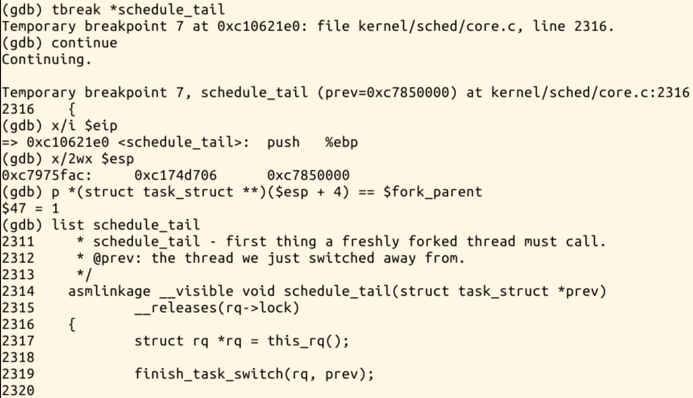

*图 14：在 `schedule_tail` 第一条指令前停下，栈上同时出现返回到 `ret_from_fork` 的地址和切走的父任务指针。*

截图中的观察结果为：

```text
当前指令：0xc10621e0 <schedule_tail>: push %ebp
ESP：0xc7975fac
[ESP]     = 0xc174d706
[ESP + 4] = 0xc7850000
prev      = 0xc7850000
```

这与源码及栈布局能够逐项对应：

1. `ret_from_fork` 的初始 `ESP` 为 `0xc7975fb4`。
2. 先压入 `prev` 参数，栈指针变为 `0xc7975fb0`。
3. `call schedule_tail` 再压入返回地址，栈指针变为 `0xc7975fac`。
4. 返回地址 `0xc174d706` 位于 `ret_from_fork` 内，正是本次镜像中调用指令之后的位置。
5. `[ESP + 4]` 与已保存的父任务地址相等，截图中的比较结果为 1。

因此，这张图同时验证了 `ret_from_fork` 已经作为调用者执行，以及当前调用现场位于子进程内核栈中。这组记录中 `prev` 恰好是父任务；一般情况下，首次运行前切走的任务应以实际调度现场为准，不能一律认定是父进程。

### 5.5 为什么子进程不会再次得到父进程的 PID 返回值

父进程完成 `do_fork` 后，沿自己的系统调用返回路径把子 PID 写入父进程保存的返回值位置。子进程则从 `ret_from_fork` 转入 **`syscall_exit`**，使用已经准备好的子进程 `pt_regs`。

这一跳转绕过了正常系统调用处理函数返回后写入返回值的位置，即 `syscall_after_call`。因此，不会把首次调度收尾时的实时 `EAX` 覆盖进子进程保存的返回值；`childregs->ax = 0` 可以一直保留到恢复用户寄存器。入口和退出标签的位置可对照 [`entry_32.S`](https://github.com/torvalds/linux/blob/v3.18-rc6/arch/x86/kernel/entry_32.S#L501)。

这解释了同一个用户态 `fork()` 接口为什么能在父进程返回子 PID，在子进程返回 0。

### 5.6 捕获 iret 时，先确认返回目标

`irq_return` 是共用的返回位置，返回用户态和返回内核态都可能经过这里。仅仅在该地址停住，不能直接认定捕获到了子进程的用户态返回。

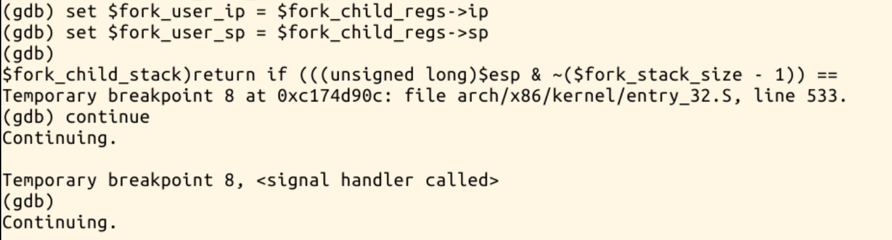

*图 15：条件断点命中，但没有保留足够的寄存器和返回帧输出，单凭这张图不能判断返回目标。部分长命令在截图中被裁切。*

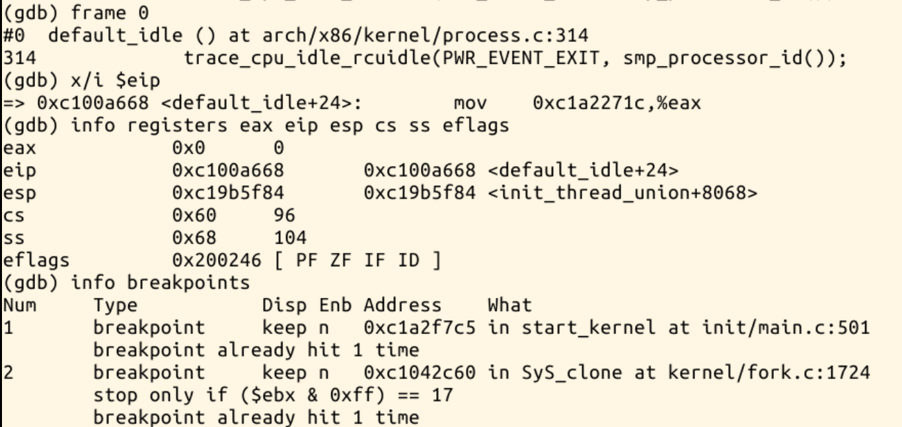

*图 16：随后记录的一次停机现场位于 `default_idle`，当前 `CS = 0x60`，仍是内核态。这个现场用于排查调试停在哪里，不能当作子进程已返回用户态的证据。*

后续一组跟踪中，目标子任务的 `pid` 为 870，保存的 `orig_ax` 为 120、`ax` 为 0。只用“当前栈属于子任务”筛选 `irq_return` 时，得到下面的现场。

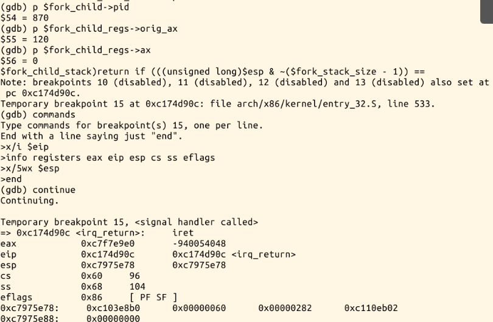

*图 17：临时断点 15 命中，指令为 `iret`；栈上的返回 `CS` 为 `0x60`，低两位为 0。*

```text
EIP = 0xc174d90c <irq_return>
ESP = 0xc7975e78
[ESP]     = 0xc103e8b0
[ESP + 4] = 0x00000060
[ESP + 8] = 0x00000282
```

虽然栈地址属于目标子任务，但保存的返回代码段是内核代码段，说明这次 `iret` 将返回内核中的执行位置。它与内核执行期间发生中断、随后返回的情况相符，但截图没有记录中断来源，不能据此进一步指定是哪一种中断。

还应区分**当前的 `CS`** 与**栈中即将恢复的 `CS`**：执行 `iret` 前 CPU 仍处于内核态，实时 `CS` 为 `0x60` 并不意味着返回后也在内核态。正确的筛选应检查返回帧中的 `CS`。

根据后续截图的条件与结果，整理后的等价断点如下。新一轮实验应先更新 `$fork_child`，再取得对应栈地址：

```gdb
set $fork_child_stack = (unsigned long)$fork_child->stack
tbreak *irq_return if (((unsigned long)$esp & ~($fork_stack_size - 1)) == $fork_child_stack) && ((*(unsigned int *)($esp + 4) & 3) == 3)
continue
```

该条件同时要求当前内核栈属于目标任务，并且即将恢复的代码段属于用户态。

### 5.7 用户态返回前的五个栈项

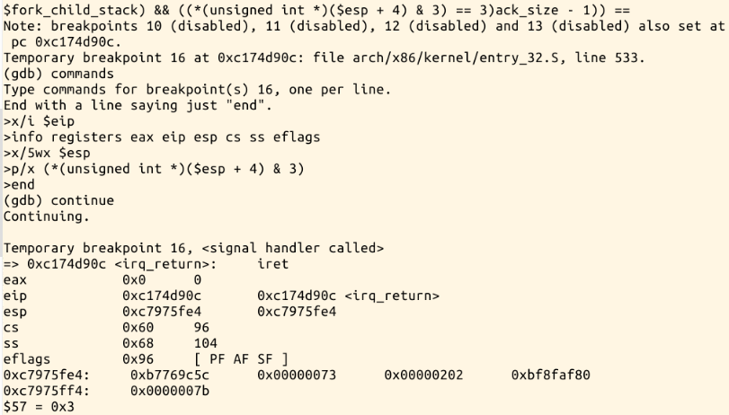

*图 18：临时断点 16 命中，`ESP = 0xc7975fe4`，栈中的返回 `CS & 3` 为 3，实时 `EAX` 已经恢复为 0。*

此时通用寄存器等已经恢复，`orig_ax` 已跳过，`ESP` 指向返回帧的 `EIP`。跨越特权级返回用户态时，`iret` 按顺序恢复以下五项：

| 当前栈偏移 | 内存地址 | 保存值 | 恢复目标 |
| --- | --- | --- | --- |
| `ESP + 0` | `0xc7975fe4` | `0xb7769c5c` | 用户态 `EIP` |
| `ESP + 4` | `0xc7975fe8` | `0x00000073` | 用户态 `CS` |
| `ESP + 8` | `0xc7975fec` | `0x00000202` | 用户态 `EFLAGS` |
| `ESP + 12` | `0xc7975ff0` | `0xbf8faf80` | 用户态 `ESP` |
| `ESP + 16` | `0xc7975ff4` | `0x0000007b` | 用户态 `SS` |

```text
iret 执行前：处于内核态，使用子任务内核栈

ESP → 0xc7975fe4  [ 用户 EIP     0xb7769c5c ]
      0xc7975fe8  [ 用户 CS      0x73       ]
      0xc7975fec  [ 用户 EFLAGS  0x202      ]
      0xc7975ff0  [ 用户 ESP     0xbf8faf80 ]
      0xc7975ff4  [ 用户 SS      0x7b       ]
                      │
                      └─ iret 跨特权级恢复现场
                                      ↓
用户态：EIP = 0xb7769c5c，ESP = 0xbf8faf80，CS & 3 = 3
```

这时的内核栈位置与前面 `pt_regs` 的布局完全对应：`0xc7975fe4 - 0xc7975fb4 = 0x30`，正好是 `pt_regs->ip` 的偏移。五个返回项来自同一份完整寄存器现场，而不是只设置一个跳转地址。恢复过程可对照 [`RESTORE_REGS` 和 `irq_return`](https://github.com/torvalds/linux/blob/v3.18-rc6/arch/x86/kernel/entry_32.S#L530)。

### 5.8 单步执行 iret，验证指令位置和用户栈

在执行前保存返回帧中的 IP、SP、CS、SS，然后用 `si` 单步执行 `iret`，得到下面的结果。

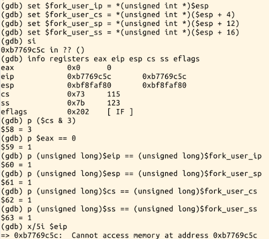

*图 19：单步后 `EAX = 0`，`EIP`、`ESP`、`CS`、`SS` 与返回帧中的保存值相同，四次一致性比较均返回 1。*

```text
EAX = 0
EIP = 0xb7769c5c
ESP = 0xbf8faf80
CS  = 0x73
SS  = 0x7b
EFLAGS = 0x202
(CS & 3) = 3
```

这些结果直接验证了：目标子任务已经进入用户态，返回值为 0，并使用与保存执行位置配套的用户栈。图末的 `x/5i $eip` 出现 `Cannot access memory at address 0xb7769c5c`，表示该地址的指令读取没有成功；它限制了对具体用户指令的反汇编分析，但不改变前面已经观察到的寄存器恢复结果。相关问题在第七节保留说明。

## 六、用户程序结果与完整执行过程

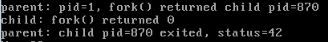

*图 20：最终一组测试中，父任务 PID 为 1，创建的子任务 PID 为 870，子进程得到返回值 0，父进程等待后取得输出状态 42。*

```text
parent: pid=1, fork() returned child pid=870
child: fork() returned 0
parent: child pid=870 exited, status=42
```

终端输出与内核观察相互印证：父进程获得新子任务的 PID，子进程获得 0，后续父进程能够报告该子进程退出及状态值。由于未提供测试处理函数的完整源码，本文按实际输出记录 `status=42`，不臆测它在程序中使用了哪一种具体状态提取写法。

结合源码，整个过程可以进一步概括为：

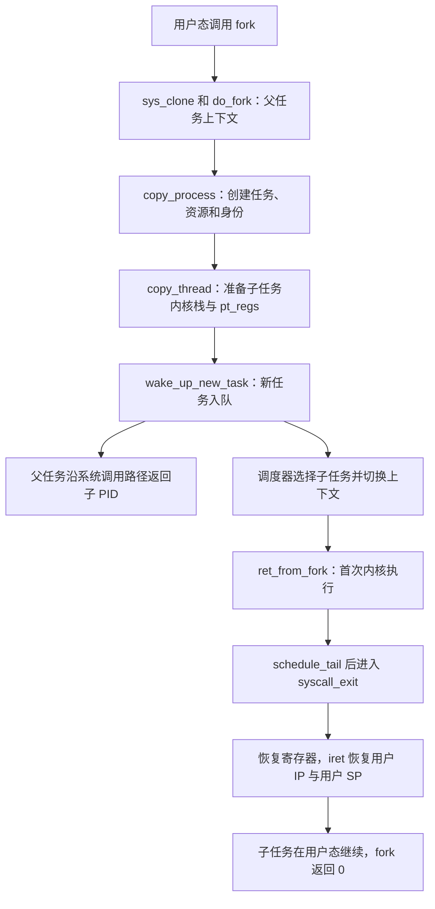

*流程图中的父子分支表示两条执行路径，不表示固定的先后次序。若 Markdown 平台不支持 Mermaid，第三节的文本流程和第五节的栈图仍可直接阅读。*

## 七、实验中的问题、处理与证据边界

### 7.1 orig 不在当前作用域

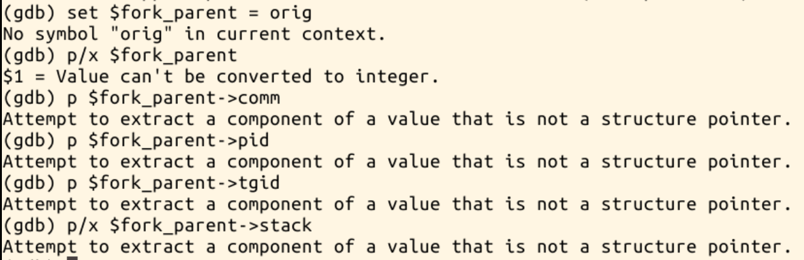

*图 21：`No symbol "orig" in current context` 之后，对无效便利变量的成员访问继续失败。*

`orig` 是 `dup_task_struct` 的形参，在 `copy_process` 当前栈帧中直接读取它没有依据。实际处理是利用内核栈对齐关系取得 `thread_info`，再通过 `thread_info->task` 找到父任务。图 9 已保留成功的后续结果。这里失败的是调试表达式，不是进程创建。

### 7.2 iret 断点首次捕获到返回内核的现场

图 17 表明，只匹配子任务内核栈仍可能遇到返回内核的 `iret`。处理时增加对返回帧中 `CS` 低两位的检查，最终图 18 捕获到了返回用户态的现场，图 19 又单步验证了恢复后的状态。

这次排查说明识别执行阶段需要同时看当前指令、栈所属任务和栈中保存的返回目标，不能只根据一个公共汇编标签判断。

## 八、总结

结合源码和本次实验，我对创建新进程的理解是：以父进程状态为起点，建立一个具有独立任务身份和正确执行上下文的新任务，再让调度器把它接入系统的执行过程。

首先，复制 `task_struct` 只是起点。图 10 中父子任务结构和内核栈地址不同，图 13 中子进程有新的 PID、自己的线程组和正确的实际父任务，说明内核还必须重新建立身份、关系和资源状态。不同的 `mm` 表示独立的地址空间管理结构，但不能因此认为所有用户物理页都立即完整复制。

其次，子进程能够顺利首次运行，关键在于执行位置与栈中内容同时准备好。`copy_thread` 使初始 `thread.sp` 指向子进程栈中的寄存器现场，使 `thread.ip` 指向与该现场匹配的 `ret_from_fork`。图 14 的 `schedule_tail` 栈内容进一步说明，这个首次入口确实在子进程的新栈上执行。

同时，内核态首次入口和用户态继续位置是两个层次。子进程在内核中从 `ret_from_fork` 完成调度收尾，再从自己的 `pt_regs` 恢复用户寄存器。图 18 和图 19 说明，`iret` 同时恢复用户 IP 和用户栈，代码段特权级也随之变为 3。子进程得到 0，来源于创建时写入 `pt_regs->ax` 的值；父进程得到子 PID，来源于父进程自己的系统调用返回路径。

因此，`fork` 的“一次调用、两处返回”可以具体理解为：内核准备了两套分别属于父子任务的返回现场，并让它们通过各自的执行路径继续运行。新进程能够从正确位置执行下去，是进程资源、调度上下文、内核栈布局和用户态恢复现场共同保持一致的结果。
