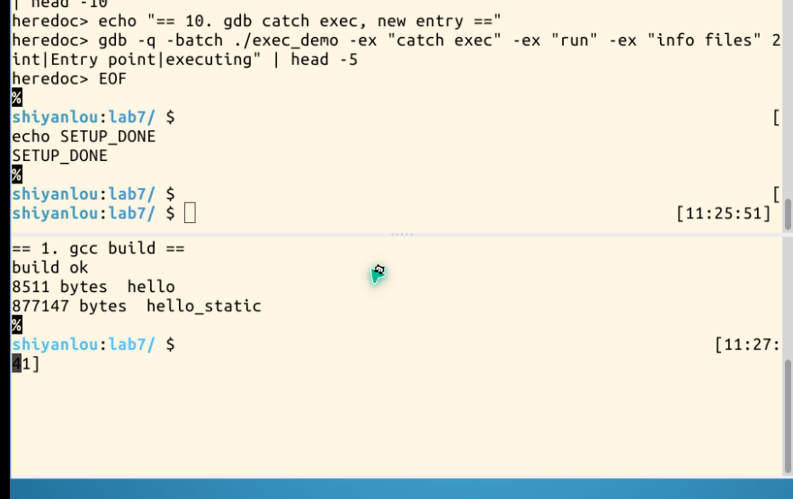
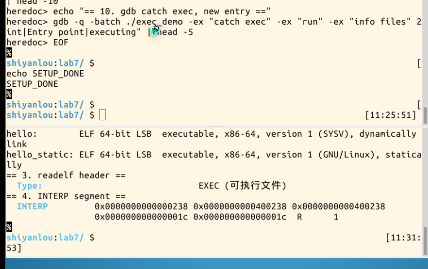
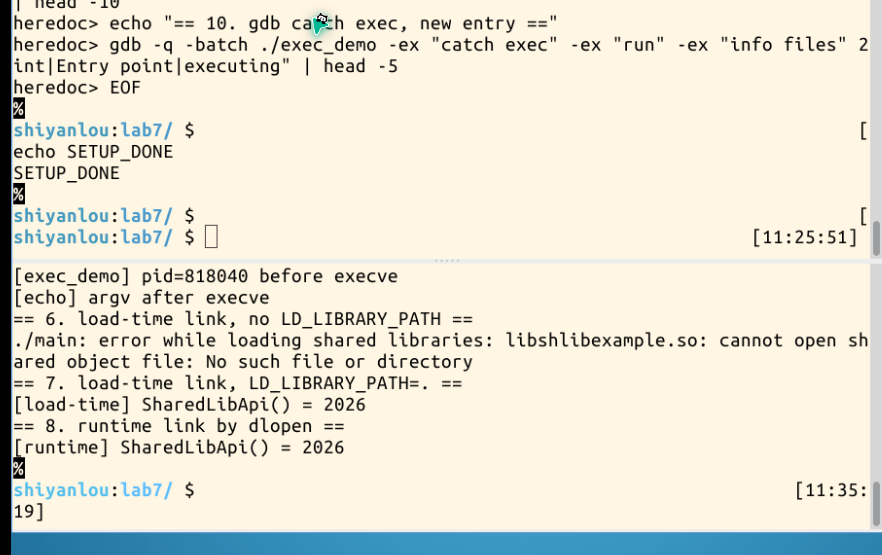
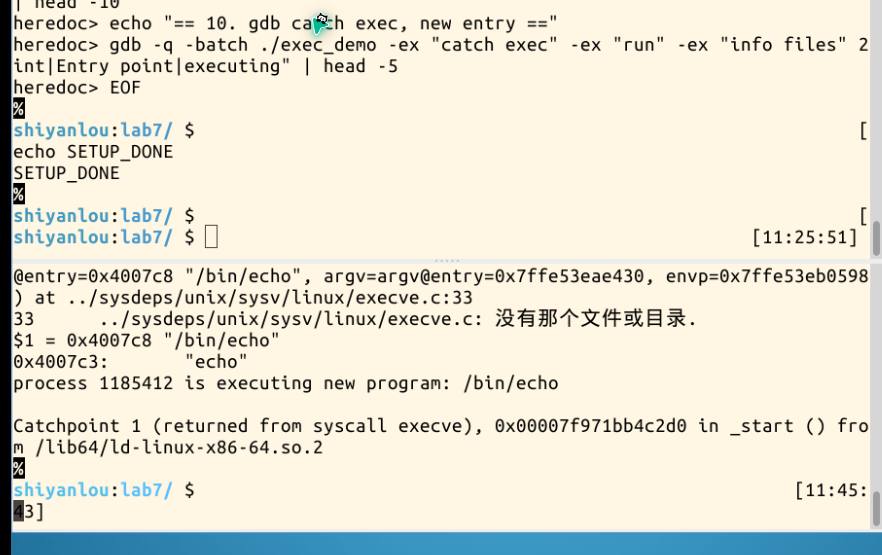
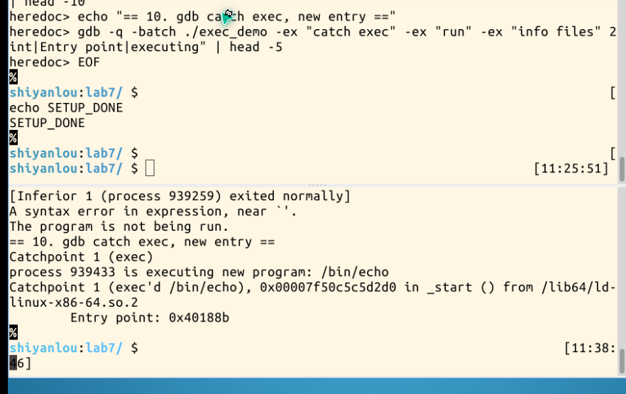
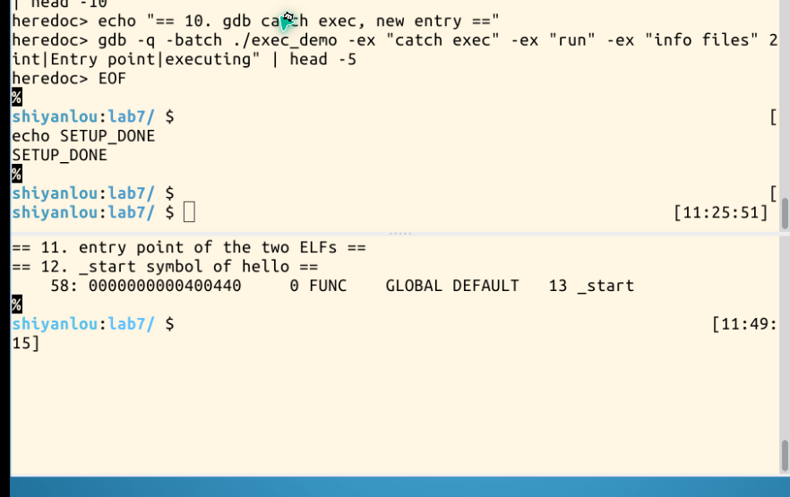

> **待本人审阅稿：**由 AI 根据现有作业整理，尚未经学生本人确认。下列方括号是待核对事项，不能视为已经完成的人工批注。

> [待人工核对：本轮 `20262803《Linux内核原理与分析》第8周作业.md` 是否为真实提交稿；补充你实际修改的理由和过程。]

> [AI 建议：按教学进程统一作业主标题；原主题保留为副标题，请人工确认提交命名。]

# 20262803《Linux内核原理与分析》第8周作业

## 原作业主题：实验七　Linux 内核如何装载和启动一个可执行程序

> **姓名**：李令琪　　**学号**：20262803
>
> **原创作品，转载请注明出处。** 本文为《Linux 内核分析》MOOC 课程（<http://mooc.study.163.com/course/USTC-1000029000>）配套实验报告。

---

## 目录

- [一、实验目的](#一实验目的)
- [二、实验环境](#二实验环境)
- [三、实验内容与过程](#三实验内容与过程)
  - [3.1 源程序与两种链接方式的编译](#31-源程序与两种链接方式的编译)
  - [3.2 用 file 与 readelf 观察 ELF 结构](#32-用-file-与-readelf-观察-elf-结构)
  - [3.3 用 exec\* 库函数加载一个可执行程序](#33-用-exec-库函数加载一个可执行程序)
  - [3.4 动态链接的两种使用方式](#34-动态链接的两种使用方式)
  - [3.5 用 gdb 跟踪 execve 与内核处理过程](#35-用-gdb-跟踪-execve-与内核处理过程)
  - [3.6 内核源码分析：sys_execve 做了什么](#36-内核源码分析sys_execve-做了什么)
  - [3.7 新程序的执行起点与栈状态](#37-新程序的执行起点与栈状态)
- [四、实验结果分析](#四实验结果分析)
- [五、总结与理解](#五总结与理解)
- [六、署名与出处声明](#六署名与出处声明)

---

## 一、实验目的

本实验围绕“一个 ELF 可执行程序如何从磁盘上的文件变成正在运行的进程”这一问题展开，具体目标为：

1. 理解编译、链接的过程以及 ELF 可执行文件的格式，重点是 ELF 头中的入口地址和程序头表中的 `PT_INTERP`、`PT_LOAD` 段；
2. 编程使用 `exec*` 系列库函数加载一个可执行文件，观察其“成功后不返回”的行为；
3. 分别用“装载时动态链接”和“运行时动态链接”两种方式使用共享库，比较两者差别；
4. 用 gdb 跟踪一次 `execve` 系统调用，结合内核源码分析 `sys_execve` 的处理流程；
5. 回答两个关键问题：新程序从哪里开始执行？`execve` 返回后为什么新程序能顺利执行？静态链接与动态链接的可执行程序在这一点上有何不同？

## 二、实验环境

实验在蓝桥云课“Linux 内核分析配套实验”在线环境中完成，环境主要参数如下。

| 项目 | 内容 |
| --- | --- |
| 操作系统 | Ubuntu 14.04（x86-64）容器环境 |
| 内核版本 | 5.15.0-164-generic（宿主内核，`uname -r` 查得） |
| 编译器 | gcc 4.8.2 (Ubuntu 4.8.2-19ubuntu1) |
| 调试工具 | gdb、readelf、objdump、file（strace 未预装） |
| 内核源码 | `~/LinuxKernel/linux-3.18.6`（含 bzImage、vmlinux、rootfs.img、menu） |
| 实验目录 | `~/lab7` |

## 三、实验内容与过程

### 3.1 源程序与两种链接方式的编译

先写一个最小的 C 程序 `hello.c`，分别以“动态链接”和“静态链接”两种方式编译，用文件大小和 ELF 元信息直观对比二者的差别。

```c
#include <stdio.h>

int main(void)
{
    printf("Hello, ELF!\n");
    return 0;
}
```

*程序 1　hello.c*

```bash
$ gcc -o hello hello.c                 # 动态链接（默认）
$ gcc -static -o hello_static hello.c  # 静态链接

$ stat -c "SIZE=%s %n" hello hello_static
```

```text
SIZE=8511 hello
SIZE=877147 hello_static
```

*命令 1　编译并比较大小*



*图 1　编译成功并比较两种链接方式生成的文件大小（在线环境截屏）*

两者相差约 100 倍：静态链接把 libc 中真正用到的目标代码和数据全部复制进可执行文件，因此不再依赖运行时的共享库；动态链接只在文件里保留一张“导入表”，真正的库代码在装载时才由动态链接器映射进进程地址空间。

### 3.2 用 file 与 readelf 观察 ELF 结构

```bash
$ file hello hello_static
$ readelf -h hello | egrep "Type:"
$ readelf -l hello | egrep "INTERP" -A 1
```

```text
hello:        ELF 64-bit LSB executable, x86-64, version 1 (SYSV),
              dynamically linked (uses shared libs), for GNU/Linux 2.6.24,
              BuildID[sha1]=b3bce657..., not stripped
hello_static: ELF 64-bit LSB executable, x86-64, version 1 (GNU/Linux),
              statically linked, for GNU/Linux 2.6.24,
              BuildID[sha1]=314d8f67..., not stripped

    Type:                              EXEC (可执行文件)

  INTERP         0x0000000000000238 0x0000000000400238
                 0x000000000000001c 0x000000000000001c
      [Requesting program interpreter: /lib64/ld-linux-x86-64.so.2]
```

*命令 2　查看 ELF 头与程序头表*



*图 2　file 与 readelf 的实际输出（在线环境截屏）*

三点结论：

1. `Type` 为 `EXEC`，说明这是“可执行文件”类型的 ELF，入口地址在链接时已经确定（本例中 `_start` 位于 `0x400440`，见 3.5 节）；
2. `hello` 的 program header 里存在 `PT_INTERP` 段，其内容就是动态链接器路径 `/lib64/ld-linux-x86-64.so.2`，而 `hello_static` 没有该段；
3. 动态程序虽然也有自己的入口，但 `execve` 之后真正开始运行的却是 `PT_INTERP` 指定的解释器入口——3.5 节的 gdb 结果直接印证了这一点。

### 3.3 用 exec\* 库函数加载一个可执行程序

`exec*` 是一组库函数（`execl`、`execlp`、`execv`、`execvp`、`execle`……），它们最终都调用同一个系统调用 `execve`。下面的程序在打印自身 pid 之后，用 `execl` 把当前进程“换成” `/bin/echo`。

```c
#include <stdio.h>
#include <unistd.h>

int main(void)
{
    printf("[exec_demo] pid=%d before execve\n", getpid());
    fflush(stdout);
    execl("/bin/echo", "echo", "[echo] argv after execve", (char *)0);
    perror("execl");      /* 只有 execve 失败时才会执行到这里 */
    return 1;
}
```

*程序 2　exec_demo.c*

```bash
$ gcc -o exec_demo exec_demo.c
$ ./exec_demo
```

```text
[exec_demo] pid=818040 before execve
[echo] argv after execve
```

*命令 3　运行结果*

可以看到：`echo` 打印的 pid 与 `exec_demo` 是同一个（因为根本没有创建新进程），但 `exec_demo` 中 `execl` 之后的 `perror` 与 `return` 都没有执行——`execve` 成功时不会返回，它用新程序的可执行映像整个替换了当前进程的用户态地址空间，只保留 pid、已打开的文件描述符等少量属性。

### 3.4 动态链接的两种使用方式

实验要求练习共享库的两种用法：装载时动态链接（link-time，运行时由 ld.so 按 `DT_NEEDED` 自动装载）和运行时动态链接（由程序自己调用 `dlopen`/`dlsym`）。先准备一个共享库。

```c
/* shlibexample.h */
#ifndef SHLIBEXAMPLE_H
#define SHLIBEXAMPLE_H
int SharedLibApi(void);
#endif

/* shlibexample.c */
#include "shlibexample.h"
int SharedLibApi(void) { return 2026; }
```

*程序 3　共享库源码*

```bash
$ gcc -shared -fPIC -o libshlibexample.so shlibexample.c
```

*命令 4　生成共享库*

**（1）装载时动态链接**：编译 `main.c` 时用 `-L. -lshlibexample` 把库“登记”进可执行文件，生成 `DT_NEEDED` 表项；运行时由动态链接器负责找到并装载它。

```c
/* main.c */
#include <stdio.h>
#include "shlibexample.h"

int main(void)
{
    printf("[load-time] SharedLibApi() = %d\n", SharedLibApi());
    return 0;
}
```

```bash
$ gcc -o main main.c -L. -lshlibexample
$ ./main
$ LD_LIBRARY_PATH=. ./main
```

```text
./main: error while loading shared libraries: libshlibexample.so:
        cannot open shared object file: No such file or directory
[load-time] SharedLibApi() = 2026
```

*程序 4 / 命令 5　装载时动态链接*

第一次运行失败并不是链接错误，而是“装载”阶段的错误：库不在 `/etc/ld.so.cache` 与默认搜索路径中，动态链接器找不到文件，进程在 `main` 执行之前就被终止。把当前目录加入 `LD_LIBRARY_PATH` 后即可正常运行——这正是“装载时”动态链接的含义。

**（2）运行时动态链接**：可执行文件本身不登记任何库依赖，而在代码中显式调用 `dlopen` 打开共享库、`dlsym` 取出符号地址，用完 `dlclose` 关闭。

```c
/* dllib.c */
#include <stdio.h>
#include <dlfcn.h>

int main(void)
{
    void *h = dlopen("./libshlibexample.so", RTLD_NOW);
    if (!h) { printf("dlopen error: %s\n", dlerror()); return 1; }
    int (*fp)(void) = (int (*)(void))dlsym(h, "SharedLibApi");
    printf("[runtime] SharedLibApi() = %d\n", fp ? fp() : -1);
    dlclose(h);
    return 0;
}
```

```bash
$ gcc -o dllib dllib.c -ldl && ./dllib
```

```text
[runtime] SharedLibApi() = 2026
```

*程序 5 / 命令 6　运行时动态链接*

两种方式的对比如下：

| 对比项 | 装载时动态链接 | 运行时动态链接 |
| --- | --- | --- |
| 链接时依赖 | 可执行文件中写入 `DT_NEEDED` | 不写入，只依赖 libdl |
| 谁来装载 | 内核把控制权交给 ld.so 后由它自动装载 | 程序自己调用 `dlopen` |
| 符号解析时机 | 进程启动、`main` 之前 | 调用 `dlsym` 时（或首次调用时） |
| 找不到库的后果 | 进程无法启动（before main） | `dlopen` 返回 NULL，可自行处理 |
| 典型用途 | 常规应用程序 | 插件、可选功能、驱动式扩展 |



*图 3　exec_demo 替换进程、两种动态链接方式的运行结果（在线环境截屏）*

### 3.5 用 gdb 跟踪 execve 与内核处理过程

在用户态先用 gdb 观察一次 `execve` 的调用与返回。`execve` 是系统调用，用 `catch syscall` 最直接：

```bash
$ gdb -q -batch ./exec_demo \
    -ex "catch syscall execve" -ex "run" \
    -ex "p (char*)$rdi" -ex "x/s *(char**)$rsi" -ex "c"
```

```text
Catchpoint 1 (syscall 'execve' [59]), 0x... in execve ()
$1 = 0x4007c8 "/bin/echo"
0x4007c3:        "echo"
process 1185412 is executing new program: /bin/echo
Catchpoint 1 (returned from syscall execve), 0x00007f97... in _start ()
        from /lib64/ld-linux-x86-64.so.2
```

*命令 7　gdb 跟踪 execve 系统调用*



*图 4　execve 的入口参数与返回后落点（在线环境截屏）*

这段输出包含三个关键信息：

1. exec 的动作确实是一个系统调用（`catch syscall` 显示 `execve` 的系统调用号为 59），参数 `$rdi` 指向字符串 `"/bin/echo"`，`argv` 的第一个元素是 `"echo"`；
2. `execve` 成功后 gdb 提示 `is executing new program`，说明进程映像已被替换；
3. 也是最重要的一点——`execve` 返回后，程序计数器落在 `/lib64/ld-linux-x86-64.so.2` 的 `_start` 处，而不是 `/bin/echo` 自己的入口。这正是动态链接程序的装载方式：内核先把控制权交给解释器 ld.so。

再用 `catch exec` 观察新程序的入口地址：

```bash
$ gdb -q -batch ./exec_demo -ex "catch exec" -ex "run" \
    -ex "info files"
```

```text
Catchpoint 1 (exec)
process 939433 is executing new program: /bin/echo
Catchpoint 1 (exec'd /bin/echo), 0x00007f50... in _start ()
        from /lib64/ld-linux-x86-64.so.2
        Entry point: 0x40188b
```

*命令 8　catch exec 观察新程序入口*



*图 5　catch exec 命中断点后，gdb 报告的新程序入口（在线环境截屏）*

`Entry point: 0x40188b` 就是 `/bin/echo` 这个 ELF 文件头里的 `e_entry`，可以从 `readelf -h` 中查到同一个值。它说明 `execve` 完成之后，进程的“下一条指令”是由被装载程序的 ELF 头决定的。

最后用 `readelf -s` 确认我们自己程序的 `_start` 位置：

```bash
$ readelf -s hello | grep -w _start
```

```text
    58: 0000000000400440     0 FUNC    GLOBAL DEFAULT   13 _start
```

*命令 9　查看 _start 符号地址*



*图 6　hello 的 `_start` 符号位于 0x400440（在线环境截屏）*

> **关于内核态断点**：实验环境里同时提供了课程的内核源码与镜像（`~/LinuxKernel` 下的 `linux-3.18.6`、`bzImage`、`vmlinux` 与 `rootfs.img`），可用 `qemu -kernel ... -s -S` 启动 MenuOS，再用 gdb 连上去对 `sys_execve` 下断点，从内核视角看同一次调用。受在线环境终端交互限制，本次未展开这一扩展步骤，下面直接结合源码分析 `sys_execve` 的处理流程。

### 3.6 内核源码分析：sys_execve 做了什么

`execve` 的调用链可以概括为：

```text
sys_execve → do_execve → do_execveat_common
           → search_binary_handler → load_elf_binary → start_thread
```

**第一步**，系统调用入口把用户态指针包装后交给通用处理函数（`fs/exec.c`）：

```c
SYSCALL_DEFINE3(execve, const char __user *, filename,
                const char __user *const __user *, argv,
                const char __user *const __user *, envp)
{
    return do_execve(getname(filename), argv, envp);
}
```

*源码 1　fs/exec.c*

**第二步**，`do_execveat_common` 做的是“为新程序准备运行环境”，关键动作依次是：

1. `bprm = kzalloc(sizeof(*bprm))`：分配 `linux_binprm` 结构，它描述“正在被装载的这个程序”；
2. `do_open_exec` / `open_exec`：打开可执行文件，并做权限与“正在被写”检查；
3. `bprm_mm_init(bprm)`：为即将运行的新程序新建一个 `mm_struct`（新的用户地址空间），并建立初始栈 VMA；
4. `count()` 与 `copy_strings()`：把 `argv`、`envp` 中的字符串从旧地址空间复制到新 mm 的栈区顶端，并登记 `argc`/`envc`；
5. `search_binary_handler(bprm)`：依次尝试注册在 `formats` 链表上的二进制格式处理器，第一个成功的就是 ELF。

**第三步**，ELF 处理器 `load_elf_binary` 完成真正的“装载”：

1. 读入文件头并校验 `ELFMAG`、`e_type`（`ET_EXEC` / `ET_DYN`）；
2. 遍历 program header：对 `PT_LOAD` 段调用 `elf_map` 建立虚拟地址映射，并记录 `elf_bss`、`elf_brk`（决定堆的起始）；对 `PT_INTERP` 段则记录解释器路径；
3. `setup_arg_pages()`：把之前复制好的参数字符串挂到新进程栈上；
4. 若存在解释器，则 `load_elf_interp()` 把 `/lib64/ld-linux-x86-64.so.2` 也映射进来，并把 `elf_entry` 设为解释器的入口；否则 `elf_entry = e_entry`；
5. `create_elf_tables()`：在新栈上依次压入 `argc`、`argv[]`、`envp[]` 与 `auxv`（其中 `AT_ENTRY` 告诉 ld.so“主程序入口在哪里”，`AT_PHDR`/`AT_PHNUM` 告诉它程序头表位置）；
6. `start_thread(regs, elf_entry, bprm->p)`：把内核栈上保存的 `pt_regs` 的 `ip` 改为 `elf_entry`、`sp` 改为新栈顶。

```c
static int load_elf_binary(struct linux_binprm *bprm)
{
    ...
    elf_entry = loc->elf_ex.e_entry;          /* 默认入口 = e_entry */
    if (elf_interpreter) {                     /* 有 PT_INTERP */
        elf_entry = load_elf_interp(&loc->elf_ex, interpreter,
                                    &interp_map_addr, ...);
    }
    ...
    start_thread(regs, elf_entry, bprm->p);    /* 改 ip / sp */
    return 0;
}
```

*源码 2　fs/binfmt_elf.c（节选）*

**第四步**，系统调用返回。`execve` 在装载成功时把返回值置 0，随后内核沿 syscall 返回路径执行 `iret`/`sysret`，把 `pt_regs` 中的 `ip`、`sp` 恢复到 CPU 寄存器——于是用户态“看起来”就像 `execve` 返回了 0，实际上执行的已经是新程序（或动态链接器）的第一条指令。

### 3.7 新程序的执行起点与栈状态

由上面的分析可以得到两条对应关系：

- **静态链接的可执行程序**：kernel 直接把 `elf_entry` 设为 `e_entry`，因此 `execve` 返回后第一条指令就是程序自己的 `_start`（glibc 的启动代码，随后调用 `__libc_start_main`，再调用 `main`）。
- **动态链接的可执行程序**：kernel 把 `elf_entry` 设为 ld.so 的入口 `_start`。ld.so 先完成自身重定位，再按 `DT_NEEDED` 装载 libc 等共享库、解析符号、执行 `.init_array`，最后跳到 `auxv` 中的 `AT_ENTRY`——也就是主程序的 `e_entry`。

两者的栈顶布局是相同的（从高地址向低地址）：

| 位置（由高到低） | 内容 |
| --- | --- |
| 栈顶附近（随机偏移） | 参数字符串、环境变量字符串 |
| `auxv[]` | `AT_ENTRY`、`AT_PHDR`、`AT_PHNUM`、`AT_BASE`、`AT_RANDOM` 等键值对，以 `AT_NULL` 结束 |
| `envp[]` | 环境变量指针数组，以 `NULL` 结尾 |
| `argv[]` | 命令行参数指针数组，以 `NULL` 结尾 |
| `argc` | 参数个数（栈指针 `sp` 指向它） |

因此“为什么 `execve` 返回后新程序能顺利执行”这个问题的答案是：内核在返回前已经把三件事都准备好了——新程序的代码/数据段已经映射好（页表已切换），新程序的入口地址已经写进 `pt_regs->ip`，参数与环境已经按 ABI 规定的格式摆在新栈上并把 `sp` 指向 `argc`。缺任何一项，返回后都会立刻崩溃。

## 四、实验结果分析

| 观察点 | 静态链接 hello_static | 动态链接 hello |
| --- | --- | --- |
| 文件大小 | 877147 字节 | 8511 字节 |
| `file` 描述 | statically linked | dynamically linked (uses shared libs) |
| `PT_INTERP` 段 | 无 | `/lib64/ld-linux-x86-64.so.2` |
| `execve` 后首条指令 | 程序自身 `_start`（`= e_entry`） | ld.so 的 `_start` |
| 依赖条件 | 无（自包含） | 需 ld.so 与共享库可被找到 |
| 启动速度 | 装载快、无重定位 | 需重定位和符号解析，略慢 |

实验中 `./main` 第一次运行失败（`cannot open shared object file`）是一个非常典型的“装载期错误”：链接阶段一切正常，因为链接器只检查库文件是否存在并记录 `DT_NEEDED`；真正的库搜索发生在运行时的 ld.so 中，搜索路径由 `DT_RPATH`、`LD_LIBRARY_PATH`、`/etc/ld.so.cache`、`/lib`、`/usr/lib` 依次决定。这正好印证了 3.6 节中“内核只负责把控制权交给解释器，库的装载是用户态 ld.so 的职责”这一分工。

## 五、总结与理解

把自己的理解概括成一句话：**execve 并不“执行”程序，它只是把进程的用户态地址空间整体换掉，并把返回地址改成新程序的入口。**

具体来说有三层认识：

1. **“替换而不是新建”**。`fork` 复制进程，`execve` 改造进程：pid、ppid、文件描述符表、信号处理等保持不变，而 `mm_struct`、页表、栈全部重建。这也解释了为什么 shell 执行命令要先 `fork` 再 `exec`——`exec` 之后原程序的代码就不存在了，没有 `fork` 就没有“回来”的地方。
2. **“内核只做装载，不做链接”**。内核对 ELF 的处理到映射段、搭好栈、设置 `ip`/`sp` 为止；符号解析、重定位、依赖库的递归装载都交给用户态的 ld.so。所以动态链接程序的“入口”在 ELF 头里写着 `e_entry`，但内核实际使用的却是 `PT_INTERP` 指向的解释器入口，主程序入口通过 `auxv` 的 `AT_ENTRY` 传给 ld.so。
3. **“入口与栈必须成套”**。新程序开始执行时，CPU 只有 `ip` 和 `sp` 两个线索：`ip` 决定从哪条指令开始，`sp` 决定参数在哪里。`argc`/`argv`/`envp`/`auxv` 的布局是 x86-64 ABI 的一部分，glibc 的 `_start` 正是按这个约定从栈上取 `argc`、`argv` 再调用 `main` 的。

这次实验也让我第一次把“课本上的 ELF 结构”和“内核里的几十行代码”对应了起来：以前只知道“动态链接省空间”，现在能说清楚省在哪里（不复制库代码）、代价是什么（装载期需要 ld.so 找库、重定位）、出错时表现为什么（before main 就退出）。
